# KudioStudio

**English** | [繁體中文](README.zh-TW.md)

[](https://www.python.org/)
[](https://doc.qt.io/qtforpython/)
[](LICENSE.txt)
[](https://pypi.org/project/kudio/)

**A desktop workbench for the [`kudio`](https://pypi.org/project/kudio/) audio toolkit.**

Open a clip, look at it, change it, measure it, and build datasets from it —
without writing a script first. Every control maps to one documented `kudio`
function, and the caption under each panel shows the exact call it will make,
so anything you work out here translates straight into code.

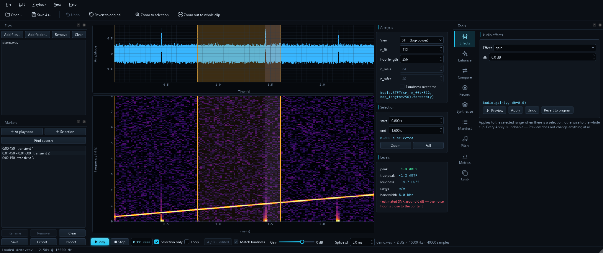

## Install

Not on PyPI. Clone it and install from the checkout:

```bash
git clone https://github.com/recklight/KudioStudio.git
cd KudioStudio
pip install -e ".[dev]"
python -m kudiostudio
```

Requires **Python 3.9+**. Everything heavy is an opt-in extra, added to that
same editable install:

| Extra | Adds |
|---|---|
| `pip install -e ".[eval]"` | STOI / SDR metrics |
| `pip install "kudio[pesq]"` | PESQ (ITU-T P.862). Its own extra because it builds from source — a C compiler, and the MSVC Build Tools on Windows — so it is deliberately left out of `[eval]` and `[all]`, which would otherwise stop installing |
| `pip install -e ".[dnsmos]"` | DNSMOS opinion scores (onnxruntime; weights not bundled) |
| `pip install -e ".[enhance]"` | learned denoising, on PyTorch. [kudio-enhance](https://github.com/recklight/KudioEnhance) 0.2 or later is not on PyPI either, so install it from a checkout of its own first — its README says how to keep PyTorch CPU-only — and this extra then finds it |
| `pip install -e ".[all]"` | all of the above, so it wants that checkout too |

The base install stays light: no PyTorch unless you ask for it.

```bash
kudiostudio                    # empty session
kudiostudio clip.wav           # open a file on start-up
kudiostudio --no-theme         # native Qt style
kudiostudio --no-plugins       # leave out panels other packages add
kudiostudio --lang zh_TW       # interface in Traditional Chinese
kudiostudio --reset            # forget saved window geometry
```

The interface comes in **English** and **Traditional Chinese (繁體中文)**.
`View → Language / 語言` switches between them and offers to restart, since
the change applies from the next start; the choice is remembered. With no
choice saved, the system's language is used when there is a translation for
it. Combo-box values, `kudio` parameter names and the call captions stay as
the code spells them, so what you read still matches the API.

## What each panel does

| Panel | `kudio` behind it | What you get |
|---|---|---|
| **Analysis** (centre) | `STFT`, `melspectrogram`, `mfcc`, `audio_report`, `loudness_over_time`, `true_peak` | Waveform + log-power STFT, log-mel or MFCC, x-linked, live `n_fft` / `hop_length` / `n_mels` / `n_mfcc`, a **loudness curve** on its own LUFS axis, plus a live **Levels** readout with true peak and loudness range |
| **Effects** | `kudio.effects`, `kudio.rir`, `kudio.apply_rir`, `kudio.rt60`, `kudio.effects.channel` | Fades, `reverse`, `remove_dc`, four Butterworth filters, `gain`, `pitch_shift`, `time_stretch`, `reverb`, **`room`** (a real impulse response, seeded and measurable), **`measured_room`** (an impulse response from a file, with its T30, EDT, C50 and DRR read off it), **`telephone`** / **`bit_depth`** / **`dropouts`** (the channel, scattered or in bursts), `add_noise_snr`, `trim_silence`, `vad_trim`, `split_on_silence` — with a looping **Preview** that commits nothing |
| **Enhance** | `kudio.spectral_enhance` + `kudio-enhance` | Seven statistical denoisers × four noise estimators, `wavelet_low_pass_filter`, and **learned models** from a [kudio-enhance](https://github.com/recklight/KudioEnhance) run |
| **Compare** | `kudio.compare_enhancers` | Every method × every noise estimator over the same clip, ranked, with per-row audition or **several rows back to back** — and a trained model in the same table |
| **Record** | `kudio.record`, `kudio.StreamRecorder`, `kudio.StreamEnhancer`, `kudio.SpectrogramStream` | Fixed-length capture, **or record until you stop** with a live level meter, a **rolling waveform and spectrogram**, and optional **live denoised monitoring** |
| **Synthesize** | `kudio.Synthesizer` | clean × noise × SNR **× room** dataset generation, optionally **down a link** (telephone / VoIP) and with **reverberant targets** beside the mixtures, seeded and reproducible, writing a manifest that records what came from what |
| **Manifest** | `kudio.load_manifest` | That manifest read back as a sortable table — noisy, clean, noise, SNR, room, link, target — filtered by noise, SNR, room and link, with **missing files marked and counted**, a **noise × SNR coverage grid** that shows the holes, and each row's noisy, clean and target files one click from your ears |
| **Pitch** | `kudio.f0` | pYIN fundamental frequency **with** the voiced/unvoiced decision — median, range in Hz and semitones, the contour drawn over the spectrogram, and the voiced spans as markers |
| **Metrics** | `kudio.audio_report`, `kudio.dnsmos`, `kudio.core.evaluator`, `kudio.find_delay` | **No reference needed**: clipping, level, DC, noise floor, real bandwidth, and a predicted **DNSMOS** opinion. **With a reference**: SNR / SI-SDR / segmental SNR always, PESQ / STOI / SDR when installed |
| **Batch** | `kudio.convert_folder`, `kudio.enhance_folder`, `kudio.loudness`, `kudio.true_peak`, `kudio.rir` | Folder-wide resample, bit depth, mono downmix, trim, peak **or LUFS** normalise, **and denoise** — mirroring the input's folder structure — with a **loudness report** naming every file that could not reach the target and why, and a **reverberant copy** of the tree beside the dry one |

Edits apply to the **selected range** when there is one, otherwise to the whole
clip — and every edit is undoable. `Revert to original` drops the lot.

### Editing, not just processing

Cut, copy, paste, delete, insert silence and crop, all undoable, all on the
selection. Paste lands at the playhead when nothing is selected, and the
clipboard remembers **its own sample rate** — pasting an 8 kHz snippet into a
16 kHz clip resamples it rather than playing it at double speed.

`Save selection as…` writes just the highlighted range; `Export analysis image…`
grabs the waveform and spectrogram exactly as you are looking at them, zoom and
all.

**Every splice crossfades**, 5 ms by default, because a hard cut leaves a step
in the waveform and a step is a click. It is on by default and **never silent**:
each edit's status line says how much was applied, including when the answer is
"none". Quietly altering audio is worse than a click, so the setting is visible
rather than buried.

The length lives **on the transport bar**, not behind a dialog, because the
right length is per edit — 5 ms inside a word and 200 ms between two takes are
different jobs, and a setting you have to open a dialog to change is one nobody
changes. `Edit → Splice crossfade…` types an exact value into the same control.
The session API takes it per call too, so `session.delete(crossfade_ms=200)`
uses 200 ms for that one join and leaves the default where it was.

Applying an *effect* to a selection is deliberately not crossfaded — it
replaces the range with a processed version of itself, and blending the edges
back would leave 5 ms at each end un-effected.

### Your edits, as a script

`File → Export edits as Python script…` writes the undo history out as a plain
Python script. It reads the original file the way KudioStudio read it, repeats
every edit in order — each under its undo label, each as the `kudio` call or
the slicing that made it — and saves the result. Run on the original, it makes
**the same samples the session holds**, not an approximation of them; the test
suite runs an exported script in a separate interpreter and checks exactly
that.

```python
# 2. highpass
head, y, tail = y[:4800], y[4800:14400], y[14400:]  # 0.300–0.900 s
y = kudio.highpass(y, sr, cutoff=120.0, order=4, zero_phase=True)
y = np.concatenate([head, y, tail])

clip = y[8000:11200].copy()  # pasted in step 5

# 3. cut
y = kudio.splice([y[:3200], y[6400:]], sr, 0.03)  # 0.200–0.400 s
```

- **Undo takes the step back out**; Revert, opening another file and a new
  recording start the history again. An edit too old for the undo stack stays
  in — it is still in the audio.
- Every splice carries the crossfade it actually used, and an effect on a
  selection is spliced back without one, as it was applied.
- **A paste pastes what was copied**, not whatever is at those samples by the
  time the script gets there: the `clip = …` line goes where the copy was
  made. A clipboard copied before an edit that was later undone, or from
  another file, is rebuilt from that file first. One copied from an earlier
  recording has no file to be rebuilt from — every take is its own, however
  alike — so the script stops there and the export says why.
- **The script checks what it is run on.** It carries the SHA-256 of the file
  the edits were made on and stops if `SOURCE` holds anything else. `Save As`
  suggests the file you opened, and once the edited audio has been saved over
  it, a script that read it back would apply every edit a second time; the
  export warns about that too, as soon as it can tell. Point `SOURCE` at a
  copy of the original, or delete the check to run the same edits on another
  file. A learned model's files are checked the same way, so a run directory
  trained again since the edit stops the script rather than denoise with a
  different model.
- An effect left on a **random** seed gets the seed Apply actually drew written
  into its call, so the script repeats that result instead of rolling again.
  Denoising is recorded too — a learned model as
  `Enhancer.load(run_dir).enhance(y)` from kudio-enhance, resampling included.
- **Nothing is skipped quietly.** An edit that cannot be written as code stops
  the script with a `raise` at that step, the script's header lists it, and the
  export says so in the status bar; a script that leaves out a step writes a
  different file and nothing about it looks wrong. A recording that was never
  a file gets a placeholder `SOURCE` and the same warning. File names and
  undo labels go into the script's comments escaped, so a newline in a name
  cannot end a comment and turn the rest of it into code.

From code, `session.edit_script()` returns the same text and `session.history`
the steps behind it.

### Markers

A selection is single, unnamed and gone the moment you make another one.
Markers are named points and ranges that stay: click to jump, double-click a
range to select it, and **`Find speech`** fills the list from `kudio.vad`.

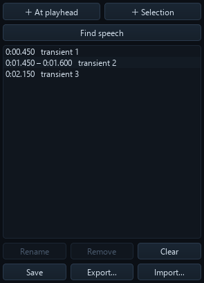

They are positions in *time*, so an edit that changes the length moves them —
delete two seconds and everything after it shifts left. Undo puts them back
where they were, because the marker list rides along on the undo stack rather
than being recomputed.

**They survive the session.** `Save` writes `clip.wav.labels.json` beside the
audio, and opening that file again picks them straight back up. `Export…` writes
an **Audacity label track** instead, which is three columns of plain text that
most of the audio world already reads.

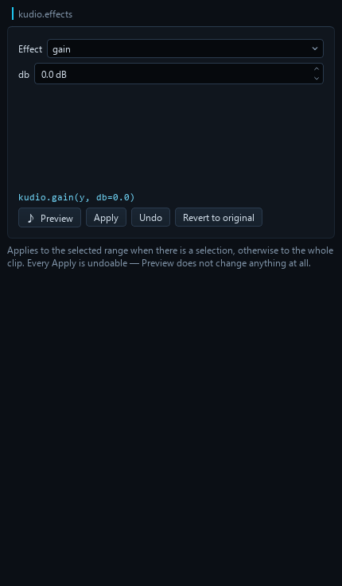
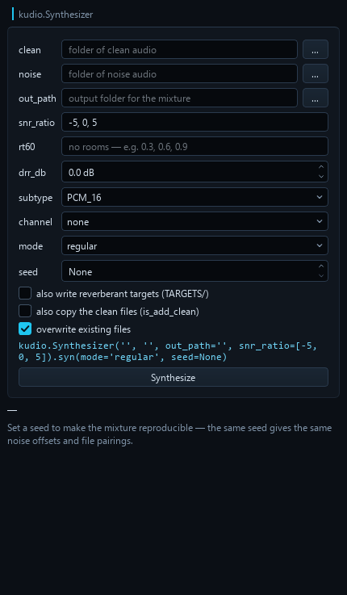

### A/B against the audio you started with

`Ctrl+B` swaps the whole workbench — playback, waveform and spectrogram —
between your edit and the file as it was loaded. It works *while playing*:
playback rebases to the same instant on the other buffer, so the switch is
seamless and you are comparing the same moment, not the same button press.

**Match loudness** is on by default, and it matters more than it sounds.
Between two versions of a clip, the louder one is reliably preferred whatever
its quality — so an unmatched A/B is partly a loudness test. The original is
levelled to the edit with `kudio.match_loudness` (ITU-R BS.1770), and the
status line always states the gain it applied, so an effect that only changed
the level correctly ends up sounding identical rather than mysteriously better:

```
A/B — the original, levelled to the edit (-17.6 LU applied)
A/B — the original, +17.6 LU against the edit; turn on Match loudness to compare fairly
```

Turn it off when the level *is* what you are judging.

The axes deliberately do **not** rescale between the two: a denoiser that also
halved the level should look half as tall, not be stretched back to fill the
plot. Zoom survives the swap for the same reason.

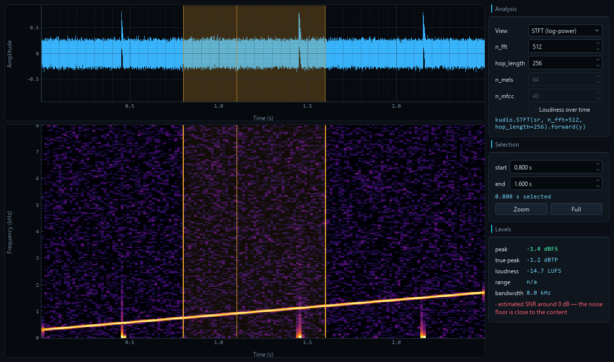
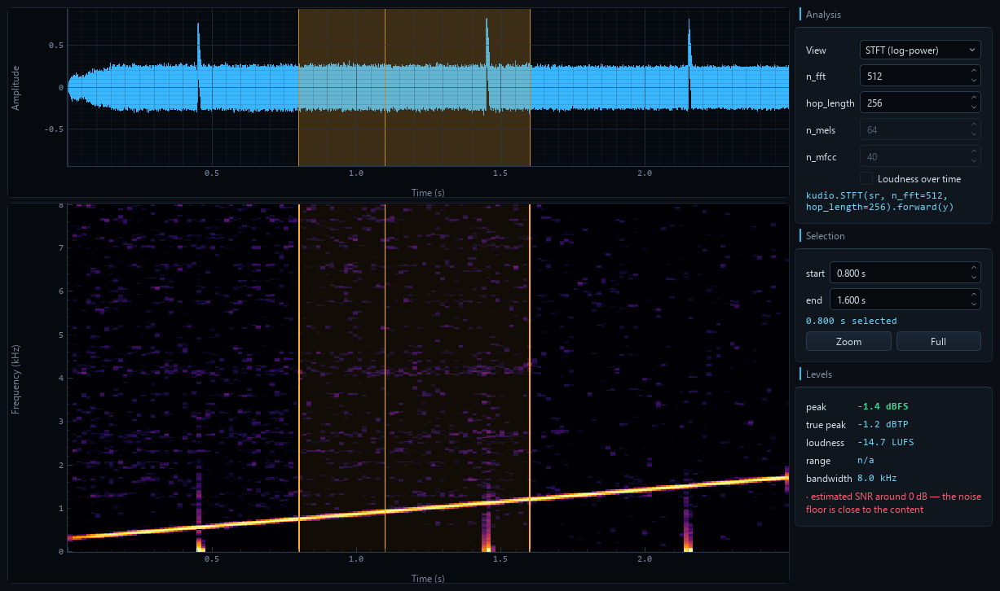

*Same clip, same axes, same instant — `trad_enhance` has thinned the noise bed
and left the chirp.*

The tools keep operating on the edit throughout — comparing is monitoring, not
a mode you can accidentally process in.

### Preview before you commit

**Preview** auditions an effect and **changes nothing**: no edit, no undo step.
It loops, so finding the right `top_db` is a matter of listening rather than
apply-listen-undo-repeat. Preview and Apply run the same code on the same
audio, so what you hear is exactly what Apply will commit.

- **Effects** re-renders as you turn a knob, debounced at 150 ms.
- **Enhance** runs on a worker thread — denoising is seconds, not milliseconds
  — processes the whole clip exactly as Denoise will, then loops whatever is
  selected.

Anything else claiming playback — Play, Stop, an edit — ends the audition and
releases the button.

### A room someone measured

`room` builds a statistical room from an RT60 and a DRR: reproducible, one knob,
and no early reflections, which is what augmentation wants and not what a
particular hall sounds like. **`measured_room`** takes an impulse response from
a file instead and applies it with `kudio.apply_rir`. It is read the way the
recorded call reads it — `kudio.file_load` at the clip's rate, in mono — and
read again if the clip changes rate, so Preview, Apply and an exported script
all use the same samples:

```python
y = kudio.apply_rir(y, kudio.file_load('/rooms/hall.wav', sr=sr)[0][192:])
```

The `[192:]` is **`start at the direct sound`**, on by default. A measured
response begins with the time the sound took to reach the microphone, and left
in, that delays the audio — a processed selection comes back late against its
neighbours. It starts the response at its loudest sample, where `kudio.rir`
puts the direct path.

Under the picker, `kudio.rt60` reads the response **as it will be applied** —
resampled, downmixed, trimmed — so a hall measured at 48 kHz and applied at
8 kHz is described as what is left of it:

```
0.91 s at 16000 Hz, direct sound at 12.0 ms — applied from there
T30 0.59 s (EDT 0.54 s)  ·  C50 +9.4 dB  ·  DRR +3.0 dB  ·  fit 1.000
```

A file that is not an impulse response still produces a T30. When the decay is
not straight, or its EDT and T30 disagree, the reading says so and turns red.

### Is this recording usable at all?

Every metric in the Metrics panel needs a clean reference beside the degraded
signal. A synthetic dataset has one. **A real recording never does** — its
"original" *is* the noisy one, so scoring against it measures how much you
changed the audio, not whether you improved it.

`kudio.audio_report` needs no reference, so the **Levels** box beside the
analysis view is always live: peak, loudness, bandwidth, and whatever is wrong
with the recording itself. The Metrics panel's **Inspect** gives the full set.

It catches the things that quietly waste a dataset:

```
· 4692 samples clipped (9.78% of the clip) — the recording was already
  too hot; no processing gets that back
· content stops at 3812 Hz although the file claims 16000 Hz — it was
  very likely upsampled from 8000 Hz, and the extra rate is empty
```

The **Record** panel runs the same check on every take, while the microphone
is still set up and re-recording is still an option.

That says the audio is technically sound, not that it sounds good. For the
other half, **DNSMOS** (ITU-T P.835) predicts what a listener would say:

```
SIG 2.94 · BAK 4.12 · OVRL 3.01
poor (OVRL 3.01) — the background is cleaner than the speech, which is
what over-aggressive denoising looks like
```

SIG and BAK move in opposite directions under denoising — suppress harder and
the background gets cleaner while the speech gets eaten — so all three numbers
are shown rather than averaged into one. Needs
`pip install -e ".[dnsmos]"` **and** the DNS-Challenge weights, which
neither kudio nor this app bundles; the panel tells you where to get them.

### Where is somebody actually talking?

`trim_silence` and `split_on_silence` cut on level alone, which works on a
studio take and falls apart on anything with a fan in the background. Above
some noise level no fixed `top_db` both keeps the quiet consonants and drops
the room.

`kudio.vad` decides per frame against **this recording's own noise floor**, and
uses spectral flatness to tell a voice from a hiss. It is in two places: the
**`vad_trim`** effect, and **`Find speech`** in the markers dock, which turns
every detected span into a marker you can click through.

### Analysis views

Log-power STFT, log-mel and MFCC, from the same `kudio` calls a training
script would use — the caption under the controls is the exact call:

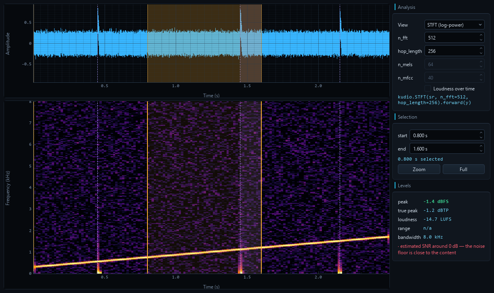
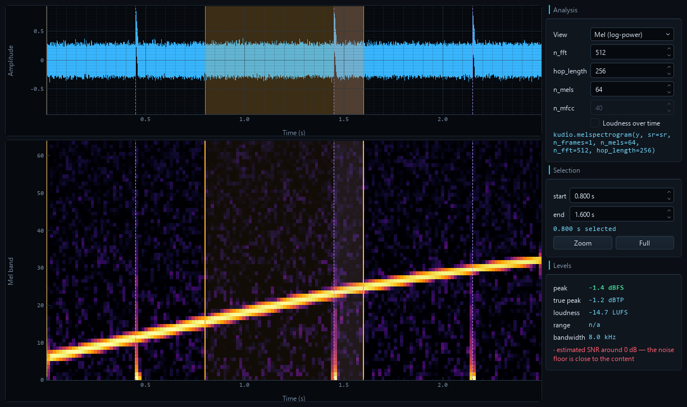
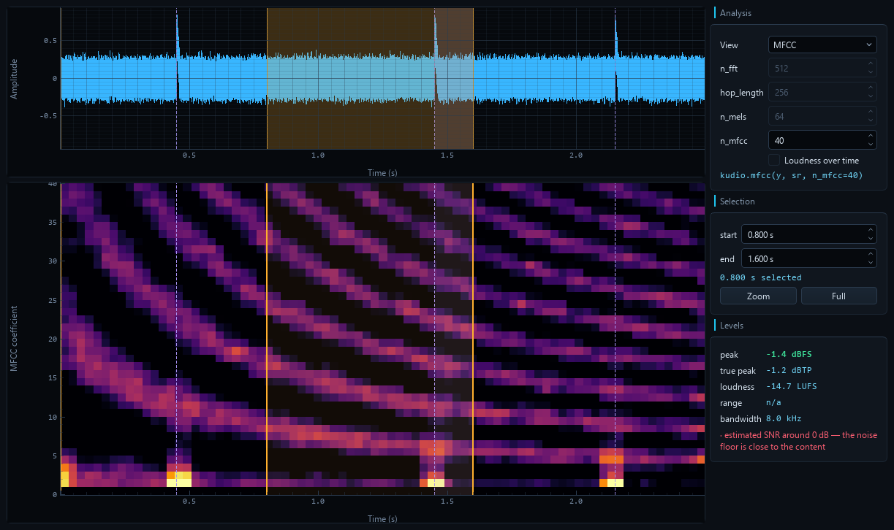

The same pair of plots also carries the two things that are *not* the clip: the
rolling picture of a take as it arrives, and an f0 contour over the
spectrogram. Both are below.

### Where did the level go?

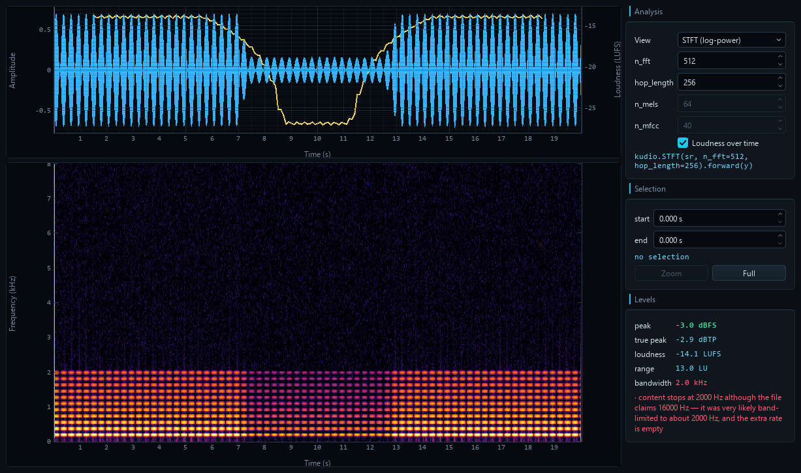

The Levels box gives one integrated LUFS figure for the whole clip — the
number you normalise against, and no help at all in finding the moment
somebody leaned away from the microphone. **Loudness over time** draws the
short-term curve (EBU Tech 3341, 3 s window, 100 ms hop) over the waveform on
its own LUFS axis, so "-31 LUFS here" is a number you can act on rather than
"about a third as tall".

Above, a take that drifts 13 dB and comes back. The Levels box agrees: `range
13.0 LU`.

It costs no extra measurement. The Levels readout already walks the signal for
its report, so the curve, the true peak and the range come out of that same
pass — four answers from one worker job, which also means they cannot describe
four different moments of an edit.

Two things it is deliberate about:

- **The curve is ungated.** Gating is what stops pauses dragging the
  *integrated* figure down; a curve with holes punched in it where the gate
  fired would describe a recording that stops existing between words. Real
  silence still breaks the line, because there the level genuinely is nothing.
- **A clip shorter than the 3 s window has no curve**, and the checkbox says so
  rather than ticking and doing nothing. Falling back to the 400 ms window
  would quietly answer a different question.

**True peak** is in the Levels box beside the sample peak, and the two
disagree more often than you would think. Samples are points on a curve that
passes between them, and the curve overshoots — so a file with no sample at
full scale can still clip in a converter or a lossy encoder. `audio_report`
cannot see that (nothing in the samples is wrong), so it is reported
separately, in dBTP, and warns at the usual -1 dBTP delivery ceiling.

### Two files that are the same take, eight milliseconds apart

Every metric in the Metrics panel compares sample *i* of the reference with
sample *i* of the current audio. A clip scored against **itself** reads
+145 dB; one sample of delay costs 134 of them, and a millisecond scores worse
than not processing at all. Nothing in the resulting number distinguishes
"your processing was bad" from "these two are misaligned", and those mean
opposite things.

So the panel measures the offset with `kudio.find_delay` **every time**, puts
it in the table, and takes it out before scoring unless you say otherwise:

```
Alignment          lags by 128 samples (8.0 ms), correlation 0.982
SI-SDR             +14.210 dB          ...instead of -7.890 dB
```

Untick `Line up with the reference first` and it still reports the offset,
with a warning that the scores below are mostly measuring it.

When the reference does not look like the same recording at all, it says so
and does **not** line the two up — aligning two unrelated signals produces a
confident-looking number about nothing, which is worse than an obviously bad
one.

### What note is this?

A spectrogram shows the harmonic stack. It does not say *which* line is the
fundamental, and it stops helping the moment that line is weak — a phone band,
a high-pass, a low voice under the first few bins.

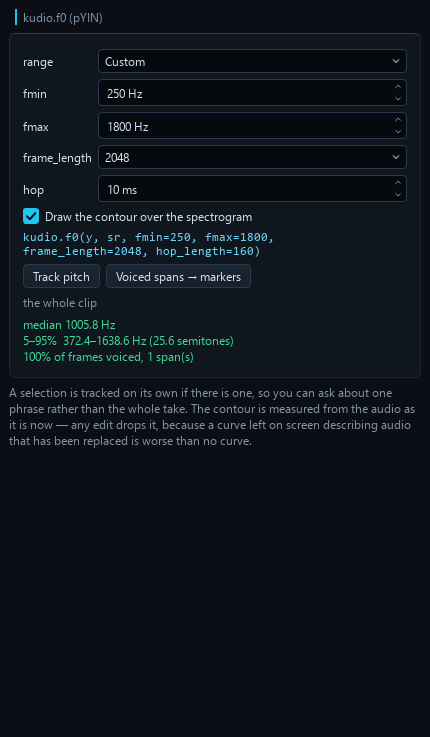
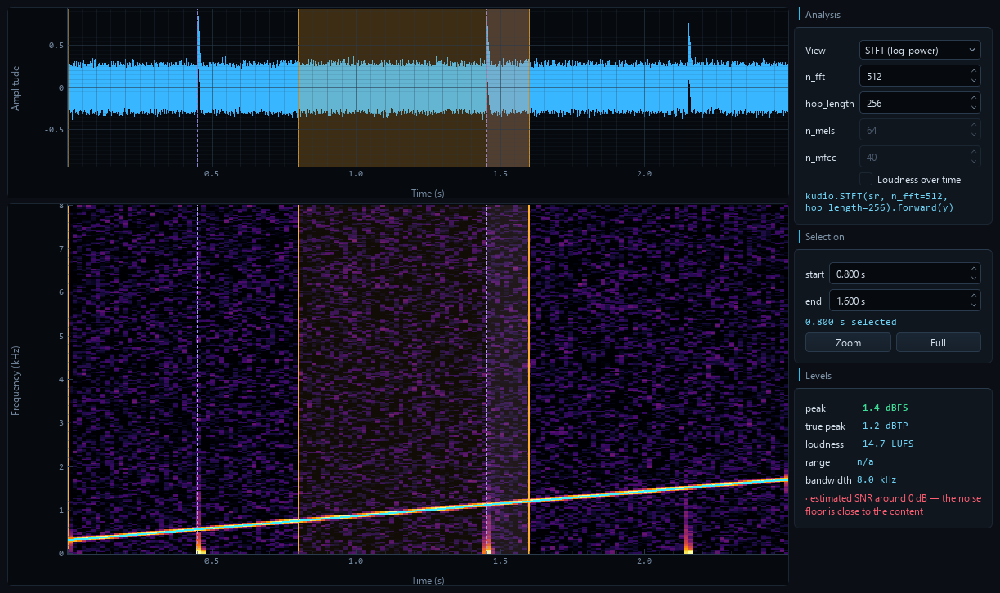

The **Pitch** panel runs `kudio.f0` (pYIN) and reports the median, the 5–95%
range in Hz *and* in semitones — the unit pitch is actually heard in — and how
much of the clip was voiced at all. The contour is drawn over the STFT view,
with **gaps where there is no pitch**: an estimator asked "what is the pitch
here" always answers, including for silence and for an `s`, and a line joined
through those answers is a picture of nothing.

Two things it is deliberate about:

- **The search range is a named choice**, not a hidden default. A voice below
  `fmin` is not reported as missing — it is reported as something plausible and
  wrong inside the range, so the presets say out loud what they cover.
- **On a mel or MFCC image the contour is hidden**, because there "180" means
  band 180. A curve in the wrong place is worse than no curve.

`Voiced spans → markers` turns the result into marker ranges, which then save
beside the file and export as a label track like any other.

### Choosing a denoiser instead of guessing

Applying one method, listening, undoing and trying the next is how you end up
with whichever one you happened to try last. The **Compare** panel runs all
seven over identical audio with identical framing, measures each, and lets you
audition any row without committing to it.

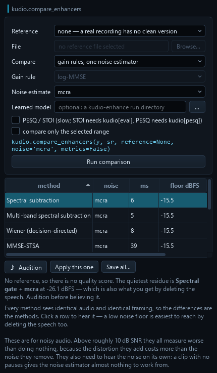

The seven methods are the same three decisions in different combinations —
estimate the noise, estimate the a priori SNR, turn it into a gain — so holding
the noise estimator still isolates the gain rule. **The estimator is as large a
lever as the gain rule**: measured across the full grid, 5.8 dB of mean SI-SDR
spread from the gain rule against 6.4 dB from the estimator. Neither dominates,
which is why both are controls and why the panel can sweep either, or both.

**Both axes sweep.** Enhancement is two decisions — a gain rule and a noise
estimator — so the panel compares gain rules at one estimator, estimators at one
gain rule, or the full 7 × 4 grid. It then reports which of the two moved *this
clip* more, or says they were comparable rather than crowning one on a 0.1 dB
difference.

Point `Learned model` at a [kudio-enhance](https://github.com/recklight/KudioEnhance)
run directory and it gets a row too, scored against the same reference on the
same audio — "is the model actually better than log-MMSE" is not a question two
separate printouts answer. The model is loaded, and run once over a short
excerpt, before the clock starts, then kept for the next comparison on the same
run, so its `ms` is the denoise — not the seconds it takes to import PyTorch
and read the checkpoint. Kept for the run *as it is on disk*: trained again
into the same directory, it is loaded again.

Select two or more rows and **`♪ Audition A→B`** loops them back to back,
with a third of a second of silence at each seam, so the comparison is not
interrupted by a click and a mouse movement. They play in the **table's
order**, top to bottom, whichever was clicked first — and re-sorting while they
play re-orders the loop, so "the one above sounds better" is a sentence about
the ranking. `Apply this one` wants exactly one row that did not fail, and
records it as the code that computes it again from the audio and the range it
was computed on — a comparison whose audio was edited while it ran is
dropped rather than shown, since its rows describe audio that is gone.

Three things the panel says out loud, because all three are easy to get wrong:

- **With no clean reference there is no quality score.** All that is left is
  the residual noise floor, and the easiest way to reach a very low floor is to
  delete the speech along with the noise. The ranking is a shortlist; `♪ Audition`
  is the verdict.
- **Scoring against the noisy original measures how much you changed the
  audio, not whether you improved it.** When every method comes out worse than
  doing nothing, that is what the panel tells you rather than crowning a winner
  that is −1 dB "better".

- **These methods are for genuinely noisy audio.** Above roughly 10 dB SNR the
  distortion they add costs more than the noise they remove, and they all
  measure worse than leaving the clip alone.

### Hearing the denoiser while you record

The Record panel's **`monitor through`** runs the take through
`kudio.StreamEnhancer` as it arrives — a live rolling waveform of the *denoised*
signal, and a readout of how much is coming off right now. One analysis frame of
latency, 32 ms at the default.

The take itself is committed **raw**. Monitoring is monitoring, the same rule the
A/B follows: what you hear is a view, not an edit. Only the four per-frame
methods can stream; the rest need the whole spectrogram and live in Enhance.

The Enhance panel's controls are **generated from `kudio.METHODS`** — range,
default, unit and help text all come from the library, so a parameter added
there appears here without anyone editing the GUI.

### Watching a take arrive

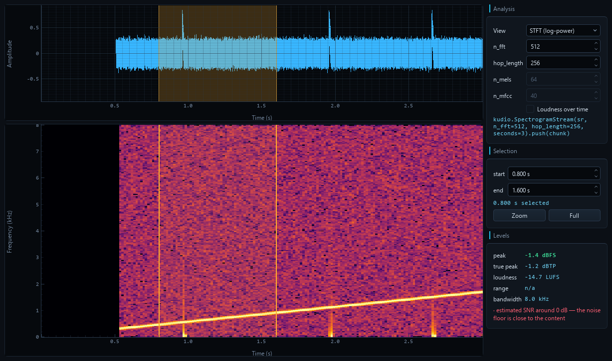

The waveform monitor was in from the start; the spectrogram was not, because
recomputing an STFT several times a second to draw a window that has already
scrolled away costs more than it shows. `kudio.SpectrogramStream` fixes that
properly: a ring buffer of columns, each computed **once**, when the samples
for it arrive.

The Record panel drains the recorder once per tick and hands the new audio
over; the view pushes all of it through the transform and redraws a few times
a second. Analysis is never skipped — that would lose audio — and drawing
always is.

Three details that are easy to get wrong and visible when you do:

- **`drain()`, never `tail()`.** A sliding window overlaps between calls, so
  every overlapping sample would be drawn twice at two different times.
- **The colour range is absolute** (dBFS per bin), not picked from the window.
  A range recomputed from something that scrolls twenty times a second is a
  brightness that means nothing and changes anyway.
- **Both plots are right-aligned on *now*.** They share a time axis, so a
  waveform drawn from zero while the window is still filling would put the
  same instant in two different places.

Turn on `monitor through` and the picture is of the *denoised* stream, while
the take is still committed raw.

### Learned denoising

The Enhance panel runs classic DSP out of the box. Install
[kudio-enhance](https://github.com/recklight/KudioEnhance) from a checkout of
its own and the panel also loads the models it trains: point `run_dir` at
a run directory and it picks up the model, its normalisation statistics and the
STFT geometry they were trained with — so inference cannot silently disagree
with training.

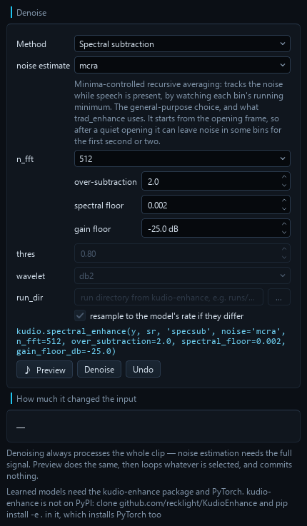

PyTorch is imported only when that method is actually used, and the panel
tells you how to install it rather than failing if it is missing. A run
directory from kudio-enhance 0.1 predates its move to PyTorch and cannot be
loaded: the panel says it has to be retrained.

### Dataset synthesis

Point it at a folder of clean audio and a folder of noise, pick your SNRs, and
it writes the mixture. `regular` gives one output per clean file; `inc` writes
every clean × noise × SNR combination. Set a seed and the result is byte-for-byte
reproducible — the same noise offsets, the same pairings.

### Reading a corpus back

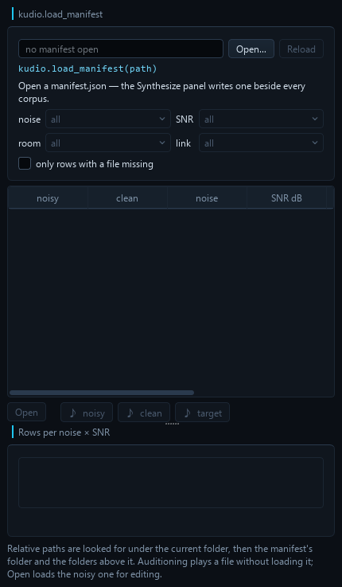

The Synthesize panel writes `manifest.json` beside every corpus, and half of
what is in it — the room, the link, the target — is in none of the file names.
`File → Open manifest…` — or `kudiostudio manifest.json` on the command line —
reads one with `kudio.load_manifest` and shows it as rows: noisy, clean, noise,
SNR, RT60, link and target. Sort any column (SNR and
RT60 by value, not as text), filter by noise, SNR, room and link, and select a
row: **Open** loads its noisy file for editing, as `File → Open` would, and
**♪ noisy / ♪ clean / ♪ target** loop one side of it without loading anything.

It answers two questions worth asking before anything is trained on a corpus:

- **Is every file still there?** Paths in a manifest are often relative — to
  wherever the synthesis ran, which nothing records. They are looked for under
  the current directory first, then the manifest's own folder and each folder
  above it, which is where `Synthesizer(..., out_path='data/mixed')` paths
  start — and the **whole manifest is read against one of those folders**: the
  first that holds every file it names, or failing that the one that holds the
  most. Never file by file: two projects built from the same clean files name
  their mixtures alike, and a lookup per path would pair one project's
  mixtures with the other's clean files. The summary names the folder. Rows
  with a file that is not found there are marked and counted, and one
  checkbox lists only those — the grid then counts where the damage is, and
  says nothing about the corpus's coverage.
- **Is it a manifest at all?** kudio reads a manifest without looking at the
  values; one edited by hand can hold a list where an SNR belongs. That is
  refused with the row and the field named, and whatever was showing stays.
- **Is the noise × SNR grid covered?** The grid under the table counts the rows
  shown per combination, so a room filter shows that room's coverage. A hole
  is a red cell, and the note says which kind it is: fewer rows than
  combinations is a `reg` corpus that needs more clean files; enough rows and
  a hole anyway is something no single run writes — rows went missing, or the
  manifest is two runs merged. Double-click a cell to list its rows.
  Only SNRs that some row has get a column — the manifest records what was
  written, not what was asked for.

Reading the manifest and checking the disk run on a worker, and the table only
builds the cells on screen, so a corpus of tens of thousands of rows does not
freeze the window.

### A tree at -23 LUFS, and the files that could not get there

`kudio.convert_folder(lufs=-23)` applies a gain to every file and says nothing
about what came of it. The job people actually have is "normalise this tree
and tell me which files could not get there", so with a LUFS target the Batch
panel **reads every written file back** and measures it — `kudio.loudness`,
then `kudio.true_peak` — against a stated tolerance (±1 LU, what
`kudio loudness --target` allows) and a true-peak ceiling (-1 dBTP, EBU R 128's).
Every file that missed is listed, with the reason:

```
could not get there:
  in/b/short.wav               —  too short to measure — BS.1770 needs 0.4 s, so it was not written
  out/a/spiky.wav     -35.4 LUFS  clipped at full scale — -23 LUFS needs a peak above 0 dBFS; 12.4 LU short
  out/b/silent.wav             —  silent — there is no level to raise
on target, too little headroom:
  out/c/plosive.wav   -23.0 LUFS  true peak +0.5 dBTP, over the -1.0 dBTP ceiling
```

It is measured from disk rather than from what was handed to `save_wave`,
because the disk is where it goes wrong: a fixed-point file clips everything
past full scale, so a quiet file levelled up comes back with its peaks
flattened. A clipped file is listed even when its loudness lands near the
target — it got there by clipping. A `FLOAT` tree keeps the peaks, and says
which files only a float file can hold. With denoising on, **the levelling
waits for it**: the conversion leaves the level alone, the denoise pass runs,
and every file is levelled after it — a denoiser takes level out along with
the noise, so a tree levelled first lands under the target it was asked for.

### Re-room a tree and keep both

Tick **Reverberant copy** and every converted file is written again in a room,
to a second tree with the same layout — `<output>_reverberant` by default,
beside the output and never inside it — so a dry file and its wet copy pair by
path: input and target for dereverberation, or two conditions of one corpus.

Each file gets **a room of its own**: the same RT60 and DRR, and a tail drawn
from the run's seed and the file's path, the way `kudio.Synthesizer` draws its
per-file rooms — one room repeated over a corpus is one acoustic condition,
and a model trained on it learns that room. The same seed rebuilds the same
rooms, and a random one is drawn at Run and reported. `apply_rir` keeps the
length and the peak, so wet and dry stay sample-aligned; with a LUFS target the
copies are levelled to it too and read back with the rest.

A batch run can take a while, and nothing in it can be stopped half-way.
**Quitting while it runs does not cut it short**: the window stays open, says
what it is waiting for, and closes itself when the job is done — a tree is
never left half-written.

### Objective metrics

SNR, SI-SDR and segmental SNR are pure numpy and always available. PESQ, STOI
and BSS-SDR need the optional back-ends:

```bash
pip install "kudio[eval]"      # STOI and BSS-SDR
pip install "kudio[pesq]"      # PESQ — builds from source, needs a C compiler
```

PESQ comes on two different scales. kudio reports MOS-LQO by default; enhancement papers mostly quote the raw narrowband P.862 score, and the two are not interchangeable — raw 2.03 is about 1.65 MOS-LQO. The Metrics panel names which one it is showing and lets you switch.

The panel reports which ones are present rather than failing.

## Shortcuts

| Key | Action |
|---|---|
| `Ctrl+O` / `Ctrl+Shift+S` | Open / Save As |
| `Ctrl+Shift+E` | Save the selection as its own file |
| `Ctrl+Z` | Undo the last edit |
| `Ctrl+X` / `Ctrl+C` / `Ctrl+V` / `Del` | Cut / copy / paste / delete the selection |
| `Ctrl+T` | Crop to the selection |
| `Ctrl+A` / `Esc` | Select all / clear selection |
| `Space` | Play / stop |
| `Home` | Playhead back to the start |
| `Ctrl+L` | Loop what was last played |
| `Ctrl+B` | A/B against the original |
| `Ctrl+E` / `Ctrl+F` | Zoom to selection / zoom out to the whole clip |

Drag on **either plot** to select, or type an exact range into the
**Selection** boxes. Click anywhere to move the playhead — click while playing
and it keeps playing from there. The waveform and the spectrogram share the
time axis, the selection, the playhead and the markers, so anything you do to
one shows on the other.

`Space`, `Home` and the clipboard keys are deliberately *not* registered as
window shortcuts. Qt resolves shortcuts **before** the key reaches the focused
widget, so a window-level `Ctrl+C` would take copy away from every path field
in the tool panels, and `Space` away from typing a filename with a space in it.
They are handled in `keyPressEvent`, which only sees them when nothing else
wanted them; the menus show the keys anyway.

## Layout

```
kudiostudio/
├── __main__.py       # CLI entry point, argument parsing
├── app.py            # main window: docks, tool rail, menus, wiring
├── session.py        # AudioSession — audio, undo, selection, clipboard,
│                     #   markers, splice crossfade, A/B, loudness match,
│                     #   and the edit history as a script
├── workers.py        # QThread helpers, so long kudio calls never block the UI,
│                     #   and cycle collection kept on the GUI thread
├── theme.py          # shared colours
├── style.py          # the dark theme: Fusion, palette, stylesheet
├── icons.py          # line icons for the toolbar, transport and tool rail
├── plugins.py        # panels other packages add, found by entry point
├── widgets/
│   ├── views.py      # TimePlot base + waveform, spectrogram/mel/MFCC,
│   │                 #   the rolling take and the f0 overlay
│   ├── levels.py     # reference-free level / loudness / warnings readout
│   ├── markers.py    # the marker list, and Find speech
│   └── transport.py  # play / stop / playhead / loop / A/B / match / gain,
│                     #   and the splice crossfade
└── panels/
    ├── base.py       # Panel base class
    ├── browse.py     # file list
    ├── effects.py    ├── enhance.py   ├── compare.py
    ├── record.py     ├── synth.py     ├── manifest.py
    ├── pitch.py      ├── metrics.py   └── batch.py
```

Panels never talk to each other. They read and mutate the shared
`AudioSession`; the views repaint on its `changed` signal. A panel that wants a
file opened asks the window with `open_requested`, so the file lands in the
Files list like any other. Adding a panel means subclassing `Panel` and
appending it to `PANEL_CLASSES`.

A panel can also live in a package of its own, for tools that have no place
in this repository. The package names its `Panel` subclass under the
`kudiostudio.panels` entry point group, and the window puts it on the tool
rail, below a rule under the built-in tools:

```toml
[project.entry-points."kudiostudio.panels"]
spectra = "mypackage.studio:SpectraPanel"
```

Two class attributes are read as it loads: `icon_svg`, its rail icon as an
SVG body on the 24-unit grid `icons.py` draws on, and `messages`, its
translations in the form `locales/zh_TW.py` uses. A plugin that fails to
import or to build is left off the rail and named in the status bar, and the
window opens without it; `--no-plugins` leaves them all out.

The UI is built in Python — there are no `.ui` files and no `uic` step, so what
you read is what runs.

## Tests

```bash
pytest -q
```

557 tests covering the session's undo/selection/clipboard/marker arithmetic,
the exported edit script landing on the session's own samples when it is run
in a separate interpreter, a manifest from a real synthesis run finding its
files from wherever the window was started and counting its coverage, a
normalised tree read back with every file that missed the target named for
the right reason, reverberant copies that are exactly their seeded rooms, a
measured room that does not delay the audio, loudness matching, the
playhead's timing, the preview and playback loops, the
shared axes and colour scale, the comparison table's ranking and its refusal
to crown a winner when the reference is not clean, a learned row timed
without the seconds its model took to load, the rolling views' promise
that every column is computed once and that real audio always wins over a live
one, where the pitch contour refuses to draw, the two plots' left and right
gutters staying the same width so a shared time axis actually lines up, each
panel's behaviour, the main window's wiring, another package's panel put on
the rail or left off it with the reason named, a panel let go of the moment its
job ends being freed on the GUI thread, a window built in Traditional
Chinese that still reads its combo boxes back in English, and the whole program quitting
cleanly mid-job — those last two in an interpreter of their own, since what
they guard against is a crash. Qt runs headless (`offscreen`), so the suite
works in CI. The learned-denoising tests (marked `learned`) train a one-epoch
model for real, run it on the panels' own worker threads, and skip cleanly
when kudio-enhance or PyTorch is not installed or will not import — unless
`KUDIOSTUDIO_REQUIRE_LEARNED=1` is set, which makes them fail instead, for a
job that installs both precisely to run them. The open-ended recorder is
driven through a fake device, since CI has no microphone.

`tools/smoke.py` is the other half: 166 end-to-end checks in one process,
covering what the unit suites cannot — real files, non-default sample rates,
minute-long feeds, the `kudio` command line, and the window driving a real
worker thread. It exits non-zero on any failure.

The README's screenshots are generated, not hand-captured — rerun
`python tools/screenshots.py` after changing the window and commit what moved.

## Related

- **[kudio](https://pypi.org/project/kudio/)** — the audio toolkit underneath: I/O,
  features, effects, synthesis, enhancement, metrics.
- **[kudio-enhance](https://github.com/recklight/KudioEnhance)** — train the
  denoising models this app loads.

## Licence

MIT — see [LICENSE.txt](LICENSE.txt).
