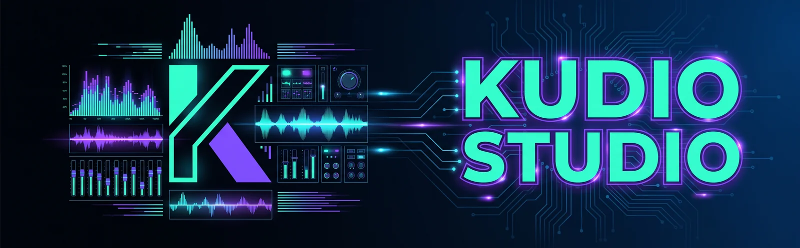
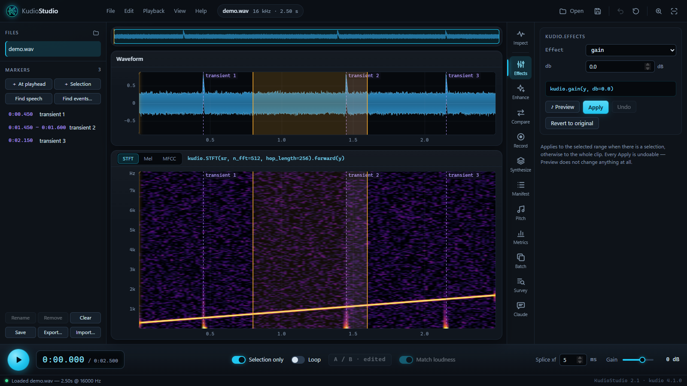

# KudioStudio



**English** | [繁體中文](https://github.com/recklight/KudioStudio/blob/master/README.zh-TW.md)

[](https://pypi.org/project/kudiostudio/)
[](https://www.python.org/)
[](https://pywebview.flowrl.com/)
[](https://github.com/recklight/KudioStudio/blob/master/LICENSE.txt)
[](https://pypi.org/project/kudio/)

**A desktop workbench for the [`kudio`](https://pypi.org/project/kudio/) audio toolkit.**

Open a clip, look at it, change it, measure it, and build datasets from it,
without writing a script first. Every control maps to one documented `kudio`
function, and the caption under each panel shows the exact call it will make,
so anything you work out here translates straight into code.

**The user guide is at [recklight.github.io/KudioStudio](https://recklight.github.io/KudioStudio/)**:
every panel, every control, and the reasons behind them.



## Install

```bash
pip install kudiostudio
kudiostudio
```

KudioStudio needs Python 3.9 or newer and kudio 4.0.0 or newer, which pip
installs with it. The window is drawn by the web view the
system already has, through [pywebview](https://pywebview.flowrl.com/):
WebView2 on Windows 10 and 11, WebKit on macOS. Linux needs GTK or Qt for
pywebview and PortAudio's library for sound; without a web view, the same page
opens in the default browser. [Getting started](https://recklight.github.io/KudioStudio/getting-started/)
has the details.

The heavy parts are extras:

| Extra | Adds |
|---|---|
| `pip install "kudiostudio[eval]"` | STOI and SDR |
| `pip install "kudio[pesq]"` | PESQ, and CSIG, CBAK and COVL, which are built on it. It builds from source and needs a C compiler, so it is in neither `[eval]` nor `[all]` |
| `pip install "kudiostudio[dnsmos]"` | DNSMOS opinion scores (the weights are not bundled) |
| `pip install "kudiostudio[enhance]"` | learned denoising on PyTorch, through [kudioenhance](https://pypi.org/project/kudioenhance/) |
| `pip install "kudiostudio[audio]"` | recording until you press Stop, on Linux and macOS (PyAudio; Windows has it already) |
| `pip install "kudiostudio[all]"` | all of the above except PESQ |

```bash
kudiostudio clip.wav           # open a file on start-up
kudiostudio manifest.json      # a corpus manifest opens in the Manifest panel
kudiostudio --browser          # the same page in the default browser
kudiostudio --lang zh_TW       # the interface in Traditional Chinese
```

## What is in it

| Panel | What it is for |
|---|---|
| [Inspect](https://recklight.github.io/KudioStudio/panels/inspect/) | the analysis view (STFT, mel, MFCC), the selection, and the Levels readout with true peak and a loudness curve |
| [Effects](https://recklight.github.io/KudioStudio/panels/effects/) | one kudio effect at a time on the selection or the whole clip, heard before it is applied |
| [Enhance](https://recklight.github.io/KudioStudio/panels/enhance/) | statistical denoisers and learned models |
| [Compare](https://recklight.github.io/KudioStudio/panels/compare/) | every denoiser on the same clip, ranked, each row a click from your ears |
| [Record](https://recklight.github.io/KudioStudio/panels/record/) | a fixed-length take, or one that runs until you stop it, drawn as it arrives |
| [Synthesize](https://recklight.github.io/KudioStudio/panels/synthesize/) | a noisy dataset from clean and noise folders, rooms and phone lines included |
| [Manifest](https://recklight.github.io/KudioStudio/panels/manifest/) | that dataset read back: missing files and the noise × SNR coverage |
| [Pitch](https://recklight.github.io/KudioStudio/panels/pitch/) | the f0 contour over the spectrogram, and the voiced spans as markers |
| [Metrics](https://recklight.github.io/KudioStudio/panels/metrics/) | what is wrong with a recording without a reference, and scores with one |
| [Batch](https://recklight.github.io/KudioStudio/panels/batch/) | a whole folder converted, normalised or denoised, with the files that missed named |

Around them: cut, copy and paste with a crossfade at every join, A/B against
the file as it was opened, markers that outlive the session, and the whole edit
history written out as a Python script that makes the same samples
([Editing and markers](https://recklight.github.io/KudioStudio/editing/)).
Other packages can add panels of their own
([Writing a panel](https://recklight.github.io/KudioStudio/plugins/)).

## Working on it

```bash
git clone https://github.com/recklight/KudioStudio.git
cd KudioStudio
pip install -e ".[dev]"
pytest -q
```

`tools/smoke.py` runs the end-to-end checks the unit tests cannot, and
`pip install -e ".[docs]"` then `mkdocs serve` builds the guide locally.

## Related

- **[kudio](https://pypi.org/project/kudio/)**: the audio toolkit underneath.
- **[kudioenhance](https://pypi.org/project/kudioenhance/)**: trains the
  denoising models this app loads.

## Licence

MIT, see [LICENSE.txt](https://github.com/recklight/KudioStudio/blob/master/LICENSE.txt).
