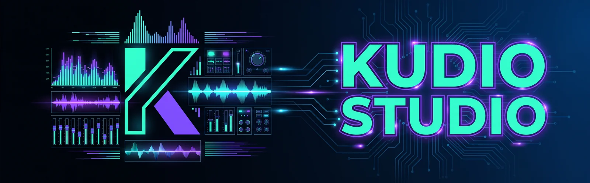
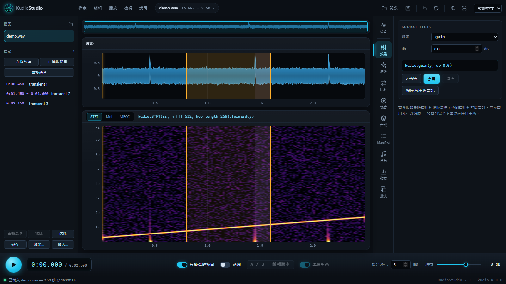

# KudioStudio



[English](https://github.com/recklight/KudioStudio/blob/master/README.md) | **繁體中文**

[](https://pypi.org/project/kudiostudio/)
[](https://www.python.org/)
[](https://pywebview.flowrl.com/)
[](https://github.com/recklight/KudioStudio/blob/master/LICENSE.txt)
[](https://pypi.org/project/kudio/)

**[`kudio`](https://pypi.org/project/kudio/) 音訊工具組的桌面工作台。**

開啟一段音訊，觀察它、修改它、量測它，並用它建立資料集，不必先寫腳本。
每個控制項都對應到一個有文件說明的 `kudio` 函式，每個面板下方的說明文字會
顯示它即將執行的確切呼叫，所以在這裡試出來的做法，都能直接轉成程式碼。

**使用說明在 [recklight.github.io/KudioStudio](https://recklight.github.io/KudioStudio/zh-TW/)**：
每個面板、每個控制項，以及背後的理由。



## 安裝

```bash
pip install kudiostudio
kudiostudio
```

KudioStudio 需要 Python 3.9 以上。視窗透過 [pywebview](https://pywebview.flowrl.com/)，
用系統本來就有的網頁元件畫出來：Windows 10 與 11 是 WebView2，macOS 是 WebKit。
Linux 上 pywebview 需要 GTK 或 Qt，聲音需要 PortAudio 的函式庫；沒有網頁元件時，
同一個頁面會改在預設瀏覽器開啟。詳細說明見[入門](https://recklight.github.io/KudioStudio/zh-TW/getting-started/)。

較重的元件都是選用套件組：

| Extra | 加入的功能 |
|---|---|
| `pip install "kudiostudio[eval]"` | STOI 與 SDR |
| `pip install "kudio[pesq]"` | PESQ。它要從原始碼編譯，需要 C 編譯器，所以不在 `[eval]` 也不在 `[all]` 裡 |
| `pip install "kudiostudio[dnsmos]"` | DNSMOS 主觀分數預測（權重沒有隨附） |
| `pip install "kudiostudio[enhance]"` | 基於 PyTorch 的學習式降噪，透過 [kudioenhance](https://pypi.org/project/kudioenhance/) |
| `pip install "kudiostudio[audio]"` | 在 Linux 與 macOS 上錄到按停止為止（PyAudio；Windows 已經包含） |
| `pip install "kudiostudio[all]"` | 以上全部，PESQ 除外 |

```bash
kudiostudio clip.wav           # 啟動時開啟一個檔案
kudiostudio manifest.json      # 語料庫的 manifest 會在 Manifest 面板開啟
kudiostudio --browser          # 改在預設瀏覽器開啟同一個頁面
kudiostudio --lang zh_TW       # 以繁體中文介面啟動
```

## 有哪些功能

| 面板 | 用途 |
|---|---|
| [檢視](https://recklight.github.io/KudioStudio/zh-TW/panels/inspect/) | 分析圖（STFT、mel、MFCC）、選取範圍，以及含 true peak 與響度曲線的「音量」讀數 |
| [效果](https://recklight.github.io/KudioStudio/zh-TW/panels/effects/) | 一次套用一種 kudio 效果到選取範圍或整段音訊，套用前先試聽 |
| [增強](https://recklight.github.io/KudioStudio/zh-TW/panels/enhance/) | 統計式降噪器與學習式模型 |
| [比較](https://recklight.github.io/KudioStudio/zh-TW/panels/compare/) | 在同一段音訊上跑每一種降噪器並排名，每一列點一下就能聽 |
| [錄音](https://recklight.github.io/KudioStudio/zh-TW/panels/record/) | 固定長度的錄音，或錄到按停止為止，錄的同時畫出來 |
| [合成](https://recklight.github.io/KudioStudio/zh-TW/panels/synthesize/) | 用乾淨語音與雜訊資料夾建立含噪資料集，可加上房間與電話線路 |
| [Manifest](https://recklight.github.io/KudioStudio/zh-TW/panels/manifest/) | 把那個資料集讀回來：遺失的檔案，以及雜訊 × SNR 的覆蓋情況 |
| [音高](https://recklight.github.io/KudioStudio/zh-TW/panels/pitch/) | 畫在頻譜圖上的 f0 輪廓，以及轉成標記的有聲區段 |
| [指標](https://recklight.github.io/KudioStudio/zh-TW/panels/metrics/) | 沒有參考訊號時找出錄音本身的問題，有參考訊號時評分 |
| [批次](https://recklight.github.io/KudioStudio/zh-TW/panels/batch/) | 整個資料夾轉檔、正規化或降噪，並列出沒能達標的檔案 |

此外還有：每個接合處都會交叉淡化的剪下與貼上、與剛開啟時的檔案做 A/B 比較、跨工作階段保留的標記，
以及把整段編輯紀錄寫成一份能產生完全相同樣本的 Python 腳本
（[編輯與標記](https://recklight.github.io/KudioStudio/zh-TW/editing/)）。
其他套件也能加入自己的面板（[撰寫面板](https://recklight.github.io/KudioStudio/zh-TW/plugins/)）。

## 開發

```bash
git clone https://github.com/recklight/KudioStudio.git
cd KudioStudio
pip install -e ".[dev]"
pytest -q
```

`tools/smoke.py` 執行單元測試涵蓋不到的端對端檢查；`pip install -e ".[docs]"` 之後執行
`mkdocs serve`，可以在本機建置這份說明。

## 相關專案

- **[kudio](https://pypi.org/project/kudio/)**：底層的音訊工具組。
- **[kudioenhance](https://pypi.org/project/kudioenhance/)**：訓練本程式所載入的降噪模型。

## 授權

MIT，請見 [LICENSE.txt](https://github.com/recklight/KudioStudio/blob/master/LICENSE.txt)。
