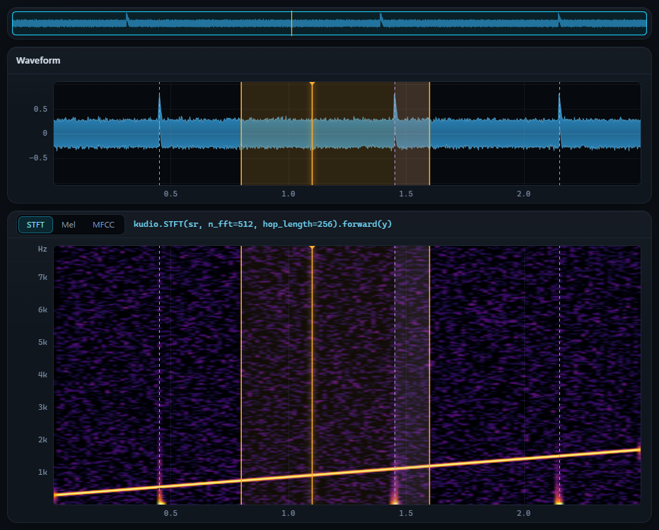
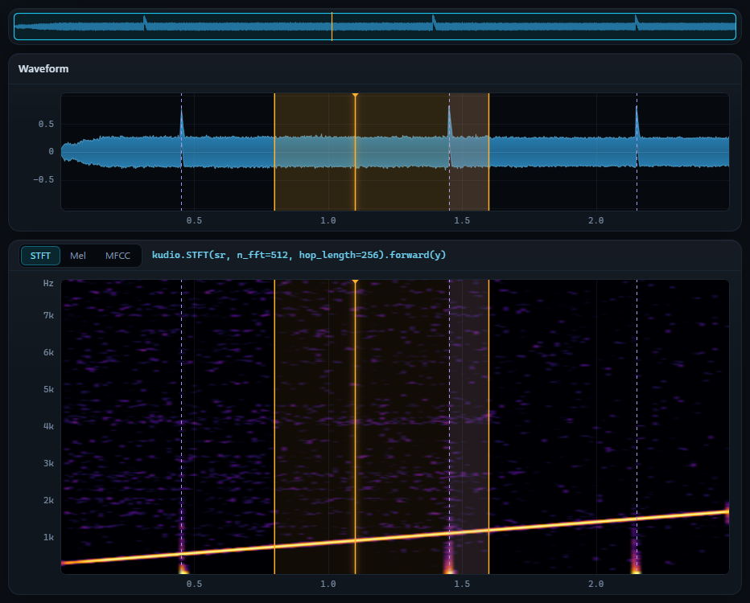
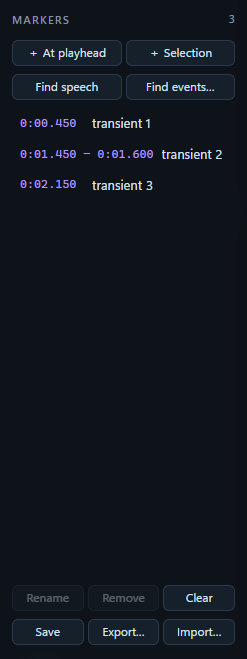

# Editing and markers

An effect works on the selection, or on the whole clip when nothing is
selected. The Enhance panel always denoises the whole clip, because the noise
estimate needs all of it. Cut, copy, delete and crop do not fall back to the
whole clip: they need a selection, or one keystroke could delete everything,
and ++ctrl+a++ is right there when everything is what you mean. Every edit can
be undone.

## Cut, copy and paste

The **Edit** menu has the usual ones: **Cut** (++ctrl+x++), **Copy**
(++ctrl+c++), **Paste** (++ctrl+v++), **Delete** (++del++), **Crop to
selection** (++ctrl+t++) and **Insert silence…**. Cut, copy, delete and crop
are greyed out until there is a selection, and their keys only get a line in
the status bar asking for one.

- **Paste** replaces the selection. With nothing selected it goes in at the
  playhead, even while the clip plays, where the playhead has got to. The
  pasted range comes out selected, so pasting twice does not stack two copies
  where you cannot see them.
- **Insert silence…** asks for a length in seconds, and goes in the same way:
  over the selection, or at the playhead.
- The clipboard keeps **its own sample rate**. An 8 kHz snippet pasted into a
  16 kHz clip is resampled on the way in, rather than played at double speed.

**File → Save selection as…** (++ctrl+shift+e++) writes just the selected
range to a file of its own. **File → Export analysis image…** saves the
waveform and the analysis image as a PNG, exactly as they are on screen, zoom
and all.

## Every join crossfades

A hard cut leaves a step in the waveform, and a step is a click. So every cut,
delete, paste and insert blends the two sides over a few milliseconds, 5 ms by
default. The status line after each edit says how much was applied, including
when the answer is none: changing audio without saying so is worse than a
click.

The length is on the transport, as **Splice xf**, rather than behind a dialog,
because the right length depends on the edit. 5 ms inside a word and 200 ms
between two takes are different jobs, and a setting that takes a dialog to
change is one nobody changes. **Edit → Splice crossfade…** types an exact
value into the same control, and 0 turns it off.

Applying an effect to a selection is not crossfaded. The effect replaces the
range with a processed copy of itself, and blending the edges back would leave
5 ms at each end without the effect.

## Undo and Revert

++ctrl+z++ undoes the last edit, back through the last 20. **Revert to
original** goes straight back to the file as it was opened: it drops every
edit at once, clears the markers, and cannot be undone.

The edits behind a script export are kept in full, so an edit too old for the
undo list is still in the [script](#your-edits-as-a-script). It is still in
the audio, after all.

## A/B against the original

++ctrl+b++, or the **A / B** button on the transport, swaps the whole window
between your edit and the file as it was opened: playback, the waveform and the
analysis image. It works while the clip plays. Playback carries on from the
same instant in the other version, so you compare the same moment, and not
whatever was playing when you pressed the key.

**Match loudness** is on by default, and it matters more than it sounds. Of
two versions of a clip, the louder one is reliably preferred whatever its
quality, so an A/B that is not level-matched is partly a loudness test. The
window measures both versions with `kudio.loudness` (ITU-R BS.1770) and scales
the original by the difference, and the status line says by how much. After a
gain of −6 dB, for instance, it reads the first line with Match loudness on and
the second with it off:

```text
A/B — the original, levelled to the edit (-6.0 LU applied)
A/B — the original, +6.0 LU against the edit; turn on Match loudness to compare fairly
```

An effect that only changed the level, like that gain, then sounds identical,
which is the right answer. Turn Match loudness off when the level is what you
are judging.

A clip shorter than BS.1770's 400 ms block has no loudness to measure, and
neither does a version that is all silence. Then the original plays at its own
level, and the line reads `A/B — the original, level as-is (too short to measure loudness)`.

The axes do not rescale between the two. A denoiser that also halved the level
should look half as tall, not be stretched back to fill the plot, and the zoom
stays put for the same reason.

<figure markdown>
{ .shot width="420" }
{ .shot width="420" }
<figcaption markdown="span">The same clip, axes and instant, before and after `specsub`
with the `mcra` noise estimate, which is where the Enhance panel starts. Most of
the noise is gone and the chirp is left; the specks that remain are the musical
noise spectral subtraction leaves behind.</figcaption>
</figure>

The panels always work on the edit. Listening to the original is a way of
monitoring, not a mode you could process in by accident.

## Your edits as a script

**File → Export edits as Python script…** writes the undo history out as a
plain Python script. It reads the original file the way KudioStudio read it,
repeats every edit in order, each under its undo label and each as the kudio
call or the slicing that made it, and saves the result. Run on the original,
it makes the same samples the session holds, not an approximation of them.
The test suite runs an exported script in a separate interpreter and checks
exactly that.

```python
# 2. highpass
head, y, tail = y[:4800], y[4800:14400], y[14400:]  # 0.300–0.900 s
y = kudio.highpass(y, sr, cutoff=120.0, order=4, zero_phase=True)
y = np.concatenate([head, y, tail])

clip = y[8000:11200].copy()  # pasted in step 4

# 3. delete
y = kudio.splice([y[:3200], y[6400:]], sr, 0.03)  # 0.200–0.400 s

# 4. paste
y = kudio.splice([y[:24000], clip, y[24000:]], sr, 0.03)  # at 1.500 s
```

- **Undo takes the step back out.** Revert, opening another file and a new
  recording start the history again.
- Every join carries the crossfade it actually used, and an effect on a
  selection goes back in without one, as it was applied.
- **A paste pastes what was copied**, not whatever is at those samples by the
  time the script gets there: the `clip = …` line goes where the copy was
  made. A clipboard copied before an edit that was later undone, or from
  another file, is rebuilt from that file first. One copied from an earlier
  recording has no file to rebuild it from, however alike the takes are, so
  the script stops there and the export says why.
- **The script checks what it runs on.** It carries the SHA-256 of the file the
  edits were made on and stops if `SOURCE` holds anything else. Save As
  suggests the opened file's name as a `.wav`, in the folder last used, so
  for a WAV you have just opened it suggests that very file. Once the edit has
  been saved over it, a script that read it back would apply every edit a
  second time; the export warns about that too, as soon as it can tell. Point
  `SOURCE` at a copy of the original, or delete the check to run the same
  edits on another file. A
  learned model's files are checked the same way, so a model trained again in
  the same folder since the edit stops the script rather than denoise with
  different weights.
- An effect left on a **random** seed gets the seed Apply actually drew
  written into its call, so the script repeats that result instead of rolling
  again. Denoising is recorded too, a learned model as
  `Enhancer.load(run_dir).enhance(y)` from kudioenhance, resampling included.
- **Nothing is skipped quietly.** An edit that cannot be written as code stops
  the script with a `raise` at that step, the script's header lists it, and
  the export says so in the status bar. A script missing a step would write a
  different file with nothing about it looking wrong. A recording that was
  never a file gets a placeholder `SOURCE` and the same warning.

From Python, `session.edit_script()` returns the same text, and
`session.history` holds the steps behind it.

## Markers

A selection is single, unnamed and gone the moment you make another one.
Markers are named points and ranges that stay.

{ .shot .side }

- **＋ At playhead** adds a point where the playhead is, or where playback has
  got to while the clip plays.
- **＋ Selection** turns the selection into a range.
- **Find speech** fills the list with every span `kudio.vad` finds speech in.
  It replaces the list rather than adding to it, so a second run, after an
  edit say, does not lay a second answer over the first.
- Click a marker to move the playhead to it; double-click a range to select
  it. **Rename**, **Remove** and **Clear** work on the list.

Markers are positions in time, so an edit that changes the length moves them:
delete two seconds and everything after it shifts two seconds left. Undo puts
them back where they were, because the list rides along on the undo stack
rather than being worked out again.

They outlive the session. **Save** writes them beside the audio as
`clip.wav.labels.json`, and opening the clip again reads them straight back.
**Export…** writes an Audacity label track instead, three columns of plain
text that most audio programs read, or a `.json` file wherever you like.
**Import…** reads either back.
