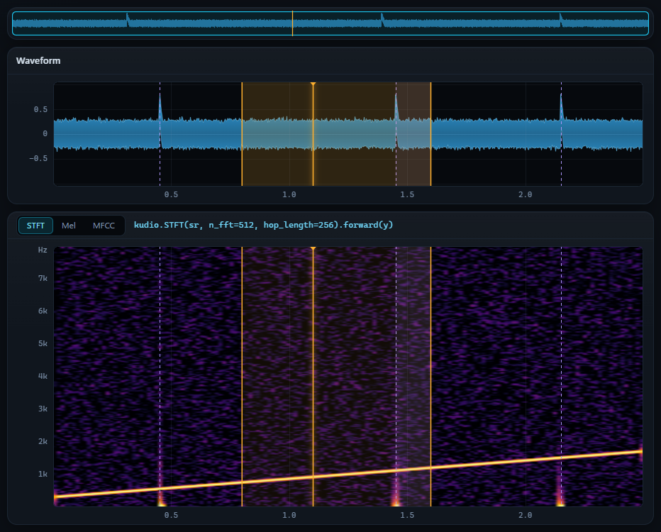
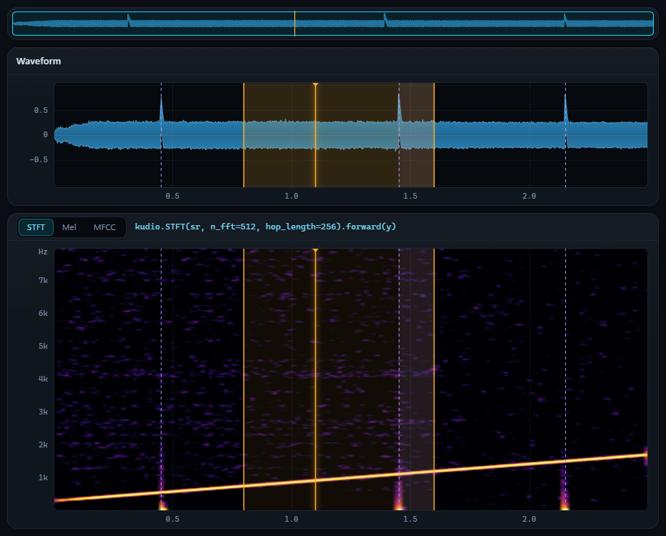
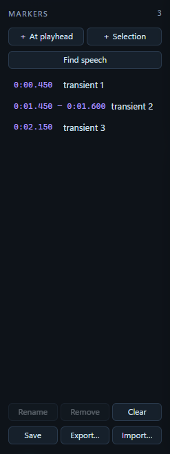

# 編輯與標記

效果作用在選取範圍上，沒有選取時就作用在整段音訊。「增強」面板則一律對整段音訊降噪，
因為雜訊估計需要整段訊號。剪下、複製、刪除與裁切不會這樣退回整段音訊，一定要先有選取範圍，
不然一個按鍵就可能把整段刪光；真的要整段時，++ctrl+a++ 就能全選。每個編輯都能復原。

## 剪下、複製與貼上 {#cut-copy-and-paste}

「編輯」選單裡是常見的幾項：剪下（++ctrl+x++）、複製（++ctrl+c++）、貼上（++ctrl+v++）、
刪除（++del++）、裁切至選取範圍（++ctrl+t++）與插入靜音…。剪下、複製、刪除與裁切在有選取範圍
之前是灰的，這時按它們的快捷鍵，狀態列只會提醒你先選取。

- 貼上會取代選取範圍。沒有選取時，它會插在播放頭的位置；播放中則插在已經播到的地方。
  貼上的那一段會變成選取範圍，所以連貼兩次時，不會在看不見的地方疊了兩份。
- 插入靜音…會先問長度（秒），插入方式相同：取代選取範圍，或插在播放頭。
- 剪貼簿會記得**它自己的取樣率**。一段 8 kHz 的片段貼進 16 kHz 的音訊時，會在貼上時重新取樣，
  而不是以兩倍速播放。

「檔案 → 將選取範圍另存為…」（++ctrl+shift+e++）只把選取的那一段寫成一個獨立檔案。
「檔案 → 匯出分析圖…」把波形與分析圖存成 PNG，跟畫面上看到的完全一樣，連縮放狀態也是。

## 每個接合處都會交叉淡化 {#every-join-crossfades}

硬切會在波形上留下一個階梯，而階梯就是喀聲。所以每次剪下、刪除、貼上與插入，
都會在接合處把兩邊混合幾毫秒，預設 5 ms。每次編輯後的狀態列都會說明套用了多少，
包括答案是「沒有」的時候：不聲不響地改動音訊，比一個喀聲更糟。

長度設定放在傳輸列上的「接合淡化」，而不是藏在對話框後面，因為合適的長度因編輯而異。
一個字中間的 5 ms 與兩段錄音之間的 200 ms 是不同的工作，而得開對話框才能改的設定，
就是沒人會去改的設定。「編輯 → 接合交叉淡化…」可以在同一個控制項輸入精確的數值，
設成 0 就關掉。

對選取範圍套用效果則不做交叉淡化。效果是用處理過的版本取代那一段，若把邊緣再混回去，
兩端就會各留下 5 ms 沒有套到效果。

## 復原與還原 {#undo-and-revert}

++ctrl+z++ 復原上一個編輯，最多可以往回 20 步。「還原為原始音訊」則直接回到剛開啟時的檔案：
它一次捨棄全部編輯、清除標記，而且無法復原。

匯出腳本用的編輯紀錄是完整保留的，所以超出復原步數的舊編輯仍然會出現在
[腳本](#your-edits-as-a-script)裡。畢竟它還在音訊裡。

## 在音訊被取代之前 {#before-a-clip-is-replaced}

開啟檔案（用「開啟」、在「檔案」清單點選、把檔案拖進視窗，或按 manifest 某一列的「開啟」）
和錄一段新的錄音，都會取代目前開啟的音訊。目前的音訊若有任何檔案都沒保存的內容，也就是開啟或
上次儲存之後做的編輯，或從沒寫成檔案的錄音，視窗會先詢問：開檔時問「要開啟另一個檔案嗎？」，
錄音時問「要錄音取代目前開啟的音訊嗎？」，按「取消」就什麼都不變。剛開啟或剛存過檔的
音訊，以及復原回到某個檔案保存狀態的音訊，會直接取代、不會詢問，因為不會失去任何東西。

## 與原始音訊做 A/B 比較 {#ab-against-the-original}

++ctrl+b++，或傳輸列上的 **A / B** 按鈕，會把整個視窗在你的編輯版本與剛開啟時的檔案之間切換：
播放、波形與分析圖都會一起換。播放中也能切換，播放會在另一個版本的同一時刻接續，
所以你比較的是同一個瞬間，而不是按下按鍵時剛好在播的地方。

「響度對齊」預設開啟。這個開關看起來不起眼，對 A/B 的影響卻很大：同一段音訊的兩個版本，
較大聲的那個幾乎總是被偏好，不論品質如何，所以沒有對齊響度的 A/B，有一部分其實是在比音量。
視窗會用 `kudio.loudness`（ITU-R BS.1770）量兩個版本的響度，再照差值調整原始音訊的音量，
狀態列會寫出調了多少。例如套用 −6 dB 的增益之後，開著「響度對齊」時是第一行，關掉時是第二行：

```text
A/B — 原始音訊，已對齊編輯版本的響度（套用 -6.0 LU）
A/B — 原始音訊，比編輯版本 +6.0 LU；開啟「響度對齊」才能公平比較
```

像這樣只改了音量的效果，切換時聽起來會完全一樣，本來就該如此。要評判的正是音量時，
就把「響度對齊」關掉。

比 BS.1770 的 400 ms 區塊還短的音訊量不出響度，整段靜音的版本也一樣。這時原始音訊照它本來的
音量播放，狀態列寫的是 `A/B — 原始音訊，音量維持原樣（太短，無法量測響度）`。

兩者之間的座標軸不會重新縮放。一個同時把音量減半的降噪器，看起來就該只有一半高，
而不是被拉伸回去填滿整張圖；縮放狀態在切換時保留，也是同樣的理由。

<figure markdown>
{ .shot width="420" }
{ .shot width="420" }
<figcaption markdown="span">同一段音訊、同樣的座標軸、同一個瞬間，分別是處理前，以及用「增強」面板一開始選好的 `specsub` 搭配 `mcra` 雜訊估計處理後。雜訊大多去掉了，chirp 還在；剩下零星的斑點，是頻譜減法會留下的 musical noise。</figcaption>
</figure>

各個面板始終作用在編輯版本上。切到原始音訊只是換個版本來聽，面板不會因此改去處理原始音訊。

## 把編輯匯出成腳本 {#your-edits-as-a-script}

「檔案 → 將編輯匯出為 Python 腳本…」把復原紀錄寫成一份普通的 Python 腳本。它用 KudioStudio
讀取原始檔案的方式讀取檔案，依序重做每個編輯，每一步都標上它的復原標籤，每一步都是當初實際
執行的 kudio 呼叫或切片，最後儲存結果。在原始檔案上執行，它產生的是與工作階段中完全相同的樣本，
而不是近似值。測試套件會在另一個直譯器中執行匯出的腳本，檢查的正是這一點。

```python
# 2. highpass
head, y, tail = y[:4800], y[4800:14400], y[14400:]  # 0.300–0.900 s
y = kudio.highpass(y, sr, cutoff=120.0, order=4, zero_phase=True)
y = np.concatenate([head, y, tail])

clip = y[8000:11200].copy()  # pasted in step 4

# 3. delete
y = kudio.splice([y[:3200], y[6400:]], sr, 0.03)  # 0.200–0.400 s

# 4. paste
y = kudio.splice([y[:24000], clip, y[24000:]], sr, 0.03)  # at 1.500 s
```

- 復原會把該步驟從腳本中拿掉。還原、開啟另一個檔案與開始新的錄音，都會讓紀錄重新開始。
- 每個接合處都帶著它實際使用的交叉淡化長度，對選取範圍套用的效果則照套用時的方式，
  不加淡化接回。
- 貼上的是當初複製的內容，而不是腳本執行到那裡時那些樣本位置上的東西：`clip = …`
  這一行會放在當初複製的位置。若剪貼簿是在一個後來被復原的編輯之前複製的，或來自另一個檔案，
  會先從那個檔案重建。若是從先前某次錄音複製的，就沒有檔案可以重建，不論兩次錄音多麼相像，
  所以腳本會在那裡停下，匯出時也會說明原因。
- 腳本會檢查它處理的對象。它帶有編輯所依據檔案的 SHA-256，若 `SOURCE` 的內容不同就會停止。
  另存新檔建議的是開啟的檔名（副檔名換成 `.wav`），放在上次用過的資料夾，所以剛開啟的 WAV
  檔，建議的就是它本身。一旦編輯後的音訊覆寫了它，讀回該檔案的腳本就會把每個編輯再套用一次；
  匯出時只要判斷得出來，也會對此發出警告。請把 `SOURCE` 指向原始檔案的副本，
  或刪掉這個檢查，以便在另一個檔案上執行相同的編輯。學習式模型的檔案也以相同方式檢查，
  所以若模型在編輯之後又在同一個資料夾重新訓練過，腳本會停下，而不是用不同的權重去降噪。
- 使用隨機 seed 的效果，會把「套用」當時實際抽到的 seed 寫進呼叫裡，讓腳本重現那次結果，
  而不是重新擲骰。降噪也會被記錄，學習式模型寫成 kudioenhance 的
  `Enhancer.load(run_dir).enhance(y)`，包含重新取樣。
- 不會默默略過任何步驟。無法寫成程式碼的編輯，會在該步驟以 `raise` 讓腳本停止，
  腳本開頭會列出它，匯出時也會在狀態列說明。少了一步的腳本會寫出不同的檔案，卻看不出任何異狀。
  從來不是檔案的錄音會得到一個佔位用的 `SOURCE` 與同樣的警告。

在 Python 中，`session.edit_script()` 會回傳相同的文字，`session.history` 則是它背後的各個步驟。

## 標記 {#markers}

選取範圍只有一個、沒有名稱，而且一做新的選取就消失了。標記則是會留下來的具名時間點與範圍。

{ .shot .side }

- 「＋ 在播放頭」在播放頭的位置加一個時間點；播放中則加在已經播到的地方。
- 「＋ 選取範圍」把選取範圍變成一個標記範圍。
- 「尋找語音」用 `kudio.vad` 找出每一段有語音的範圍，填進清單。它會取代整份清單而不是附加，
  所以在編輯之後再跑一次，不會把第二次的答案疊在第一次上面。
- 點一下標記會把播放頭移過去，雙擊範圍標記則選取它。「重新命名」、「移除」與「清除」
  作用在清單上。

標記是時間上的位置，所以改變長度的編輯會移動它們：刪掉兩秒，後面的一切都會往左移兩秒。
復原會把它們放回原位，因為標記清單是跟著復原堆疊一起存放的，而不是重新算出來的。

標記能跨工作階段保留。「儲存」會在音訊旁寫出 `clip.wav.labels.json`，下次開啟同一段音訊時
會直接讀回來。「匯出…」則寫成 Audacity 標籤軌，那是三欄純文字，大部分音訊軟體都能讀；
也可以寫成 `.json` 檔，放在任何地方。「匯入…」兩種都能讀回。
