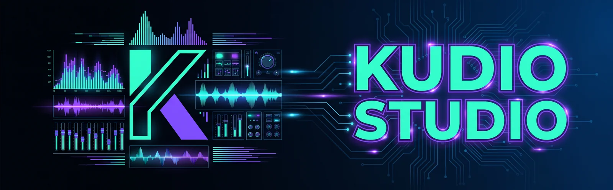
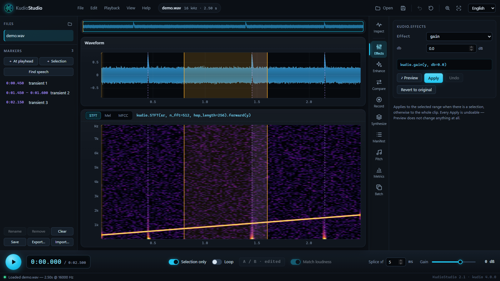

# KudioStudio



KudioStudio is a desktop workbench for [kudio](https://pypi.org/project/kudio/),
my Python toolkit for speech audio. Open a clip, look at it, change it, measure
it and build a dataset from it, without writing a script first. The panels run
documented kudio functions, and each one shows the call its controls make. That
line is written to be read; what an edit records is the exact call, with the
seed a random effect actually drew and the full path of any file it reads, so
whatever you settle on here carries straight over to code.

{ .shot }

## Install

```bash
pip install kudiostudio
kudiostudio
```

It needs Python 3.9 or newer. [Getting started](getting-started.md) lists the
extras and what Linux needs, and walks through a first session from opening a
file to saving it.

## The panels

The rail on the right of the window holds one tool per panel:

| Panel | What it is for | kudio behind it |
|---|---|---|
| [Inspect](panels/inspect.md) | the analysis view's settings, the selection, and the Levels readout | `STFT`, `melspectrogram`, `mfcc`, `audio_report`, `loudness_over_time`, `true_peak` |
| [Effects](panels/effects.md) | one effect at a time on the selection or the whole clip, heard before it is applied | `kudio.effects`, `rir`, `apply_rir`, `rt60` |
| [Enhance](panels/enhance.md) | seven statistical denoisers over four noise estimators, `trad_enhance`, a wavelet filter, and learned models | `spectral_enhance`, `trad_enhance`, `wavelet_low_pass_filter`, kudioenhance |
| [Compare](panels/compare.md) | the seven statistical denoisers, the four noise estimators or the whole grid on the same clip, ranked, with a learned model as one more row if you give it one; each row is a click from your ears | `compare_enhancers` |
| [Record](panels/record.md) | a fixed-length take, or one that runs until you stop it, drawn as it arrives | `record`, `StreamRecorder`, `SpectrogramStream`, `StreamEnhancer` |
| [Synthesize](panels/synthesize.md) | a noisy dataset from a clean folder and a noise folder, rooms and phone lines included | `Synthesizer` |
| [Manifest](panels/manifest.md) | that dataset read back: missing files, and the noise × SNR coverage | `load_manifest` |
| [Pitch](panels/pitch.md) | the f0 contour over the spectrogram, and the voiced spans as markers | `f0` |
| [Metrics](panels/metrics.md) | what is wrong with a recording when there is no reference, and scores when there is | `audio_report`, `srmr`, `wada_snr`, `dnsmos`, `find_delay`, `eval_metrics`, `pesq`, `snr`, `si_sdr`, `segmental_snr`, `llr`, `itakura_saito`, `cepstral_distance`, `wss`, `fw_segmental_snr`, `lsd`, `composite`, `ncm`, `csii` |
| [Batch](panels/batch.md) | a whole folder converted, normalised, denoised or given a reverberant copy, with a report of the files that missed | `convert_folder`, `enhance_folder`, `rir`, `apply_rir` |

## Where to go next

<div class="grid cards" markdown>

-   __[Getting started](getting-started.md)__

    ---

    Installing, the extras, the command line, and a first session from
    opening a file to saving it.

-   __[The window](window.md)__

    ---

    What each part of the window is, how to select, zoom and play, and every
    shortcut.

-   __[Editing and markers](editing.md)__

    ---

    Cut and paste with a crossfade at every join, A/B against the original,
    markers that outlive the session, and your edits written out as a script.

-   __[Panels](panels/inspect.md)__

    ---

    One page per tool on the rail, with every control and what it calls.

-   __[Writing a panel](plugins.md)__

    ---

    A tool of your own on the rail, from a package of its own.

-   __[Troubleshooting](troubleshooting.md)__

    ---

    What it means when the window, the sound or a panel does not do what
    you expected, and what to do about it.

</div>

## Related projects

[kudio](https://pypi.org/project/kudio/)
:   The toolkit underneath: files, features, effects, rooms and channels,
    dataset synthesis, denoising, metrics and recording. Its own guide is at
    [recklight.github.io/Kudio](https://recklight.github.io/Kudio/).

[kudioenhance](https://pypi.org/project/kudioenhance/)
:   Trains the learned denoisers that the Enhance and Compare panels load.
