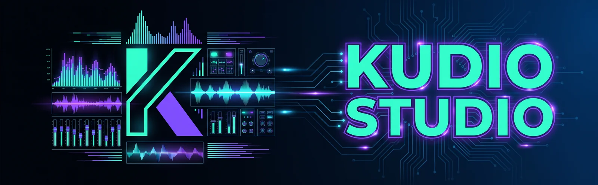
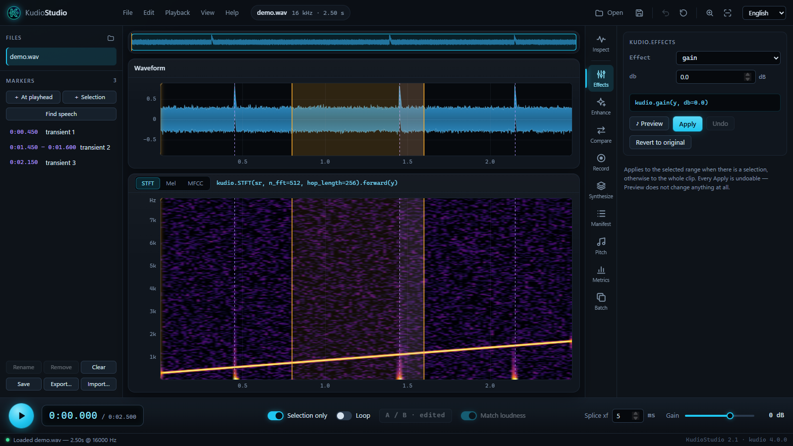

# KudioStudio



KudioStudio 是 [kudio](https://pypi.org/project/kudio/) 的桌面工作台，kudio 是我寫的
Python 語音音訊工具組。開啟一段音訊，觀察它、修改它、量測它，再用它建立資料集，
這些都不必先寫腳本。各個面板執行的都是有文件的 kudio 函式，面板上也會顯示那些控制項
組成的呼叫。那一行是寫給人讀的；編輯真正記錄下來的是確切的呼叫，隨機效果實際抽到的 seed、
讀取的檔案完整路徑都會寫進去，所以在這裡試出來的做法，可以直接搬進程式碼。

{ .shot }

## 安裝 {#install}

```bash
pip install kudiostudio
kudiostudio
```

需要 Python 3.9 以上。[入門](getting-started.md)列出各個選用套件組、Linux 需要的東西，
以及從開啟檔案到存檔的第一次操作。

## 各面板 {#the-panels}

視窗右側的工具列，每個工具對應一個面板：

| 面板 | 用途 | 背後的 kudio |
|---|---|---|
| [檢查](panels/inspect.md) | 分析圖的設定、選取範圍，以及「音量」讀數 | `STFT`, `melspectrogram`, `mfcc`, `audio_report`, `loudness_over_time`, `true_peak` |
| [效果](panels/effects.md) | 一次套用一種效果到選取範圍或整段音訊，套用前先試聽 | `kudio.effects`, `rir`, `apply_rir`, `rt60` |
| [增強](panels/enhance.md) | 七種統計式降噪器搭配四種雜訊估計器、`trad_enhance`、小波濾波，以及學習式模型 | `spectral_enhance`, `trad_enhance`, `wavelet_low_pass_filter`, kudioenhance |
| [比較](panels/compare.md) | 在同一段音訊上比較七種統計式降噪器、四種雜訊估計器，或兩者的完整組合，並排名；給它一個學習式模型，就多一列。每一列點一下就能聽 | `compare_enhancers` |
| [錄音](panels/record.md) | 固定長度的錄音，或錄到按停止為止，錄的同時畫出來 | `record`, `StreamRecorder`, `SpectrogramStream`, `StreamEnhancer` |
| [合成](panels/synthesize.md) | 用一個乾淨語音資料夾和一個雜訊資料夾建立含噪資料集，可加上房間與電話線路 | `Synthesizer` |
| [Manifest](panels/manifest.md) | 把那個資料集讀回來：遺失的檔案，以及雜訊 × SNR 的覆蓋情況 | `load_manifest` |
| [音高](panels/pitch.md) | 畫在頻譜圖上的 f0 輪廓，以及轉成標記的有聲區段 | `f0` |
| [指標](panels/metrics.md) | 沒有參考訊號時找出錄音本身的問題，有參考訊號時評分 | `audio_report`, `srmr`, `wada_snr`, `dnsmos`, `find_delay`, `eval_metrics`, `pesq`, `snr`, `si_sdr`, `segmental_snr`, `llr`, `itakura_saito`, `cepstral_distance`, `wss`, `fw_segmental_snr`, `lsd`, `composite`, `ncm`, `csii` |
| [批次](panels/batch.md) | 整個資料夾轉檔、正規化、降噪，或另外做一份加了殘響的副本，並列出沒能達標的檔案 | `convert_folder`, `enhance_folder`, `rir`, `apply_rir` |

## 接下來看哪裡 {#where-to-go-next}

<div class="grid cards" markdown>

-   __[入門](getting-started.md)__

    ---

    安裝、選用套件組、命令列，以及從開啟檔案到存檔的第一次操作。

-   __[視窗導覽](window.md)__

    ---

    視窗每個區塊是什麼，怎麼選取、縮放、播放，以及所有快捷鍵。

-   __[編輯與標記](editing.md)__

    ---

    每個接合處都有交叉淡化的剪下與貼上、與原始音訊做 A/B 比較、跨工作階段保留的標記，
    以及把編輯匯出成腳本。

-   __[面板](panels/inspect.md)__

    ---

    工具列上每個工具各一頁，列出每個控制項與它呼叫的函式。

-   __[撰寫面板](plugins.md)__

    ---

    在自己的套件裡寫一個工具，放上工具列。

-   __[疑難排解](troubleshooting.md)__

    ---

    視窗、聲音或某個面板沒有照預期運作時，可能的原因與處理方式。

</div>

## 相關專案 {#related-projects}

[kudio](https://pypi.org/project/kudio/)
:   底層的工具組：檔案、特徵、效果、房間與通道、資料集合成、降噪、指標與錄音。
    它自己的說明在 [recklight.github.io/Kudio](https://recklight.github.io/Kudio/zh-TW/)。

[kudioenhance](https://pypi.org/project/kudioenhance/)
:   訓練「增強」與「比較」面板載入的學習式降噪模型。
