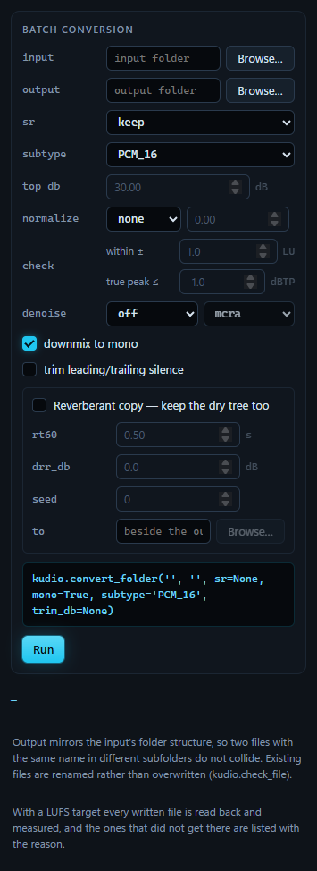

# Batch

{ .shot .side }

A whole folder in one Run: resampled, re-encoded, mixed down to mono, trimmed,
levelled by peak or by loudness, denoised, and copied into a room, into an
output tree laid out like the input. The box above **Run** lists what a Run
will do, one pass a line, each as the kudio call that does it.

With a LUFS target, every file is read back from disk afterwards, and the ones
that did not reach the target are listed with the reason. That list is most of
why I use this panel instead of a loop in a script.

## The settings

| Setting | Choices and default | What it does |
|---|---|---|
| `input` | a folder | every WAV file in it and in its subfolders |
| `output` | a folder | where the converted tree goes, laid out like the input |
| `sr` | `keep`, 48000, 44100, 32000, 22050, 16000, 8000; `keep` | resamples every file |
| `subtype` | `PCM_16`, `PCM_24`, `PCM_32`, `FLOAT`; `PCM_16` | how the files are written |
| `top_db` | 1–90 dB; 30 | for trimming: audio this far below the peak counts as silence |
| `normalize` | `none`, `peak`, `LUFS`; `none` | levels every file, to the target beside it; [below](#lufs-or-peak) |
| `check` | within ± 0.1 to 6 LU, 1; true peak ≤ −20 to 0 dBTP, −1 | what the read-back holds a LUFS tree to; [below](#the-loudness-report) |
| `denoise` | `off` or a method, with a noise estimator; `off` | denoises every file after the conversion; [below](#denoise-before-levelling) |
| **downmix to mono** | on | every file comes out with one channel; with a denoiser they do whether this is ticked or not, [below](#the-order-of-the-passes) |
| **trim leading/trailing silence** | off | cuts quiet audio off both ends, by level |
| **Reverberant copy — keep the dry tree too** | off | a second tree, in a room; [below](#the-reverberant-copy) |

A control greys out when what it sets is not in use: `top_db` without
trimming, the target without normalising, the two read-back limits without a
LUFS target, the noise estimator without a denoiser, and the reverberant
copy's four settings while the copy is off.

The denoisers are the seven statistical methods of the
[Enhance](enhance.md) panel, and the estimators the four it offers, `mcra`
first; hover over an estimator in the list for what it assumes about the noise.

Only WAV files are collected, `.WAV` included, so a FLAC or MP3 in the tree is
left out. An output folder inside the input is fine, since its files are not
collected as input. The conversion never overwrites a file already in the
output: the one from this Run is written under another name
(`kudio.check_file`).

## The order of the passes

Every setting is read when you press **Run**, and the passes then go in this
order:

1. `kudio.convert_folder` reads each file at the chosen rate, mixes it down
   to mono if asked, trims it, levels it and writes it.
2. `kudio.enhance_folder` denoises the files the conversion just wrote, in
   place. It is a pass of its own because it reads a whole file to estimate
   the noise. It keeps the subtype, so a `FLOAT` tree stays float. It does
   not keep the channels: it reads every file in mono, and with a denoiser
   every file comes out with one channel, **downmix to mono** or not.
3. With a denoiser and a target, LUFS or peak, the levelling comes here,
   after the denoise, for the reason [below](#denoise-before-levelling).
4. The reverberant copies are made from the dry files as the passes before
   left them.
5. With a LUFS target, every file is read back. That comes last so that it
   measures the files as everything else left them, the reverberant copies
   included.

With all of them on and the seed at its default of 0, the box above **Run**
reads:

```text
kudio.convert_folder('raw', 'out', sr=16000, mono=True, subtype='PCM_16', trim_db=30.0)
→ kudio.enhance_folder(converted.outputs, <their folder>, 'logmmse', noise='mcra', subtype='PCM_16', overwrite=True, report=True)
→ per file: kudio.normalize_lufs(y, sr, lufs=-23.0), after the denoise
→ per file: kudio.apply_rir(y, kudio.rir(sr, rt60=0.5, drr_db=0.0, seed=file_seed(0, path))), kudio.normalize_lufs(…, lufs=-23.0) → 'out_reverberant'
→ read back: kudio.loudness, kudio.true_peak — within ±1 LU of -23 LUFS, true peak ≤ -1 dBTP
```

At a seed of −1 the room line reads `file_seed(…, path)`, because the seed is
only drawn when you press **Run**.

`converted.outputs` is the list of files the conversion wrote, and `<their
folder>` the deepest folder they share. kudio places each file of a list by
its path below that folder, so with the same folder as the destination, each
file is written back where it was.

## LUFS or peak

`peak` scales each file by its loudest sample, which says nothing about how
loud the file sounds: one stray click normalises a whole clip to a whisper.
`LUFS` levels by perceived loudness (ITU-R BS.1770), which is what a dataset
gathered from mixed sources needs.

The two targets are different quantities. A peak target is a fraction of full
scale, from 0.01 to 1.0, and starts at 0.99. A loudness target is in LUFS,
from −60 to 0, and starts at −23, the EBU R 128 level. Switching between the
two puts the box back to the default of the mode chosen, because −23 as a peak
and 0.99 as a loudness are both nonsense.

Only a LUFS target is read back.

## The loudness report

`kudio.convert_folder(lufs=-23)` applies a gain to every file. When the gain
takes a peak past full scale, kudio warns in the terminal, with the peak but
not the file, and that is all it says about what came of it. What I actually
want to know is which files could not get there. So with a LUFS target the
panel reads every written file back and measures it, `kudio.loudness` and
then `kudio.true_peak`, against two limits:
a tolerance, ±1 LU by default, which is what `kudio loudness --target`
allows, and a true-peak ceiling, −1 dBTP by default, EBU R 128's.

For a tree of five files at −23 LUFS, the result under the form reads:

```text
4/5 file(s) written to D:\corpus\out

Loudness, read back from disk: 1 of 5 file(s) within ±1 LU of -23 LUFS, true peak at or under -1 dBTP. 3 could not get there and 1 got there with too little headroom — listed below.
```

and the list under it:

```text
could not get there:
  in/b/short.wav               —  too short to measure — BS.1770 needs 0.4 s, so it was not written
  out/a/spiky.wav     -31.1 LUFS  clipped at full scale — -23 LUFS needs a peak above 0 dBFS; 8.1 LU short
  out/b/silent.wav             —  silent — there is no level to raise
on target, too little headroom:
  out/c/plosive.wav   -23.0 LUFS  true peak +0.4 dBTP, over the -1.0 dBTP ceiling
```

The status line adds it up: `Batch complete — 4/5 written, 4 missed the
loudness target.` `short.wav` is one of the four rather than a failure as
well, since the list already says why it was not written.

It is measured from disk rather than from what was handed to `save_wave`,
because the disk is where it goes wrong. A fixed-point file clips everything
past full scale, so a quiet file levelled up comes back with its peaks
flattened, and nothing before the write can see that. `spiky.wav` above is a
quiet file with one loud click: −23 LUFS would put the click at +20 dBFS, the
16-bit file cuts it off at full scale, and the file ends up 8.1 LU short.

Each file gets one reason, the most basic one that applies, checked in this
order:

| Reason | What it means |
|---|---|
| too short to measure | BS.1770 gates in 400 ms blocks, so a clip under 0.4 s has no loudness at all. When the conversion does the levelling it does not write such a file, and the list shows it from the input tree; levelled after a denoise, it stays as the denoise left it and is listed with its length |
| could not be read back | the written file would not load |
| silent | there is no level to raise |
| clipped at full scale | the file's peak sits at full scale, where the write clipped it. It is listed even when the loudness lands near the target, because it got there by clipping; `LU short` follows when it is under as well |
| LU over, LU under | further from the target than the tolerance |
| peaks at … dBFS | a `FLOAT` file as loud as asked, with peaks past full scale that only a float file holds; any fixed-point copy clips them |
| true peak … over the ceiling | as loud as asked, but the waveform between the samples overshoots the ceiling, and clips in the next converter or codec it meets |

The first five go under **could not get there**, the last two under **on
target, too little headroom**. A `FLOAT` tree keeps the peaks, so its report
names the files only a float file can hold.

Paths are shown from the folder that holds the output, so `out/…` and
`out_reverberant/…` read side by side; a file the conversion refused is shown
from above the input, as `in/…`. The list is plain text and can be copied out.
Failures that the report already explains are not listed twice. Any others,
such as a file that would not decode, go in the result above the list, after
the loudness sentence: `… failed:`, then a line for each file, five at most,
and `… and … more` for the rest.

## Denoise before levelling

A denoiser takes level out along with the noise. Level a tree first and
denoise it after, and it lands under the target it was asked for. So with a
denoiser and a target together, LUFS or peak, the conversion leaves the level
alone, the denoise pass runs, and then every converted file is levelled to the
target, including any the denoiser failed on. The result says so:

```text
Levelled to -23 LUFS after the denoise pass, which takes level out with the noise.
Peak-normalised to 0.99 after the denoise pass, which takes level out with the noise.
```

The first is for a LUFS target, the second for a peak one, and the box above
**Run** shows the pass as `kudio.normalize_lufs` or `kudio.normalize`.

The denoise pass also measures each file's noise floor before and after, the
figure the Metrics panel shows as [Noise floor](metrics.md#inspect-this-audio),
and the result gives the average. After one run it read:

```text
Noise floor down 22.2 dB on average — a measurement of what was removed, not of whether it sounds better. Open one and listen.
```

A folder of audio that is already clean comes out worse, not better.

The denoise pass takes the files this Run wrote and nothing else. A file an
earlier Run left in the output folder is neither denoised a second time nor
counted in the result.

## The reverberant copy

Tick **Reverberant copy — keep the dry tree too** and every converted file is
written again in a room, to a second tree with the same layout. The dry files
stay where they are, so the two trees pair by path: input and target for
dereverberation, or two conditions of one corpus.

| Setting | Range and default | What it does |
|---|---|---|
| `rt60` | 0.05–5 s; 0.5 | how long the tail takes to fall 60 dB: a treated studio is under 0.3 s, a living room around 0.5, a hall over 1.5 |
| `drr_db` | −20 to +30 dB; 0 | direct-to-reverberant ratio: +10 and above is a close microphone, 0 a metre or two away, negative the far end of a hall |
| `seed` | −1 (random) to 2³¹ − 1; 0 | the run's seed, which every file's room is drawn from |
| `to` | a folder; `<output>_reverberant` | where the copies go |

The copies need a folder of their own: by default `out_reverberant` beside
`out`, never inside it. A folder that is the output, or inside it, or holds
it, is refused before anything runs, because the copies would land among the
dry files and the next pass over the output would take them for more dry
files.

Each file gets a room of its own: the same RT60 and DRR, with a tail drawn
from the run's seed and the file's path below the output, the way
`kudio.Synthesizer` draws its per-file rooms. One room repeated over a corpus
is one acoustic condition, and a model trained on it learns that room. The
path rather than the name, because a mirrored tree repeats names, and rather
than the file's place in the list, which moves when a file is added. The same
seed rebuilds the same rooms. At −1 a seed is drawn when you press **Run**,
and the result names the seed either way:

```text
Reverberant copies: 4/4 written to D:\corpus\out_reverberant — each file its own room, from seed 7; the same seed makes the same rooms again.
```

`kudio.rir` puts the direct sound at the first sample, and `kudio.apply_rir`
keeps the length and the peak, so a wet file stays sample-aligned with its
dry one. Without a denoiser, a file that keeps several channels gets the same
room on every channel; after a denoise there is only one channel to put in it.
With a LUFS target the copies are levelled to it as well, since the room moves
energy into the tail, and they are read back with the rest.

## Quitting while it runs

A Run can take a while, and nothing in it can be stopped half-way: a kudio
call has no point to stop at. Quitting while one runs, with **File → Quit**,
++ctrl+q++ or the window's close button, does not cut it short. The window
stays open, the status line says `Quitting when Batch finishes — a running job
cannot be stopped half-way.`, and the window closes itself when the job is
done, so a tree is never left half-written. The same goes for a synthesis or
any other job that is running.

One Run goes at a time. While it runs, the button reads **Running…** and is
greyed out. The form can be changed meanwhile without touching the Run in
progress, since every setting was read when it started.
