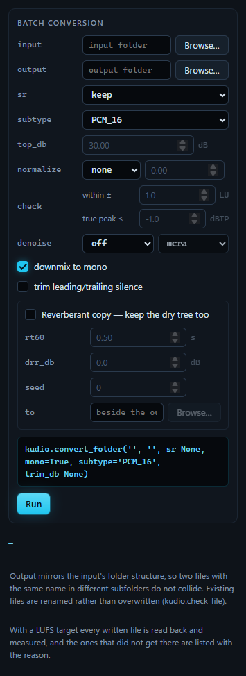

# 批次

{ .shot .side }

按一次「執行」處理整個資料夾：重新取樣、改變寫出格式、混為單聲道、修剪靜音、依峰值或響度調整音量、
降噪，再複製一份放進房間，寫到一棵結構與輸入相同的輸出樹。「執行」上方的框列出這次執行會做的事，
一輪一行，每一行都是負責那一輪的 kudio 呼叫。

設定 LUFS 目標時，每個檔案之後都會從磁碟讀回來，沒有達到目標的會連同原因列出。
我之所以用這個面板，而不是在腳本裡寫個迴圈，大半就是為了這份清單。

## 設定 {#the-settings}

| 設定 | 選項與預設值 | 作用 |
|---|---|---|
| 輸入 | 一個資料夾 | 其中與所有子資料夾裡的每個 WAV 檔 |
| 輸出 | 一個資料夾 | 轉換後的樹寫到這裡，結構與輸入相同 |
| `sr` | `keep`、48000、44100、32000、22050、16000、8000；`keep` | 重新取樣每個檔案 |
| `subtype` | `PCM_16`、`PCM_24`、`PCM_32`、`FLOAT`；`PCM_16` | 檔案的寫出格式 |
| `top_db` | 1–90 dB；30 | 修剪時，比峰值低這麼多的部分算作靜音 |
| `normalize` | `none`、`peak`、`LUFS`；`none` | 把每個檔案調整到旁邊填的目標；見[下文](#lufs-or-peak) |
| 檢查 | 容許 ± 0.1 到 6 LU，1；true peak ≤ −20 到 0 dBTP，−1 | 設定 LUFS 目標時，讀回檢查所用的兩個標準；見[下文](#the-loudness-report) |
| `denoise` | `off` 或一種方法，加上雜訊估計器；`off` | 在轉換之後為每個檔案降噪；見[下文](#denoise-before-levelling) |
| 混為單聲道 | 開 | 每個檔案都輸出為單一聲道；選了降噪時，不勾也一樣，見[下文](#the-order-of-the-passes) |
| 修剪開頭與結尾的靜音 | 關 | 依音量切掉兩端的安靜部分 |
| 殘響副本 — 同時保留乾聲樹 | 關 | 第二棵樹，放進房間；見[下文](#the-reverberant-copy) |

用不到的控制項會變灰：沒有修剪時的 `top_db`、沒有正規化時的目標值、沒有 LUFS 目標時的兩個讀回
標準、沒有選降噪方法時的雜訊估計器，以及殘響副本關閉時它的四個設定。

降噪方法就是[增強](enhance.md)面板的七種統計式方法，估計器則是它提供的四種，`mcra` 排第一；
在清單中把游標停在估計器上，可以看到它對雜訊的假設。

只會收集 WAV 檔，`.WAV` 也算，所以樹裡的 FLAC 或 MP3 會被略過。輸出資料夾放在輸入資料夾裡面
也沒關係，裡面的檔案不會被當成輸入收進來。轉換時不會覆寫輸出中已有的檔案：這次執行的檔案會改用
另一個檔名寫出（`kudio.check_file`）。

## 各輪的順序 {#the-order-of-the-passes}

所有設定都在按下「執行」時讀取，接著依這個順序處理：

1. `kudio.convert_folder` 以選定的取樣率讀入每個檔案，需要時混為單聲道，再修剪、調整音量、寫出。
2. `kudio.enhance_folder` 為轉換剛寫出的檔案降噪，就地覆寫。它自成一輪，是因為它要讀完整個檔案
   才能估計雜訊。寫出格式不變，寫成 `FLOAT` 的仍是浮點；聲道卻會變，因為它一律以單聲道讀入，
   所以選了降噪，不管有沒有勾「混為單聲道」，每個檔案都只剩一個聲道。
3. 同時有降噪與目標（LUFS 或峰值）時，音量到這一輪才調整，排在降噪之後，原因見[下文](#denoise-before-levelling)。
4. 殘響副本取前面各輪處理完的乾聲檔案來做。
5. 有 LUFS 目標時，把每個檔案讀回來檢查。這一步排在最後，量到的才是其他各輪處理完的檔案，
   殘響副本也包括在內。

全部打開、seed 維持預設的 0 時，「執行」上方的框是這樣：

```text
kudio.convert_folder('raw', 'out', sr=16000, mono=True, subtype='PCM_16', trim_db=30.0)
→ kudio.enhance_folder(converted.outputs, <their folder>, 'logmmse', noise='mcra', subtype='PCM_16', overwrite=True, report=True)
→ per file: kudio.normalize_lufs(y, sr, lufs=-23.0), after the denoise
→ per file: kudio.apply_rir(y, kudio.rir(sr, rt60=0.5, drr_db=0.0, seed=file_seed(0, path))), kudio.normalize_lufs(…, lufs=-23.0) → 'out_reverberant'
→ read back: kudio.loudness, kudio.true_peak — within ±1 LU of -23 LUFS, true peak ≤ -1 dBTP
```

seed 設為 −1 時，房間那一行寫的是 `file_seed(…, path)`，因為要按下「執行」才會抽出 seed。

`converted.outputs` 是轉換寫出的檔案清單，`<their folder>` 則是它們共同所在最深的那一層資料夾。
kudio 依清單中每個檔案在這個資料夾底下的相對路徑決定寫到哪裡；目的地也給同一個資料夾，
每個檔案降噪後就寫回原處。

## LUFS 或峰值 {#lufs-or-peak}

`peak` 依每個檔案最大的樣本縮放，而這與檔案聽起來多大聲無關：一個突兀的喀聲，
就能把整段音訊正規化成耳語。`LUFS` 依感知響度（ITU-R BS.1770）調整，
這才是來源混雜的資料集真正需要的。

這兩種目標是不同的量。峰值目標是滿刻度的比例，範圍 0.01 到 1.0，預設 0.99。響度目標以 LUFS
為單位，範圍 −60 到 0，預設 −23，也就是 EBU R 128 的標準。在兩者之間切換時，目標值會回到所選模式
的預設值，因為 −23 當峰值、0.99 當響度，都沒有意義。

只有 LUFS 目標會被讀回檢查。

## 響度報告 {#the-loudness-report}

`kudio.convert_folder(lufs=-23)` 對每個檔案套用增益。增益讓峰值超過滿刻度時，kudio 會在終端機
印出警告，只寫峰值、不寫是哪個檔案，對結果如何就只說這麼多。我真正想知道的，是哪些檔案沒辦法達標。
所以設定 LUFS 目標時，面板會把每個寫出的檔案讀回來量測，先用 `kudio.loudness`，再用
`kudio.true_peak`，對照兩個標準：容許誤差，預設 ±1 LU，與 `kudio loudness --target`
允許的範圍相同；以及 true peak 上限，預設 −1 dBTP，也就是 EBU R 128 的上限。

以五個檔案、目標 −23 LUFS 的樹為例，表單下方的結果是：

```text
已將 4/5 個檔案寫入 D:\corpus\out

從磁碟讀回的響度：1 / 5 個檔案在 -23 LUFS 的 ±1 LU 內，true peak 不超過 -1 dBTP。3 個未能達標，1 個達標但餘裕不足 — 列於下方。
```

下面接著這份清單：

```text
未能達標：
  in/b/short.wav               —  太短無法量測 — BS.1770 需要 0.4 秒，因此沒有寫出
  out/a/spiky.wav     -31.1 LUFS  在滿刻度削波 — -23 LUFS 需要高於 0 dBFS 的峰值；差 8.1 LU
  out/b/silent.wav             —  靜音 — 沒有音量可以拉高
已達標，但餘裕不足：
  out/c/plosive.wav   -23.0 LUFS  true peak +0.4 dBTP，超過 -1.0 dBTP 上限
```

狀態列則做個總結：`批次完成 — 已寫入 4/5 個，4 個未達響度目標。`清單已經寫出 `short.wav` 沒寫出的原因，所以它算在這四個裡，不再另算一個失敗。

量測的是磁碟上的檔案，而不是交給 `save_wave` 的資料，因為出問題的地方正是磁碟。定點格式的檔案會
把超過滿刻度的部分全部削掉，所以一個被拉高音量的安靜檔案，讀回來時峰值已經被削平，而寫出之前的
任何步驟都看不到這件事。上面的 `spiky.wav` 是一個只有一聲大喀聲的安靜檔案：−23 LUFS 會讓那聲喀聲
到達 +20 dBFS，16 位元的檔案把它削在滿刻度，結果整個檔案差了 8.1 LU。

每個檔案只列一個原因，取適用的原因中最基本的那個，檢查順序如下：

| 原因 | 意思 |
|---|---|
| 太短無法量測 | BS.1770 以 400 ms 為一個區塊做閘控，所以短於 0.4 秒的音訊根本沒有響度。由轉換負責調整音量時，這種檔案不會寫出，清單以輸入樹的路徑列出它；若是在降噪之後才調整音量，它會維持降噪後的樣子，並連同長度一起列出 |
| 無法讀回 | 寫出的檔案讀不回來 |
| 靜音 | 沒有音量可以拉高 |
| 在滿刻度削波 | 檔案的峰值正好落在滿刻度，也就是寫出時被削掉的地方。即使響度接近目標也會列出，因為它是靠削波達標的；若同時低於目標，後面會加上「差 … LU」 |
| 高了、低了 … LU | 與目標的差距超過容許誤差 |
| 峰值 … dBFS | 響度達標的 `FLOAT` 檔案，但峰值超過滿刻度，只有浮點檔案存得下；任何定點格式的副本都會削掉它們 |
| true peak … 超過上限 | 響度達標，但樣本之間的波形超出上限，遇到下一個轉換器或編解碼器時就會削波 |

前五種列在「未能達標」下，後兩種列在「已達標，但餘裕不足」下。寫成 `FLOAT` 時峰值會保留下來，
所以這時的報告會指出哪些檔案只有浮點格式存得下。

路徑從包含輸出資料夾的那一層開始顯示，所以 `out/…` 與 `out_reverberant/…` 可以並排對照；
轉換時被拒絕的檔案則從輸入資料夾的上一層開始顯示，例如 `in/…`。清單是純文字，可以直接複製出來。
報告已經說明過的失敗不會重複列出。其他失敗，例如無法解碼的檔案，寫在結果裡，接在響度那句話之後、
清單之前：先是「… 個失敗：」，接著每個檔案一行，最多五行，其餘的寫成「… 另有 … 個」。

## 先降噪，再調整音量 {#denoise-before-levelling}

降噪器在去除雜訊的同時，也會拿掉一些音量。先調整音量再降噪，整棵樹就會落在要求的目標之下。
所以同時設定降噪與目標時，不論是 LUFS 還是峰值，轉換都不動音量，先跑降噪，接著把每個轉換過的檔案
調整到目標，連降噪失敗的檔案也一樣。結果會寫明這一點：

```text
已在降噪之後調整到 -23 LUFS，因為降噪會連同雜訊拿掉一些音量。
已在降噪之後把峰值正規化到 0.99，因為降噪會連同雜訊拿掉一些音量。
```

第一行是 LUFS 目標，第二行是峰值目標；「執行」上方的框會把這一輪寫成 `kudio.normalize_lufs`
或 `kudio.normalize`。

降噪這一輪也會量測每個檔案處理前後的底噪，也就是「指標」面板上的[「底噪」](metrics.md#inspect-this-audio)，
結果裡列出平均值。某一次執行的結果是：

```text
底噪平均降低 22.2 dB — 這是量測去除了多少，不代表聽起來更好。請開一個來聽聽看。
```

本來就乾淨的資料夾，處理後只會更差，不會更好。

降噪這一輪只處理這次執行寫出的檔案。先前執行留在輸出資料夾裡的檔案，不會再降噪一次，
也不會算進結果。

## 殘響副本 {#the-reverberant-copy}

勾選「殘響副本 — 同時保留乾聲樹」，每個轉換後的檔案都會放進一個房間再寫一次，存到結構相同的
第二棵樹。乾聲檔案留在原處，所以兩棵樹可以依路徑配對：作為去殘響的輸入與目標，
或同一個語料庫的兩種條件。

| 設定 | 範圍與預設值 | 作用 |
|---|---|---|
| `rt60` | 0.05–5 秒；0.5 | 殘響尾巴衰減 60 dB 所需的時間：處理過的錄音室低於 0.3 秒，客廳約 0.5 秒，音樂廳超過 1.5 秒 |
| `drr_db` | −20 到 +30 dB；0 | 直達聲與殘響比：+10 以上是近距離麥克風，0 是一兩公尺外，負值是音樂廳的遠端 |
| `seed` | −1（random）到 2³¹ − 1；0 | 這次執行的 seed，每個檔案的房間都由它抽出 |
| 存到 | 一個資料夾；`<output>_reverberant` | 副本要寫到哪裡 |

副本需要自己的資料夾：預設是 `out` 旁邊的 `out_reverberant`，絕不放在輸出裡面。若指定的資料夾就是
輸出資料夾、在它裡面，或包住它，執行前就會被拒絕，因為副本會混進乾聲檔案中，下一輪處理輸出時，
會把它們當成更多的乾聲檔案。

每個檔案都有自己的房間：RT60 與 DRR 相同，殘響尾巴則由這次執行的 seed 與檔案在輸出底下的路徑決定，
跟 `kudio.Synthesizer` 為每個檔案抽房間的方式一樣。整個語料庫重複同一個房間，就只有一種聲學條件，
用它訓練的模型學到的就是那個房間。用路徑而不用檔名，是因為鏡像的樹會有重複的檔名；
不用檔案在清單中的位置，是因為加入一個檔案，位置就會變動。相同的 seed 會重建相同的房間。
設為 −1 時，會在按下「執行」時抽一個 seed，不論哪種情況，結果都會寫出用的是哪個 seed：

```text
殘響副本：已將 4/4 個寫入 D:\corpus\out_reverberant — 每個檔案各有自己的房間，seed 為 7；相同的 seed 會再產生相同的房間。
```

`kudio.rir` 把直達聲放在第一個樣本，`kudio.apply_rir` 則維持長度與峰值不變，所以殘響檔案與它的乾聲
檔案在樣本上是對齊的。沒有降噪時，保留多聲道的檔案，每個聲道都放進同一個房間；降噪過的檔案只剩
一個聲道。設定 LUFS 目標時，副本也會調整到該目標，因為房間會把能量移到殘響尾巴，而且副本會和其他
檔案一起被讀回檢查。

## 執行中結束程式 {#quitting-while-it-runs}

一次執行可能要花一段時間，而其中任何一步都無法中途停止：kudio 的呼叫沒有可以停下的地方。
在執行中用「檔案 → 結束」、++ctrl+q++ 或視窗的關閉按鈕結束程式，並不會打斷它。視窗會保持開啟，
狀態列顯示 `將在批次完成後結束 — 執行中的工作無法中途停止。`，等工作做完再自己關閉，
所以一棵樹永遠不會只寫到一半。合成或其他任何執行中的工作也是一樣。

同一時間只會有一個批次在執行。執行期間，按鈕變成灰色的「執行中…」。這段期間可以修改表單，
不會影響正在進行的那一次，因為所有設定都在它開始時就讀取了。
