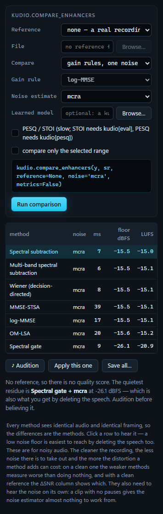

# Compare

{ .shot .side }

Applying one denoiser, listening, undoing and trying the next is how you end
up with whichever one you happened to try last. Compare runs them all over the
same audio with the same framing, measures each, and puts them in one table,
where any row can be heard without committing to it. The line above **Run
comparison** shows the `kudio.compare_enhancers` call the controls describe.

## Setting up a run

### The reference

What the numbers can say depends on whether there is a clean version of the
clip to measure against. **Reference** offers three answers:

| Reference | When it is the right one |
|---|---|
| none — a real recording has no clean version | the default, and the honest choice for any real recording. The table then shows what can be measured without one: the noise floor left behind, and the loudness |
| the original, before this session's edits | you made the noisy clip yourself, say by opening a clean file and adding noise with `add_noise_snr` in [Effects](effects.md#the-effects). The file as it was opened is the truth to score against; at another sample rate it is resampled to the clip's |
| a file… | the clean version is a file of its own: the clean half of a synthetic dataset, a studio take. Choose it under **File**, which is greyed out for the other two; it is read at the clip's sample rate |

The reference is set against each result sample by sample, so it has to be
the same take, lined up. After a cut, the original is longer than the clip and
out of step with everything after the cut; once more than half of the longer
one would go unmeasured, kudio refuses to score at all and the comparison
fails.

A real recording you have not edited has the noisy file itself as its
original. Scored against that, every method measures worse than leaving it
alone, and the [verdict](#the-verdict) says so.

### What to sweep

Denoising is two choices, a gain rule and a noise estimator, and **Compare**
picks which of them to vary:

| Compare | Rows |
|---|---|
| gain rules, one noise estimator | the seven gain rules, each with the estimator in **Noise estimate** (`mcra` to start with) |
| noise estimators, one gain rule | the four estimators, each with the gain rule in **Gain rule** (log-MMSE to start with) |
| everything — the full grid | all 28 pairs |

The picker for the axis being swept is greyed out, since holding it at one
value would contradict the sweep, and on the full grid both are. Which of the
two matters more depends on the clip, which is the reason to sweep both rather
than assume; the [verdict](#the-verdict) says which one moved this clip more.

Each row runs with kudio's defaults, a 512-sample frame and every parameter at
its starting value, so a row is exactly what the [Enhance](enhance.md) panel
gives for that method and estimator before any of its controls is touched.
Enhance is where to tune the one you picked.

### Other options

**Learned model** adds a trained model to the table; it has
[a section of its own](#a-trained-model-in-the-same-table).

**PESQ / STOI (slow; STOI needs kudio[eval], PESQ needs kudio[pesq])** adds
the two perceptual scores to the table. They need a reference, and over a grid
of 28 they take a while. kudio computes PESQ only at 8 and 16 kHz, so at any
other rate its column stays empty.

**compare only the selected range** runs on the selection alone. It is faster,
and it lets you judge one difficult passage, but the noise estimators then see
only that range, which changes the result. A range shorter than 512 samples is
refused.

**Run comparison** starts it. The status bar says how many combinations are
running, and how many succeeded when they are done. If the clip is edited
while they run, the results are dropped, since they describe audio the session
does not hold, and the status bar asks for another run. Any later change to
the clip empties the table for the same reason.

## The table

| Column | What it holds |
|---|---|
| method | the gain rule, by kudio's label; a learned model by the name of its run directory |
| noise | the noise estimator; `own` for a learned model, which brings its own |
| ms | how long the denoise took. kudio runs each method once over the first second before it starts the clock, so the first row is not charged for the one-time cost of compiling and importing |
| floor dBFS | the noise floor left in the result, from `kudio.audio_report` |
| LUFS | the integrated loudness of the result |
| SI-SDR | against the reference, in dB |
| ΔSNR | the result's SNR against the reference, minus the untouched input's: how much better than leaving it alone, which is the number that answers "did this help" |
| PESQ, STOI | the perceptual scores, when their box is ticked |

Without a reference the last four columns are hidden, as there is nothing for
them to measure against. LUFS is worth reading beside the floor: a row whose
loudness has dropped well below the others' took out more than noise.

A row that failed stays in the table, marked, with the error in place of its
numbers. One failure does not stop the comparison, which exists to find out
which methods work. A failed row cannot be heard, applied or saved.

### Sorting

Click a heading to sort by it, and again to reverse. The scores, SI-SDR, ΔSNR,
PESQ and STOI, sort best first on the first click; ms, floor dBFS and LUFS
lowest first. method and noise put the rows back in the order kudio ran them.
Empty cells go to the bottom either way.

A comparison opens ranked by SI-SDR, best first, when there is a reference.
Without one it opens in kudio's order, because then there is nothing to rank
by: sorted by the floor, the top row would be the one most likely to have
deleted speech. Running the same sweep again keeps your sort and your
selection.

## Hearing the rows

Click a row to select it, ++ctrl++-click to add or drop one, ++shift++-click
to select a run of rows. **♪ Audition** loops the selected row and commits
nothing. Click another row while it plays and the loop moves to it.

Select two or more and the button becomes **♪ Audition A→B**: the rows play
back to back on a loop, with 0.35 s of silence at each seam. That is the
comparison people actually make, and clicking from row to row instead puts a
gap and a mouse movement in the middle of the only thing being judged. A third
of a second is long enough to hear the switch as a switch, and short enough
not to lose the thread.

The rows play in the table's order, top to bottom, whatever order they were
clicked in, and re-sorting while they play re-orders the loop. So "the second
one sounds better" is a sentence about the ranking. The status bar names what
is playing:

```text
Auditioning logmmse + quantile → wiener + mcra — nothing has been committed.
```

What plays is what the comparison ran on: the whole clip, or the selected
range.

## Keeping a result

**Apply this one** takes exactly one row; with more selected it is greyed out,
and its tooltip asks for one. The row goes back over the range it was computed
from: the whole clip, or the range that was selected when the comparison ran.
What is selected when you press it, and whether **compare only the selected
range** is still ticked, make no difference. A two-second row pasted into a
half-second selection would lengthen the clip by a second and a half, and a
half-second row put over the whole clip would throw the rest of it away. It is
one undo step named after the row, and the status bar suggests ++ctrl+b++ to
[A/B it against the original](../editing.md#ab-against-the-original).
Applying is an edit, and the table describes the audio before it, so the table
empties.

The step goes into the history as the call that computes the row again from
the audio it replaces, so an
[exported script](../editing.md#your-edits-as-a-script) repeats it:

```python
y = np.asarray(kudio.spectral_enhance(y, sr, 'logmmse', noise='quantile'), dtype=np.float32)
```

A row computed on a selection is the same call on the same samples, cut out
first and joined back between what comes before and after them:

```python
head, y, tail = y[:8000], y[8000:16000], y[16000:]  # 0.500–1.000 s
y = np.asarray(kudio.spectral_enhance(y, sr, 'logmmse', noise='mcra'), dtype=np.float32)
y = np.concatenate([head, y, tail])
```

**Save all…** writes every row that did not fail to a folder you choose, at
the clip's sample rate, as `<clip>_<method>_<estimator>.wav`:
`clip_logmmse_quantile.wav`, or `clip_exp1_own.wav` for a model whose run
directory is `exp1`. The estimator is in the name because on a grid several
rows share a method and would otherwise overwrite each other. It is there for
comparing them outside the window.

## The verdict

Under the buttons, one paragraph says what the table shows, and is careful
about what it does not.

With a reference, it names the best row by SI-SDR and, by that row's ΔSNR, how
far it beat leaving the clip alone. When both axes were swept, it adds which of
the two moved this clip more. In one run on a synthetic voiced clip with
pauses, six seconds in white noise at 5 dB SNR, the full grid ended:

```text
Best against the reference: MMSE-STSA + quantile at +13.32 dB SI-SDR, +8.43 dB better than leaving it alone.
The noise estimator moved this clip more than the gain rule did (15.9 dB against 6.8 dB).
```

The two figures are spreads. The gain rule's is how far apart the gain rules
landed with each estimator, averaged over the estimators; the noise
estimator's is the same measured the other way round. I take the mean rather
than the widest, so that one lucky combination does not decide which axis
matters. When the two come within 20% of each other, the line says they moved
the clip about equally and that neither is the one to spend the effort on,
rather than crown an axis on a 0.1 dB difference. A learned row sits on
neither axis and is left out of it.

Even with a reference, one score is not a ranking. In that same run the best
STOI, 0.542 for Wiener (decision-directed) + mcra, came tenth by SI-SDR.

SI-SDR ignores level and ΔSNR does not, so the best row by SI-SDR can have lost
SNR while another row gained some. The verdict then says that the first did not
beat leaving it alone, with its ΔSNR, and names the row that beat it by the
most in a sentence of its own. Each sentence quotes the measure it ranked by.

Without a reference there is no quality score, and the verdict says so:

```text
No reference, so there is no quality score. The quietest residue is Wiener (decision-directed) + quantile at -41.0 dBFS — which is also what you get by deleting the speech. Audition before believing it.
```

The lowest floor is the easiest thing to reach by deleting the speech along
with the noise, so I have it name the quietest row and doubt it in the same
breath. Without a reference the table is a shortlist, and listening is the
verdict. On the clip above, the row it named came fourth of 28 by SI-SDR once
the clean original was there to score against.

When no row's ΔSNR is above zero, the verdict does not crown the least bad
one. It opens with **No method beat leaving it alone**, names the row that
came closest by ΔSNR, with that ΔSNR, and says what that usually means: the
reference is not clean, and scoring against the noisy recording measures how
much the audio changed, not whether it improved.

The note under the verdict adds two limits of the methods themselves. They are
for noisy audio: on a clean recording the distortion they add can cost more
than the noise they remove, and ΔSNR goes below zero. And they need to hear
the noise on its own, so a clip with no pauses gives the noise estimators
almost nothing to work from.

## A trained model in the same table

Point **Learned model** at a
[kudioenhance](https://pypi.org/project/kudioenhance/) run directory, the same
kind the [Enhance](enhance.md) panel loads, and the model gets a row of its
own, scored against the same reference on the same audio. "Is the model
actually better than log-MMSE" is not a question two separate printouts
answer. The call above Run comparison lists it as `('exp1', model.enhance)`:

```python
kudio.compare_enhancers(y, sr, ['logmmse', ('exp1', model.enhance)], reference=ref, noises=list(kudio.NOISE_ESTIMATORS), metrics=False)
```

- It runs once whatever the sweep, since it brings its own noise handling. Its
  noise column reads `own`, and with it the full grid has 29 rows.
- Before the comparison starts, the model is loaded and run once over the
  first half second. Loaded inside its row, it would be charged for importing
  PyTorch and reading the checkpoint, for a small model hundreds of times what
  the denoise costs, in a column whose only use is setting rows against each
  other. The extra pass pays the one-time set-up a network has on its first
  run. Its ms is the denoise.
- The model is kept for the next comparison on the same directory, and loaded
  again when the run's files on disk change, as they do when it is trained
  again.
- A clip at another rate than the model's goes in at the model's rate and comes
  back at its own, as in Enhance with the resample box ticked.
- A model that will not load or run fails its own row, with the reason, and
  the other rows stand.
- With a folder in **Learned model** but without kudioenhance and PyTorch, the
  call above Run comparison gives way to the line saying how to install them,
  and Run comparison reports the same and does not start.
- A path that is not a folder, usually a typo, adds no row, and the verdict
  ends on a line saying so: `No learned row: runs/exp9 is not a folder.`

Applied, the model's row is recorded the way Enhance records a learned
denoise, as `Enhancer.load(run_dir).enhance(y)` with the model files checked
by SHA-256 first; see [Your edits as a script](../editing.md#your-edits-as-a-script).
