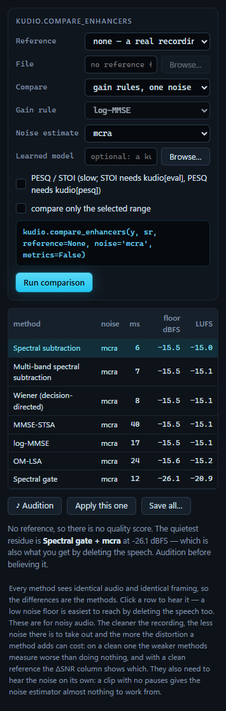

# 比較

{ .shot .side }

套用一種降噪器、聽一聽、復原、再試下一種，最後留下的只會是你剛好最後試的那一種。「比較」面板
在同樣的音訊上、以同樣的分幀跑過所有降噪器，逐一量測，排進同一張表，表中任何一列都能先試聽，
不必提交。「執行比較」上方那一行，是控制項所描述的 `kudio.compare_enhancers` 呼叫。

## 設定一次比較 {#setting-up-a-run}

### 參考訊號 {#the-reference}

數字能說明什麼，取決於有沒有一份乾淨的版本可以對照。「參考訊號」有三個選項：

| 參考訊號 | 適用的情況 |
|---|---|
| 無 — 真實錄音沒有乾淨版本 | 預設值，也是面對真實錄音時誠實的選擇。表格只列出沒有參考訊號也量得到的東西：殘留的底噪與響度 |
| 原始音訊（本次工作階段編輯之前） | 含噪的音訊是你自己做出來的，例如開啟一個乾淨的檔案，再用[效果](effects.md#the-effects)面板的 `add_noise_snr` 加上雜訊。剛開啟時的檔案就是評分的標準答案；取樣率不同時，會重新取樣到音訊的取樣率 |
| 檔案… | 乾淨的版本是另一個檔案：合成資料集裡的乾淨語音、錄音室的錄音。在「檔案」欄選擇它，選其他兩項時這一欄是灰的；檔案會以音訊的取樣率讀入 |

參考訊號與每個結果是逐樣本比對的，所以它必須是同一段錄音，而且對齊。剪掉一段之後，原始音訊比編輯版本長，
剪接點之後的每個樣本都錯開了；較長那一方若有超過一半的部分量不到，kudio 會直接拒絕評分，整次比較以失敗收場。

一段沒有編輯過的真實錄音，它的原始音訊就是含噪的那個檔案本身。拿它當參考訊號，每種方法量起來
都會比不處理還差，[結論](#the-verdict)也會直接這樣說。

### 要掃描哪一個軸 {#what-to-sweep}

降噪包含兩個選擇：增益規則與雜訊估計器。「比較」決定要變動哪一個：

| 比較 | 產生的列 |
|---|---|
| 增益規則（固定一種雜訊估計器） | 七種增益規則，各搭配「雜訊估計」選的估計器（起始為 `mcra`） |
| 雜訊估計器（固定一種增益規則） | 四種估計器，各搭配「增益規則」選的方法（起始為 log-MMSE） |
| 全部 — 完整網格 | 全部 28 種組合 |

正在掃描的那個軸，它的選單會變灰，因為把它固定在某個值，就和掃描本身矛盾；完整網格時兩個都是灰的。
兩個選擇哪一個影響較大，因音訊而異，這正是要掃描、而不是憑假設的理由；[結論](#the-verdict)
會說明對這段音訊來說是哪一個。

每一列都用 kudio 的預設值執行：512 樣本的幀，每個參數都是起始值。所以一列的結果，
與[增強](enhance.md)面板在同樣的方法與估計器、還沒動過任何控制項時得到的完全相同。
要調整你挑中的那一個，就到增強面板去。

### 其他選項 {#other-options}

「學習式模型」把訓練好的模型加進表格，[下文](#a-trained-model-in-the-same-table)另有說明。

「PESQ / STOI（較慢；STOI 需要 kudio[eval]，PESQ 需要 kudio[pesq]）」在表格中加上這兩個感知分數。
它們需要參考訊號，在 28 列的網格上也要花上一段時間。kudio 只在 8 kHz 與 16 kHz 計算 PESQ，
其他取樣率下這一欄會是空的。這裡的 PESQ 是 MOS-LQO，也就是 kudio 與「指標」面板的預設；
要放到論文的數字旁邊之前，先看 [PESQ：MOS-LQO 還是 raw](metrics.md#pesq-mos-lqo-or-raw)。

「只比較選取範圍」只處理選取的那一段。這樣比較快，也方便評判某一段特別難處理的片段，
但雜訊估計器也只看得到那一段，結果會因此不同。短於 512 個樣本的範圍會被拒絕；沒有選取時，
比較的就是整段音訊。

按「執行比較」開始。狀態列會說明要跑幾種組合，跑完時說明成功了幾種。比較進行中若音訊被編輯了，
結果會被捨棄，因為它們描述的不是工作階段裡的這份音訊，狀態列會請你重新執行。
之後音訊的任何改動，也會因為同樣的理由清空表格。

## 表格 {#the-table}

| 欄位 | 內容 |
|---|---|
| method | 增益規則，以 kudio 的標籤顯示；學習式模型則顯示它的執行目錄名稱 |
| noise | 雜訊估計器；學習式模型自帶雜訊處理，顯示為 `own` |
| ms | 降噪花了多少毫秒。kudio 在開始計時之前，會先讓每種方法在前一秒的音訊上跑一次，免得第一列替所有人付了編譯與匯入的一次性成本 |
| 底噪 dBFS | 結果中殘留的底噪，出自 `kudio.audio_report` |
| LUFS | 結果的整合響度 |
| SI-SDR | 相對於參考訊號，單位 dB |
| ΔSNR | 結果相對於參考訊號的 SNR，減去未處理輸入的 SNR：比不處理好了多少，也就是回答「這樣做有沒有用」的那個數字 |
| PESQ、STOI | 感知分數，勾選對應的核取方塊才會計算 |

沒有參考訊號時，最後四欄會隱藏，因為它們沒有東西可以對照。LUFS 值得和底噪一起看：
某一列的響度若明顯低於其他列，它去掉的就不只是雜訊。

失敗的列會留在表格中，加上標記，並以錯誤訊息取代數字。一列失敗不會讓整次比較停下，
畢竟比較的目的就是找出哪些方法行得通。失敗的列無法試聽、套用或儲存。

### 排序 {#sorting}

點欄位標題就依該欄排序，再點一次反過來。分數欄（SI-SDR、ΔSNR、PESQ、STOI）第一次點會把最好的
排在最上面；ms、底噪 dBFS 與 LUFS 則由低到高。method 與 noise 會把各列放回 kudio 執行它們的順序。
空白的格子不論方向都排在最後。

有參考訊號時，比較結果一出來就依 SI-SDR 由好到壞排好。沒有參考訊號時則照 kudio 的順序，
因為這時沒有東西可以排名：若依底噪排序，排在最上面的會是最可能把語音也刪掉的那一列。
同樣的掃描再跑一次，你的排序與選取都會保留。

## 試聽 {#hearing-the-rows}

點一列就選取它，按住 ++ctrl++ 點擊可以加選或取消，按住 ++shift++ 點擊則選取連續的幾列。
「♪ 試聽」循環播放選取的那一列，不提交任何變更。播放中點另一列，播放就跟著換過去。

選取兩列以上，按鈕會變成「♪ 試聽 A→B」：這幾列接連循環播放，每個接縫處有 0.35 秒的靜音。
這才是大家實際在做的比較；改成在列與列之間來回點，等於在唯一要評判的東西中間，
塞進一段空檔和一次滑鼠移動。三分之一秒，長到聽得出那是一次切換，又短到不會忘了剛才聽到什麼。

各列依表格的順序由上到下播放，與點選的先後無關；播放中重新排序，循環的順序也會跟著改。
所以說「第二段聽起來比較好」，指的就是表格裡排第二的那一列。狀態列會說明正在播放什麼：

```text
試聽中：logmmse + quantile → wiener + mcra — 尚未提交任何變更。
```

播放的是比較時處理的範圍：整段音訊，或選取的那一段。

## 留下結果 {#keeping-a-result}

「套用這一個」只接受恰好一列；選了不只一列時按鈕是灰的，提示會請你只選一列。那一列會放回它當初算出來的範圍：
整段音訊，或比較執行時選取的那一段。按下時選取的是哪裡、「只比較選取範圍」是否還勾著，都不影響結果。
把兩秒的結果貼進半秒的選取範圍，音訊會多出一秒半；把半秒的結果蓋過整段音訊，其餘部分就全沒了。
它是一個以該列命名的復原步驟，狀態列也會提醒你
用 ++ctrl+b++ [與原始音訊做 A/B 比較](../editing.md#ab-against-the-original)。
套用是一次編輯，而表格描述的是編輯之前的音訊，所以表格會清空。

這一步會以「從它所取代的音訊重新算出這一列」的呼叫，記進復原紀錄，
[匯出的腳本](../editing.md#your-edits-as-a-script)也就會重做它：

```python
y = np.asarray(kudio.spectral_enhance(y, sr, 'logmmse', noise='quantile'), dtype=np.float32)
```

在選取範圍上算出的那一列，是同樣的呼叫作用在同樣的樣本上：先把那一段切出來，算完再接回前後的音訊之間：

```python
head, y, tail = y[:8000], y[8000:16000], y[16000:]  # 0.500–1.000 s
y = np.asarray(kudio.spectral_enhance(y, sr, 'logmmse', noise='mcra'), dtype=np.float32)
y = np.concatenate([head, y, tail])
```

「全部儲存…」把每一列沒有失敗的結果，以音訊的取樣率寫進你選的資料夾，檔名是
`<音訊名稱>_<方法>_<估計器>.wav`：例如 `clip_logmmse_quantile.wav`；執行目錄為 `exp1` 的模型
則是 `clip_exp1_own.wav`。檔名裡有估計器，是因為在網格中好幾列共用同一種方法，否則會互相覆寫。
這是為了在視窗之外比較它們。

## 結論 {#the-verdict}

按鈕下方有一段文字，說明表格呈現了什麼，也小心不去說它沒有呈現的事。

有參考訊號時，它會指出 SI-SDR 最好的一列，並以那一列的 ΔSNR 說明它比不處理好了多少。兩個軸都掃描時，
還會加一句，說明對這段音訊影響較大的是哪一個。有一次在一段六秒、有停頓的合成濁音上，
加上 5 dB SNR 的白雜訊，完整網格的結論是：

```text
相對於參考訊號最佳：MMSE-STSA + quantile，SI-SDR +13.32 dB，比不處理好 +8.43 dB。
這段音訊受雜訊估計器的影響比增益規則大（15.9 dB 對 6.8 dB）。
```

這兩個數字是分散程度。增益規則的那個數字，是固定每一種估計器，看各增益規則的結果相差多遠，
再對所有估計器取平均；雜訊估計器的則反過來算。我取平均而不是最大差距，免得一組剛好走運的組合，
就決定了哪個軸重要。兩者相差在 20% 以內時，這一句會說兩者的影響差不多、哪一個都不特別值得花力氣，
而不是為了 0.1 dB 的差距硬選出一個軸。學習式模型那一列不屬於任何一個軸，不納入這個計算。

即使有參考訊號，單一分數也不等於排名。同一次執行裡，STOI 最好的是 Wiener (decision-directed) + mcra
的 0.542，依 SI-SDR 卻排第十。

SI-SDR 不看音量，ΔSNR 則會看，所以 SI-SDR 最好的那一列，SNR 可能反而變差，同時另一列卻有改善。
這時結論會說前者沒有勝過不處理，附上它的 ΔSNR，再另起一句，指出勝過不處理最多的那一列。
每一句引用的，都是它排名所依據的那個量。

沒有參考訊號時就沒有品質分數，結論也會這樣說：

```text
沒有參考訊號，所以沒有品質分數。殘留最小的是 Wiener (decision-directed) + quantile，為 -41.0 dBFS — 這也正是把語音刪掉會得到的結果。相信之前請先試聽。
```

最低的底噪，最容易靠著把語音連同雜訊一起刪掉來達成，所以我讓它點出最安靜的那一列，
又在同一句裡提醒你別急著相信。沒有參考訊號時，表格只是一份候選名單，試聽才是結論。
在上面那段音訊上，這裡點名的那一列，等到有乾淨的原始音訊可以評分，依 SI-SDR 在 28 列中排第四。

沒有任何一列的 ΔSNR 大於零時，結論不會從中挑一個「最不差」的當贏家。它會以**沒有任何方法勝過不處理**
開頭，指出 ΔSNR 最接近的一列與它的 ΔSNR，並說明這通常代表什麼：參考訊號不乾淨，而拿含噪錄音評分，
量到的是音訊被改動了多少，而不是有沒有改善。

結論下方的說明，再補上這些方法本身的兩個限制。它們是為含噪音訊設計的：在乾淨的錄音上，
它們帶來的失真可能比去掉的雜訊代價更高，ΔSNR 就會變成負的。它們也需要聽到單獨的雜訊，
所以一段沒有停頓的音訊，幾乎不給雜訊估計器任何可用的東西。

## 訓練好的模型也在同一張表裡 {#a-trained-model-in-the-same-table}

把「學習式模型」指向一個 [kudioenhance](https://pypi.org/project/kudioenhance/) 執行目錄
（和[增強](enhance.md)面板載入的是同一種），模型就會得到自己的一列，在同樣的音訊上、
以同樣的參考訊號評分。「模型真的比 log-MMSE 好嗎」不是兩份分開的輸出能回答的問題。
「執行比較」上方的呼叫會把它列成 `('exp1', model.enhance)`：

```python
kudio.compare_enhancers(y, sr, ['logmmse', ('exp1', model.enhance)], reference=ref, noises=list(kudio.NOISE_ESTIMATORS), metrics=False)
```

- 不論掃描哪一個軸，它都只跑一次，因為它自帶雜訊處理。noise 欄顯示 `own`，
  加上它，完整網格共有 29 列。
- 比較開始之前，模型會先載入，並在前半秒的音訊上跑一次。若在它自己那一列裡才載入，
  匯入 PyTorch 與讀取 checkpoint 的時間都會算到它頭上；對小模型來說，那是降噪本身的好幾百倍，
  而這一欄唯一的用途，就是讓各列互相比較。多跑的那一次，則先付掉網路第一次執行時才有的設定成本。
  所以它的 ms 就是降噪本身。
- 模型會保留給同一個目錄的下一次比較，目錄裡的檔案在磁碟上有變動時，例如重新訓練過，才重新載入。
- 取樣率與模型不同的音訊，會以模型的取樣率送進去，再以自己的取樣率回來，
  和增強面板勾選重新取樣時一樣。
- 載入或執行失敗的模型，只有它自己那一列失敗並寫出原因，其他列照常。
- 「學習式模型」填的是資料夾，卻沒有安裝 kudioenhance 與 PyTorch 時，「執行比較」上方的呼叫
  會換成安裝說明，按「執行比較」也會顯示同樣的訊息，不會開始執行。
- 指向的路徑不是資料夾時（通常是打錯字），不會加上這一列，結論最後會有一行說明：
  `沒有學習式模型那一列：runs/exp9 不是資料夾。`

套用模型那一列時，記錄的方式和增強面板記錄學習式降噪相同：寫成 `Enhancer.load(run_dir).enhance(y)`，
並先以 SHA-256 檢查模型檔案；見[把編輯匯出成腳本](../editing.md#your-edits-as-a-script)。
