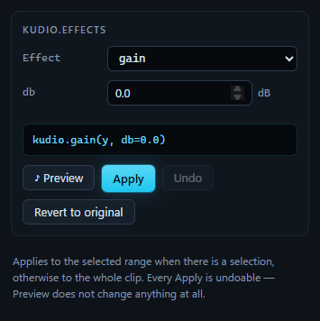

# Effects

{ .shot .side }

One kudio effect at a time, on the selection when there is one and on the
whole clip when there is not. Choose the effect from **Effect**, set its
parameters, and the line above the buttons shows the call **Apply** will make.
That same call goes into the undo history, and from there into an
[exported script](../editing.md#your-edits-as-a-script).

## Preview, Apply, Undo

**♪ Preview** plays the effect over the selection, or the whole clip, and
changes nothing: no
edit, no undo step. It loops, so finding the right `top_db` is a matter of
listening rather than apply, listen, undo, again. Change a parameter while it
plays and it renders again, 120 ms after the last change. Preview and Apply
run the same code on the same audio, so what you hear is what Apply will
commit. A random [seed](#seeds) is the exception: every render draws again,
Apply included, so set a seed when the result you heard is the one you want.

Anything else that claims playback ends the audition and releases the button:
Play, Stop, an edit, another panel's preview.

**Apply** makes the edit. **Undo** takes back the last one and **Revert to
original** drops them all; both are the same as in the
[Edit menu](../editing.md#undo-and-revert).

An effect applied to a selection replaces the range with a processed copy of
itself, with no crossfade at its edges: blending them back would leave a few
milliseconds at each end without the effect.

## The effects

Parameter names are kudio's, so the call in the caption reads the same as the
controls.

### Level and fades

| Effect | Parameters | What it does |
|---|---|---|
| `gain` | `db` | a fixed gain |
| `random_gain` | `db_range` low and high, `seed` | a gain drawn from the range |
| `fade_in`, `fade_out` | `duration`, `shape` | a fade at the start or the end; `shape` is `linear`, `cosine` or `exponential` |
| `fade` | `fade_in_s`, `fade_out_s`, `shape` | both at once |
| `reverse` | | the selection backwards |
| `remove_dc` | | subtracts the mean, per channel. An offset that drifts over a long recording is a very low frequency, which is a job for `highpass` |

### Filters and pitch

| Effect | Parameters | What it does |
|---|---|---|
| `highpass`, `lowpass` | `cutoff`, `order`, zero-phase | a Butterworth filter. Zero-phase, on by default, runs it forwards and backwards so nothing moves in time |
| `bandpass`, `bandstop` | `low`, `high`, `order` | a band kept or taken out. `bandstop` starts at 45–55 Hz, around 50 Hz mains hum |
| `pitch_shift` | `n_steps` | up or down, in semitones, keeping the length |
| `time_stretch` | `rate` | faster or slower, keeping the pitch; the length changes |

A cutoff cannot go above half the clip's sample rate. The controls stop
there, rather than letting Apply fail on it.

### Rooms

| Effect | Parameters | What it does |
|---|---|---|
| `reverb` | `decay`, `delay_ms` | an echo every `delay_ms`, each `decay` times the one before: cheap, and not a room |
| `room` | `rt60`, `drr_db`, `seed` | a generated impulse response, from `kudio.rir`: how long the tail takes to fall 60 dB, and how loud the direct sound is against it |
| `measured_room` | an impulse response file, start at the direct sound | a room someone measured; [below](#a-room-someone-measured) |

### Noise and channels

| Effect | Parameters | What it does |
|---|---|---|
| `add_noise_snr` | a noise file, `snr_db`, `seed` | noise from a file, mixed in at the SNR asked for |
| `telephone` | `codec` | a phone line: band-limited and resampled, with G.711 μ-law or A-law companding, or `none` to hear the line without the codec |
| `bit_depth` | `bits`, dither, `seed` | fewer bits. With dither ticked, a triangular (TPDF) dither two steps wide, peak to peak, goes in before rounding |
| `dropouts` | `loss`, `packet_ms`, `burst`, `conceal`, `seed` | lost packets, as on a VoIP link; [below](#lost-packets) |

### Silence and speech

| Effect | Parameters | What it does |
|---|---|---|
| `trim_silence` | `top_db`, `frame_length`, `hop_length` | cuts quiet audio off both ends, by level |
| `vad_trim` | `threshold_db`, `pad` | cuts both ends down to the first and last speech `kudio.vad` finds; [below](#speech-not-level) |
| `split_on_silence` | `top_db`, `frame_length`, `hop_length` | finds the non-silent stretches without changing anything; [below](#splitting-on-silence) |

### Seeds

A `seed` of −1 shows as `None` or `random`, and draws a new result every time.
Any other value gives the same result every time, so a room or a dropout
pattern can be rebuilt later. Apply on a random seed still records the seed it
drew, and an exported script repeats that result rather than rolling again.

## A room someone measured

`room` builds a statistical room from an RT60 and a DRR: reproducible, a few
controls, and no early reflections. That is what augmentation wants, and not
what a particular hall sounds like. **`measured_room`** takes an impulse
response from a file instead and applies it with `kudio.apply_rir`. The file is
read the way the recorded call reads it, with `kudio.file_load` at the clip's
rate and in mono, and read again if the clip changes rate, so Preview, Apply
and an exported script all use the same samples:

```python
y = kudio.apply_rir(y, kudio.file_load('/rooms/hall.wav', sr=sr)[0][192:])
```

The `[192:]` is **start at the direct sound**, on by default. A measured
response begins with the time the sound took to reach the microphone, and left
in, that delays the audio: a processed selection comes back late against its
neighbours. This starts the response at its loudest sample, which is the
direct sound in any ordinary room, and where `kudio.rir` puts it.

Under the file, `kudio.rt60` reads the response as it will be applied,
resampled, mixed to mono and trimmed, so a hall measured at 48 kHz and applied
at 8 kHz is described as what is left of it:

```text
0.91 s at 16000 Hz, direct sound at 12.0 ms — applied from there
T30 0.59 s (EDT 0.54 s)  ·  C50 +9.4 dB  ·  DRR +3.0 dB  ·  fit 1.000
```

A file that is not an impulse response, a speech take say, can still produce
a T30. When the decay is not a straight line, or its EDT and T30 disagree, the
reading says so and turns red. Even steady noise gets one: the decay curve is
the energy still to come, which reaches zero at the end of any file, so 5 s of
white noise reads a T30 of several seconds, with an EDT more than four times as
long and a fit of about 0.77, in red.

## Lost packets

`dropouts` drops whole packets, the way a VoIP link loses them.

- `loss` is the fraction of packets dropped, and it is achieved exactly, so a
  corpus labelled 5% carries 5%.
- `packet_ms` is the packet length, 20 ms by default as in G.711 over RTP. It
  decides whether the damage comes as many short holes or a few long ones, not
  how much of it there is.
- `burst` is the mean run length of a loss. Real links lose packets in runs,
  and a run is far harder to conceal than the same packets scattered, because
  there is no recent speech left to repeat. `independent` is not runs of one:
  independent draws land side by side sometimes, and already average
  1/(1 − loss), 1.05 packets at 5%.
- `conceal` fills a hole with `silence`, or with `hold`, which repeats the last
  packet that arrived. Whether `hold` measures better than a hole depends on
  whether the repeat lands in phase, an accident of the talker's pitch against
  the packet length, so a waveform metric cannot choose between them. Across a
  burst it tiles one packet over the whole gap, and there it is plainly worse.

## Speech, not level

`trim_silence` and `split_on_silence` cut on level alone. That works on a
studio take and falls apart on anything with a fan in the background: above
some noise level no fixed `top_db` both keeps the quiet consonants and drops
the room.

`vad_trim` decides frame by frame against the recording's own noise floor,
with `kudio.vad`, and uses spectral flatness to tell a voice from a hiss. `pad`
keeps a little audio either side of the speech, and a clip with no speech
found in it comes back untouched rather than empty. The same detector is behind
**Find speech** in the [marker list](../editing.md#markers).

## Splitting on silence

`split_on_silence` cannot be previewed, because it changes nothing. Apply
reports how many non-silent segments it found and how long they are in all,
and **Save segments…** then writes each one to a folder as its own WAV file,
numbered after the clip: `clip_001.wav`, `clip_002.wav` and so on.
