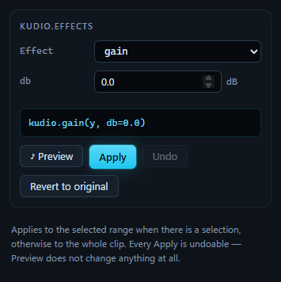

# 效果

{ .shot .side }

一次套用一種 kudio 效果：有選取範圍時作用在選取範圍上，沒有時作用在整段音訊。從「效果」選一種，
設定它的參數，按鈕上方那一行就會顯示「套用」將執行的呼叫。同一個呼叫會寫進復原紀錄，
再從那裡進入[匯出的腳本](../editing.md#your-edits-as-a-script)。

## 預覽、套用、復原 {#preview-apply-undo}

「♪ 預覽」把效果套在選取範圍（或整段音訊）上播放，而且不改變任何東西：沒有編輯，也沒有復原步驟。
它會循環播放，所以找出合適的 `top_db` 是靠聽，而不是套用、聽、復原、再來一次。播放中改參數，
它會在最後一次改動後 120 ms 重新算繪。預覽與套用在同樣的音訊上執行同樣的程式碼，
所以你聽到的就是「套用」將會寫入的結果。隨機的 [seed](#seeds) 例外：每次算繪都重新抽一次，
「套用」也是，所以聽到想要的結果時，請把 seed 設成固定的數字。

任何其他要求播放的動作都會結束試聽並放開按鈕：播放、停止、一次編輯，或另一個面板的預覽。

「套用」執行編輯。「復原」取消上一個編輯，「還原為原始音訊」捨棄全部編輯；兩者都與
[「編輯」選單](../editing.md#undo-and-revert)裡的相同。

對選取範圍套用效果時，是用處理過的版本取代那一段，邊緣不做交叉淡化：若把邊緣混回去，
兩端就會各留下幾毫秒沒有套到效果。

## 各種效果 {#the-effects}

參數名稱都是 kudio 的，所以說明文字裡的呼叫與控制項讀起來一致。

### 音量與淡入淡出 {#level-and-fades}

| 效果 | 參數 | 作用 |
|---|---|---|
| `gain` | `db` | 固定增益 |
| `random_gain` | `db_range` 的 low 與 high、`seed` | 從範圍中隨機抽一個增益 |
| `fade_in`、`fade_out` | `duration`、`shape` | 在開頭或結尾淡入、淡出；`shape` 可選 `linear`、`cosine` 或 `exponential` |
| `fade` | `fade_in_s`、`fade_out_s`、`shape` | 兩者同時 |
| `reverse` | | 把選取範圍倒過來 |
| `remove_dc` | | 逐聲道減去平均值。在長錄音中緩慢漂移的偏移其實是極低頻，那要用 `highpass` 處理 |

### 濾波與音高 {#filters-and-pitch}

| 效果 | 參數 | 作用 |
|---|---|---|
| `highpass`、`lowpass` | `cutoff`、`order`、零相位 | Butterworth 濾波器。零相位預設開啟，正反各濾一次，所以時間上不會有任何位移 |
| `bandpass`、`bandstop` | `low`、`high`、`order` | 保留或去除一個頻帶。`bandstop` 預設 45–55 Hz，對準 50 Hz 的市電交流聲 |
| `pitch_shift` | `n_steps` | 以半音為單位升高或降低音高，長度不變 |
| `time_stretch` | `rate` | 加快或放慢，音高不變；長度會改變 |

截止頻率不能超過音訊取樣率的一半。控制項會停在那裡，而不是等到「套用」時才出錯。

### 房間 {#rooms}

| 效果 | 參數 | 作用 |
|---|---|---|
| `reverb` | `decay`、`delay_ms` | 每 `delay_ms` 一次回音，每次是前一次的 `decay` 倍：運算便宜，但不是真的房間 |
| `room` | `rt60`、`drr_db`、`seed` | 由 `kudio.rir` 產生的脈衝響應：殘響尾巴衰減 60 dB 要多久，以及直達聲相對於殘響有多大 |
| `measured_room` | 脈衝響應檔、從直達聲開始 | 別人實際量測過的房間；見[下文](#a-room-someone-measured) |

### 雜訊與通道 {#noise-and-channels}

| 效果 | 參數 | 作用 |
|---|---|---|
| `add_noise_snr` | 雜訊檔、`snr_db`、`seed` | 以指定的 SNR 混入檔案中的雜訊 |
| `telephone` | `codec` | 電話線路：限頻並重新取樣，加上 G.711 的 μ-law 或 A-law 壓伸；選 `none` 則只聽線路、不加編碼器 |
| `bit_depth` | `bits`、dither、`seed` | 降低位元數。勾選 dither 時，取整之前會先加上三角形（TPDF）dither，峰對峰寬兩階 |
| `dropouts` | `loss`、`packet_ms`、`burst`、`conceal`、`seed` | 掉封包，就像 VoIP 連線那樣；見[下文](#lost-packets) |

### 靜音與語音 {#silence-and-speech}

| 效果 | 參數 | 作用 |
|---|---|---|
| `trim_silence` | `top_db`、`frame_length`、`hop_length` | 依音量切掉兩端的安靜部分 |
| `vad_trim` | `threshold_db`、`pad` | 切到 `kudio.vad` 找到的第一段與最後一段語音；見[下文](#speech-not-level) |
| `split_on_silence` | `top_db`、`frame_length`、`hop_length` | 找出非靜音的區段，不改變任何東西；見[下文](#splitting-on-silence) |

### Seed {#seeds}

`seed` 設為 −1 時會顯示 `None` 或 `random`，每次都抽出新的結果。其他數值則每次都得到相同的結果，
所以一個房間或一種掉包樣式之後可以重建。用隨機 seed 按「套用」時，實際抽到的 seed 仍會被記錄，
匯出的腳本會重現那次結果，而不是重新擲骰。

## 別人實際量測過的房間 {#a-room-someone-measured}

`room` 用 RT60 與 DRR 建立一個統計式房間：可重現、控制項少，而且沒有早期反射。這正是資料增強要的，
卻不是某個特定廳堂的聲音。**`measured_room`** 改從檔案讀取脈衝響應，並用 `kudio.apply_rir`
套用。檔案的讀法與記錄下來的呼叫一致，以音訊的取樣率、單聲道呼叫 `kudio.file_load`，
音訊的取樣率改變時會重新讀取，所以預覽、套用與匯出的腳本都使用相同的樣本：

```python
y = kudio.apply_rir(y, kudio.file_load('/rooms/hall.wav', sr=sr)[0][192:])
```

`[192:]` 就是「從直達聲開始」，預設開啟。量測到的響應開頭，是聲音傳到麥克風所花的時間，
若保留下來就會延遲音訊：處理過的選取範圍會比前後的音訊晚出現。這個選項讓響應從最大的那個樣本
開始，在一般房間裡那就是直達聲，也是 `kudio.rir` 放置直達聲的位置。

檔案下方，`kudio.rt60` 依**實際套用時的樣子**讀取響應：重新取樣、混為單聲道、修剪之後。
所以一個在 48 kHz 量測、以 8 kHz 套用的廳堂，描述的是它剩下的部分：

```text
0.91 秒，16000 Hz，直達聲在 12.0 ms — 從那裡開始套用
T30 0.59 s（EDT 0.54 s）  ·  C50 +9.4 dB  ·  DRR +3.0 dB  ·  fit 1.000
```

不是脈衝響應的檔案，例如一段語音，仍然可能算出一個 T30。衰減不是直線，或 EDT 與 T30 不一致時，
讀數會說明這一點並變成紅色；殘響尾巴從來沒有衰減到 35 dB 的檔案，例如穩定的雜訊，則完全沒有 T30。

## 掉封包 {#lost-packets}

`dropouts` 以整個封包為單位丟掉音訊，就像 VoIP 連線掉包那樣。

- `loss` 是丟掉的封包比例，而且會精確達成，所以標示 5% 的語料庫就是 5%。
- `packet_ms` 是封包長度，預設 20 ms，與 G.711 走 RTP 時相同。它決定損傷是許多短洞還是少數長洞，
  而不影響損傷的總量。
- `burst` 是連續掉包的平均長度。真實的連線會一串一串地掉包，而一串連續的掉包遠比同樣數量的
  零散掉包難以掩蓋，因為附近已經沒有語音可以重複。`independent` 不等於每串長度 1：
  獨立抽樣有時也會剛好相鄰，平均本來就是 1/(1 − loss)，5% 時是 1.05 個封包。
- `conceal` 決定洞怎麼補：`silence` 補靜音，`hold` 重複最後收到的那個封包。`hold` 量起來
  比靜音好還是差，取決於重複的封包是否剛好同相位，而那是說話者音高與封包長度之間的巧合，
  所以波形指標無法替你選擇掩蓋方式。遇到連續掉包時，它會把同一個封包鋪滿整個缺口，
  那時就明顯比較差。

## 看語音，而不是看音量 {#speech-not-level}

`trim_silence` 與 `split_on_silence` 只依音量切割。這在錄音室的錄音上可行，但只要背景有風扇就會失效：
雜訊超過某個程度之後，沒有任何固定的 `top_db` 能既保留輕聲的子音、又去掉房間的聲音。

`vad_trim` 用 `kudio.vad` 以這段錄音自己的底噪為基準逐幀判斷，並用頻譜平坦度分辨人聲與嘶嘶聲。
`pad` 會在語音前後各多留一點音訊；完全找不到語音的音訊會原封不動地回來，而不是變成空的。
[標記清單](../editing.md#markers)上的「尋找語音」用的也是同一個偵測器。

## 依靜音切段 {#splitting-on-silence}

`split_on_silence` 無法預覽，因為它不改變任何東西。「套用」會回報找到幾個非靜音片段、總長多少，
接著「儲存片段…」把每一段各存成一個 WAV 檔，放進你選的資料夾，並依音訊名稱編號：
`clip_001.wav`、`clip_002.wav`，依此類推。
