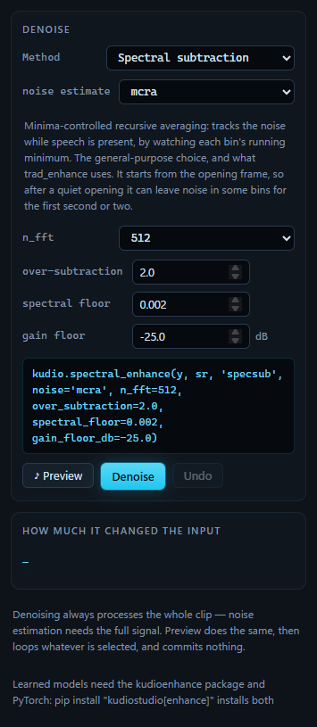

# Enhance

{ .shot .side }

Denoising, always over the whole clip. **Method** chooses one of kudio's seven
statistical denoisers, `trad_enhance`, `wavelet_low_pass_filter`, or a model
trained with kudioenhance. The controls under it change with the choice, and
the line above the buttons shows the call **Denoise** will make. That call is
what the undo history records, and what an
[exported script](../editing.md#your-edits-as-a-script) repeats.

This panel runs the method you have chosen and lets you tune it. Choosing one
is a separate job, and a better one for [Compare](compare.md), which runs them
all over the same clip and ranks them.

## Preview, Denoise, Undo

Denoising processes the whole clip, with or without a selection. The noise
estimators learn the noise from the recording itself, from its pauses above
all, and a selection that is nothing but speech would leave them almost
nothing to learn from.

**♪ Preview** runs the denoise exactly as Denoise will, over the whole clip,
then loops the selected part of the result, or all of it when nothing is
selected. It commits nothing. A denoise takes seconds rather than
milliseconds, so it runs as a job: the dot in the status bar turns from green
to amber, with the job named beside it. A change to the controls while the
preview plays waits 400 ms for them to settle before it renders again. Change
them again while that render runs and the latest values render next; the ones
in between are skipped, and two renders never run side by side.

As in Effects, anything else that claims playback ends the audition: Play,
Stop, an edit, another panel's preview.

**Denoise** replaces the clip with the result, as one undo step named after
the method, `log-MMSE + quantile` for instance. While it runs the button reads
**Denoising…** and cannot be pressed again. Edit the clip in that time and the
result is dropped when it lands: it was made from the audio before the edit,
and committing it would put that audio back over the edit. The status bar says
so; press Denoise again to run it on the edited clip. **Undo** is the window's
[Undo](../editing.md#undo-and-revert). The file you opened stays the
original, so ++ctrl+b++ afterwards
[compares](../editing.md#ab-against-the-original) the denoised clip with the
noisy one.

## The statistical methods

The first seven entries in **Method** are the methods of
`kudio.spectral_enhance`. They share one framework: a noise estimate, a frame
length, and a gain rule that turns the estimate into how far each bin of each
frame is turned down. The list names the gain rule; the noise estimate and the
frame length are the two controls above the method's own.

All of these controls are built from `kudio.METHODS`, which carries each
parameter's range, default, step, unit and a sentence of help. The panel
restates none of it, so a parameter added to kudio appears here without a
change to KudioStudio. The help on each control, each method's tooltip in the
list (kudio's summary of it and, where there is one, the paper it comes from)
and the estimator's description under the list are kudio's own text, and stay
in English whatever language the window is in.

Each method keeps the values you gave it while the window is open, so
switching to another and back does not reset them.

### Noise estimate

| Estimator | How it finds the noise |
|---|---|
| `mcra` | the first in the list, and kudio's default. Minima-controlled recursive averaging: it follows each bin's running minimum, so it keeps tracking the noise while someone talks. It is also what `trad_enhance` uses. It starts from the first frame, so after a quiet opening some bins can keep their noise for the first second or two |
| `quantile` | a low quantile of each bin over the whole file, scaled up to the mean of steady noise: the 15th percentile of noise power is 0.16 of its mean, 7.9 dB low. It has to see the whole file, and when the noise is steady and the file is not one continuous shout, it is usually the most accurate of the four |
| `initial` | the average of the first few frames, taken to be room tone. Exact when the recording opens on room tone, badly wrong when it opens on speech |
| `minimum` | a running minimum over a sliding window, with its bias corrected. It follows changing noise faster than `mcra`, and is noisier for it |

The chosen estimator's description sits under the list. It deserves as much
thought as the method: with the gain rule held still, how the noise was
measured can move the result by several dB of SI-SDR, and Compare can sweep
the four estimators over a clip to find out which suits it.

### n_fft

The analysis frame: 256, 512, 1024 or 2048 samples, 512 to start with, which
is 32 ms at 16 kHz. Longer frames resolve the noise better and smear
transients more.

### Methods and their parameters

| Method | Name in the call | What it does |
|---|---|---|
| Spectral subtraction | `specsub` | subtracts the noise spectrum (Boll 1979). The cheapest of the seven, and where musical noise comes from: isolated bins that survive the subtraction warble from frame to frame |
| Multi-band spectral subtraction | `multiband` | subtraction with an over-subtraction factor for each band, set from that band's own SNR (Kamath & Loizou 2002). Coloured noise is not equally loud everywhere, and one factor for the whole spectrum over-suppresses where it is quiet |
| Wiener (decision-directed) | `wiener` | the gain ξ/(1+ξ). Smooth, so far less musical noise than subtraction; at low SNR it muffles the speech instead |
| MMSE-STSA | `mmse_stsa` | the MMSE estimate of the spectral amplitude under a Gaussian model (Ephraim & Malah 1984). Keeps more speech than Wiener at the same suppression |
| log-MMSE | `logmmse` | the same estimate in the log-spectral domain, which is closer to how loudness is heard (Ephraim & Malah 1985). The usual default, and hard to beat without a model |
| OM-LSA | `omlsa` | log-MMSE weighted by the probability that the bin holds any speech at all: hard where there is probably none, gentle where there might be (Cohen 2001) |
| Spectral gate | `spectral_gate` | not a statistical estimator but a mask: every bin below the noise mean plus *n* standard deviations is attenuated, and the mask is smoothed so its edges do not click (after noisereduce). Unprincipled, and very predictable |

Their parameters, by the label on the control and the argument in the call:

| Control | Argument | Starts at | Used by | What it sets |
|---|---|---|---|---|
| over-subtraction | `over_subtraction` | 2.0 | `specsub` | the multiple of the noise estimate that is subtracted. Above about 3 the speech starts going with it |
| bands | `bands` | 6 | `multiband` | how many bands, linearly spaced. More follow coloured noise more closely and are noisier to estimate |
| spectral floor | `spectral_floor` | 0.002 | `specsub`, `multiband` | what is left where the subtraction went below zero, as a fraction of the noisy spectrum |
| alpha (SNR smoothing) | `alpha` | 0.98 | `wiener`, `mmse_stsa`, `logmmse`, `omlsa` | the decision-directed smoothing. Higher removes more musical noise and lags further behind the start of speech |
| P(no speech) | `q` | 0.3 | `omlsa` | the prior probability that a bin holds no speech. Higher suppresses more and risks clipping the start of words |
| gain floor | `gain_floor_db` | −25 dB | all but `spectral_gate` | how far a bin may be turned down. A hard zero sounds worse than a quiet bed of noise: total suppression is what makes the residue audible as warbling |
| threshold | `n_std_thresh` | 1.5 sigma | `spectral_gate` | how far above the noise floor a bin must be to be kept |
| strength | `prop_decrease` | 1.0 | `spectral_gate` | 1.0 applies the mask in full; lower mixes the original back in, trading noise for artefacts |
| smooth (freq) | `freq_smooth_hz` | 500 Hz | `spectral_gate` | how far the mask is blurred across frequency. An unsmoothed mask is what musical noise sounds like |
| smooth (time) | `time_smooth_ms` | 50 ms | `spectral_gate` | how far the mask is blurred across time |

## The other two filters

Under the line in **Method** are two filters that do not go through
`spectral_enhance`.

**trad_enhance (fixed spectral subtraction)** calls `kudio.trad_enhance(y, sr)`
and has no controls at all. It is spectral subtraction with an `mcra` noise
estimate and a Wiener-style gain, over 512-sample Hamming frames at 50%
overlap, with the over-subtraction set frame by frame from that frame's SNR.
With nothing to set, it is a baseline that stays put: the same clip gives the
same result every time. It needs at least one 512-sample frame, and the last
partial frame, under 256 samples, comes back silent.

**wavelet_low_pass_filter** decomposes the clip with a wavelet and
soft-thresholds every level of detail coefficients at `thres` times the clip's
peak, leaving the coarsest approximation as it is. What survives is mostly the
low end, hence the name. `thres` runs from 0 to 5 and starts at 0.8; `wavelet`
is one of `db2`, `db4`, `db8`, `sym4`, `coif3` and `haar`, `db2` to start
with. There is no noise estimate in it: the threshold follows the clip's peak,
not the noise, so it takes detail away whether that detail is noise or not.

## Learned models

**learned model (kudioenhance)** runs a denoiser trained with
[kudioenhance](https://pypi.org/project/kudioenhance/). That needs kudioenhance
and PyTorch, which `pip install "kudiostudio[enhance]"` installs together
([Extras](../getting-started.md#extras)). Without them, the line at the bottom
of the panel says how to install them, and Denoise says the same instead of
failing; the other methods are not affected. The two packages are looked up
without importing either, and an install that has kudioenhance but not
PyTorch counts as missing, rather than failing at the first Denoise. PyTorch
is imported only when a model is first loaded.

**run_dir** is a directory kudioenhance wrote during training, typed in or
chosen with **Browse…**. The model is built from what the run kept: the
configuration in `config.yaml`, with the STFT geometry it was trained with,
the normalisation statistics in `stats.npz`, and the checkpoint. All three
come from the same run, so inference cannot quietly disagree with training
about the frame or the scaling.

The first Denoise or Preview loads the model, which means importing PyTorch
and reading the checkpoint, and takes seconds. The model is then kept, and
later presses on the same directory reuse it. It is kept for the directory as
it is on disk, not for its name: train the run again into the same directory
and the next press loads it again, so the weights that run are always the ones
in the folder.

**resample to the model's rate if they differ** is ticked to start with. A
model works at the rate it was trained at. With the box ticked, a clip at
another rate is resampled to the model's, denoised, and resampled back to its
own rate and length, so the session keeps its rate. Unticked, the same clip
fails:

```text
learned model (exp1) failed — ValueError: this model was trained at 16000 Hz but the clip is 8000 Hz — enable resampling, or convert it in the Batch panel
```

An exported script writes the model's step as kudioenhance's
`Enhancer.load(run_dir).enhance(y)`, resampling included, and checks the model
files' SHA-256 first, so a run trained again since the edit stops the script
rather than denoise with different weights; see
[Your edits as a script](../editing.md#your-edits-as-a-script).

### When a model will not load

| The status bar says | Because |
|---|---|
| Learned models need the kudioenhance package and PyTorch: … | one of the two is not installed |
| Select a kudioenhance run directory first. | **run_dir** is empty, or is not a folder |
| learned model (…) failed — FileNotFoundError: … | the folder is not a complete run: it has no `config.yaml` or `stats.npz`, or no checkpoint named after the model the config describes (`no model at …`) |
| learned model (…) failed — FileNotFoundError, naming a `.keras` file | the run holds Keras weights, which PyTorch cannot read. Train it again; the config and the data splits in the folder can be reused as they are |
| learned model (…) failed — ValueError: … | the checkpoint was trained as a different model from the one `config.yaml` describes |

## How much it changed the input

After each Denoise, the box under the buttons says how far the run moved the
audio:

```text
SNR +6.65 dB   ·   SI-SDR +5.71 dB   ·   segSNR +4.60 dB
```

All three set the result against the audio as it was before the run. They
measure distance, not quality: deleting the whole clip would score 0 dB, and a
run that changed nothing would score as high as they go, so a good denoise
lands somewhere between, depending on how much noise there was to take out.
SI-SDR ignores level and SNR does not: a run that only halved the volume would
show 6 dB of SNR and, on anything but a near-silent clip, an SI-SDR over
100 dB.

Whether the result is any better is a different question, and it needs a clean
reference: the [Metrics](metrics.md) panel scores against one, and
[Compare](compare.md) ranks every method against one.
