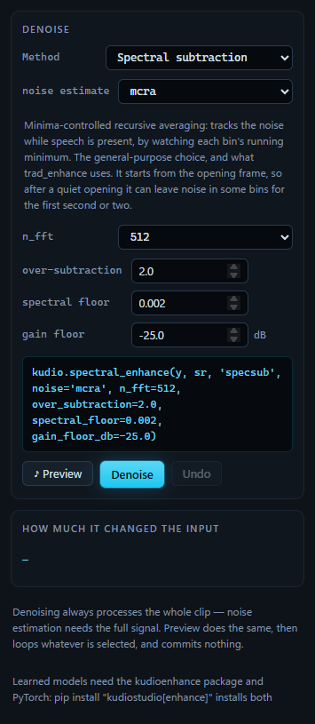

# 增強

{ .shot .side }

降噪，而且一律處理整段音訊。「方法」可以選 kudio 的七種統計式降噪器、`trad_enhance`、
`wavelet_low_pass_filter`，或用 kudioenhance 訓練出來的模型。下方的控制項隨選擇改變，
按鈕上方那一行顯示「降噪」將執行的呼叫。復原紀錄記下的就是這個呼叫，
[匯出的腳本](../editing.md#your-edits-as-a-script)重做的也是它。

這個面板負責執行你選好的方法，並把它調好。該選哪一種是另一件事，交給[比較](compare.md)面板更合適：
它在同一段音訊上跑過全部方法，再排出名次。

## 預覽、降噪、復原 {#preview-denoise-undo}

不論有沒有選取範圍，降噪都處理整段音訊。雜訊估計器是從錄音本身學雜訊的，主要靠其中的停頓；
一段全是語音的選取範圍，幾乎沒有東西可以讓它們學。

「♪ 預覽」完全照「降噪」的做法處理整段音訊，再循環播放結果中選取的那一段，沒有選取時就播放全部。
它不提交任何變更。降噪花的是秒而不是毫秒，所以它以背景工作執行：狀態列左側的圓點會從綠色變成琥珀色，
工作名稱則出現在狀態列右端。預覽播放中改了控制項，會等 400 ms、數值穩定下來才重新算繪。算繪進行中又改了數值，
接著算的是最新的那一組，中間經過的會略過，兩次算繪也不會同時進行。

和「效果」面板一樣，任何其他要求播放的動作都會結束試聽：播放、停止、一次編輯，或另一個面板的預覽。

「降噪」用結果取代整段音訊，成為一個以方法命名的復原步驟，例如 `log-MMSE + quantile`。
執行期間按鈕顯示「降噪中…」，無法再按。這段時間裡若編輯了音訊，結果回來時會被捨棄：
它是從編輯之前的音訊算出來的，提交的話，會把那份音訊蓋回剛才的編輯上。狀態列會說明這件事；
再按一次「降噪」，就會在編輯後的音訊上重新執行。「復原」就是視窗的[復原](../editing.md#undo-and-revert)。
你開啟的檔案仍是原始音訊，所以降噪之後按 ++ctrl+b++，就能拿結果和含噪的原檔
[做 A/B 比較](../editing.md#ab-against-the-original)。

## 統計式方法 {#the-statistical-methods}

「方法」清單的前七項是 `kudio.spectral_enhance` 的方法。它們的架構相同：一個雜訊估計、
一個分析幀長度，再加上一條增益規則，把雜訊估計換算成每一幀的每個頻率格要壓低多少。
清單列出的名稱就是增益規則；雜訊估計與幀長度，則是方法本身參數上方的那兩個控制項。

這些控制項全部由 `kudio.METHODS` 產生，裡面附有每個參數的範圍、預設值、步進、單位與一句說明。
面板本身不重寫任何一項，所以 kudio 多加一個參數，這裡就會跟著出現，不必改 KudioStudio。
控制項上的說明、清單中每個方法的提示（kudio 對它的簡介，有出處的話再加上論文），以及清單下方的
估計器說明，都是 kudio 自己的文字，所以在中文介面裡仍是英文。

視窗開著的期間，每個方法都記得你給它的數值，換到別的方法再換回來，不會被重設。

### 雜訊估計 {#noise-estimate}

| 估計器 | 怎麼找出雜訊 |
|---|---|
| `mcra` | 清單的第一項，也是 kudio 的預設。Minima-controlled recursive averaging：追蹤每個頻率格的移動最小值，所以有人說話時也能繼續追蹤雜訊。`trad_enhance` 用的也是它。它從第一幀開始估計，所以開頭安靜的錄音，前一兩秒可能有些頻率格還留著雜訊 |
| `quantile` | 每個頻率格在整個檔案上的一個低分位數，再放大到穩定雜訊的平均值：雜訊功率的第 15 百分位數是平均值的 0.16 倍，低了 7.9 dB。它必須看到整個檔案；雜訊穩定、檔案又不是從頭吼到尾時，它通常是四者中最準的 |
| `initial` | 前幾幀的平均，假設那是房間底噪。錄音以房間底噪開頭時很準，以語音開頭時就錯得離譜 |
| `minimum` | 滑動視窗內的移動最小值，並補償它的偏差。追蹤變動的雜訊比 `mcra` 快，代價是估計值跳動得比較厲害 |

選中的估計器，說明會顯示在清單下方。這個選擇值得和方法本身一樣認真看待：增益規則不變，
單是雜訊的量法不同，SI-SDR 就可能差上好幾 dB。[比較](compare.md)面板可以針對一段音訊，
把四種估計器都掃過一遍，看哪一種適合它。

### n_fft {#n_fft}

分析幀的長度：256、512、1024 或 2048 個樣本，一開始是 512，在 16 kHz 下是 32 ms。
幀越長，雜訊解析得越準，瞬態也被抹得越開。

### 各方法與參數 {#methods-and-their-parameters}

| 方法 | 呼叫中的名稱 | 作用 |
|---|---|---|
| Spectral subtraction | `specsub` | 減去雜訊頻譜（Boll 1979）。七種裡最便宜的一種，也是 musical noise 的來源：減完後零星留下的頻率格，在幀與幀之間忽隱忽現 |
| Multi-band spectral subtraction | `multiband` | 每個頻帶各有一個過減係數，依該頻帶自己的 SNR、照 Berouti 的規則決定（Berouti、Schwartz & Makhoul 1979）；分頻帶相減的想法來自 Kamath & Loizou（2002）。有色雜訊在各頻率的強度不同，全頻譜共用一個係數，會在雜訊小的地方壓過頭 |
| Wiener (decision-directed) | `wiener` | 增益 ξ/(1+ξ)。變化平滑，musical noise 比減法少得多；代價是在低 SNR 時讓語音變悶 |
| MMSE-STSA | `mmse_stsa` | 高斯模型下頻譜振幅的 MMSE 估計（Ephraim & Malah 1984）。在相同的 SNR 下，它把頻率格壓得比 Wiener 少，所以保留的語音較多，殘留的雜訊也稍多 |
| log-MMSE | `logmmse` | 同樣的估計改對振幅的對數來做（Ephraim & Malah 1985）。它的增益一定低於 MMSE-STSA，殘留雜訊較少。常見的預設選擇，沒有模型的話很難贏過它 |
| OM-LSA | `omlsa` | 以「這個頻率格裡到底有沒有語音」的機率加權的 log-MMSE：大概沒有語音的地方壓得重，可能有的地方壓得輕（Cohen 2001） |
| Spectral gate | `spectral_gate` | 不是統計估計器，而是遮罩：低於雜訊平均值加 *n* 個標準差的頻率格都被衰減，遮罩再經過平滑，邊緣才不會有喀聲（參考 noisereduce 的做法）。沒有理論依據，但結果非常好預測 |

各參數以控制項上的標籤與呼叫中的引數列出：

| 控制項 | 引數 | 起始值 | 用於 | 設定的是 |
|---|---|---|---|---|
| over-subtraction | `over_subtraction` | 2.0 | `specsub` | 減去雜訊估計的倍數。越大，減掉的雜訊越多，超過某個程度連語音也一起減掉；Berouti 等人在 0 dB SNR 時用 3 到 6，他們的下限跟著雜訊功率走 |
| bands | `bands` | 6 | `multiband` | 頻帶數，線性等分。越多越能貼合有色雜訊，估計起來也越不穩 |
| spectral floor | `spectral_floor` | 0.002 | `specsub`、`multiband` | 減法結果為負的地方留下多少，以含噪頻譜的比例表示 |
| alpha (SNR smoothing) | `alpha` | 0.98 | `wiener`、`mmse_stsa`、`logmmse`、`omlsa` | decision-directed 平滑。越高，去掉的 musical noise 越多，對語音起頭的反應也越慢 |
| P(no speech) | `q` | 0.3 | `omlsa` | 一個頻率格不含語音的先驗機率。越高壓得越多，也越可能切掉字的開頭 |
| gain floor | `gain_floor_db` | −25 dB | `spectral_gate` 以外全部 | 一個頻率格最多能壓低多少。硬壓到零，聽起來比留一層小聲的雜訊還糟：完全壓制，正是讓殘留聲聽起來忽隱忽現的原因 |
| threshold | `n_std_thresh` | 1.5 sigma | `spectral_gate` | 頻率格要高出底噪多少才保留 |
| strength | `prop_decrease` | 1.0 | `spectral_gate` | 1.0 表示完整套用遮罩；越低，混回的原音越多，以雜訊換取較少的瑕疵 |
| smooth (freq) | `freq_smooth_hz` | 500 Hz | `spectral_gate` | 遮罩在頻率方向模糊的範圍。沒有平滑的遮罩，聽起來就是 musical noise |
| smooth (time) | `time_smooth_ms` | 50 ms | `spectral_gate` | 遮罩在時間方向模糊的範圍 |

## 另外兩個濾波器 {#the-other-two-filters}

「方法」清單分隔線下方的兩個濾波器，不經過 `spectral_enhance`。

「trad_enhance（固定頻譜減法）」呼叫 `kudio.trad_enhance(y, sr)`，完全沒有控制項。它是頻譜減法，
搭配 `mcra` 雜訊估計與 Wiener 式的增益，在 512 個樣本、重疊 50% 的 Hamming 幀上運算，
過減係數依每一幀自己的 SNR 逐幀決定。沒有東西可調，它就是一個固定不動的基準：同一段音訊，
每次都得到同樣的結果。它至少需要一個 512 樣本的幀，最後不足 256 個樣本的殘幀會變成靜音。

`wavelet_low_pass_filter` 對音訊做小波分解，把每一層的細節係數以「`thres` 乘上音訊峰值」為門檻做
soft thresholding，最粗的近似係數則保持不動。留下來的主要是低頻部分，名稱就是這麼來的。
`thres` 的範圍是 0 到 5，起始值 0.8；`wavelet` 可選 `db2`、`db4`、`db8`、`sym4`、`coif3` 與
`haar`，起始為 `db2`。它沒有任何雜訊估計：門檻跟著音訊的峰值走，而不是跟著雜訊，
所以不論那些細節是不是雜訊，它都照樣拿掉。

## 學習式模型 {#learned-models}

「學習式模型（kudioenhance）」執行用 [kudioenhance](https://pypi.org/project/kudioenhance/)
訓練出來的降噪器。這需要 kudioenhance 與 PyTorch，`pip install "kudiostudio[enhance]"` 會一起安裝
（見[選用套件組](../getting-started.md#extras)）。沒有安裝時，面板最下方那一行會說明怎麼安裝，
按「降噪」也會顯示同樣的訊息，而不是直接出錯；其他方法完全不受影響。這兩個套件只會被查找、
不會被匯入，所以裝了 kudioenhance 卻沒有 PyTorch 的環境會被當成沒裝，而不是等到第一次降噪才失敗。
PyTorch 要到第一次載入模型時才會匯入。

run_dir 是 kudioenhance 訓練時寫出的目錄，可以直接輸入，或按「瀏覽…」選擇。模型由這次訓練留下的
東西組成：`config.yaml` 裡的設定（包含訓練時的 STFT 參數）、`stats.npz` 裡的正規化統計量，
以及 checkpoint。三者出自同一次訓練，所以推論不可能在不知不覺中，與訓練用了不同的幀長或縮放方式。

第一次按「降噪」或「預覽」時會載入模型，也就是匯入 PyTorch 並讀取 checkpoint，要花幾秒。
之後模型會被保留，同一個目錄再按就直接沿用。保留的依據是目錄在磁碟上的內容，而不是它的名稱：
在同一個目錄重新訓練之後，下一次按下會重新載入，所以執行的權重一定是資料夾裡的那一份。

「若取樣率不同，重新取樣到模型的取樣率」一開始是勾選的。模型只在它訓練時的取樣率下運作。
勾選時，其他取樣率的音訊會先重新取樣到模型的取樣率、降噪，再取樣回原本的取樣率與長度，
所以工作階段的取樣率不變。不勾選的話，同樣的音訊會失敗：

```text
學習式模型（exp1） 失敗 — ValueError: 此模型以 16000 Hz 訓練，但音訊為 8000 Hz — 請啟用重新取樣，或在「批次」面板轉換
```

匯出的腳本會把這一步寫成 kudioenhance 的 `Enhancer.load(run_dir).enhance(y)`，包含重新取樣，
並先檢查模型檔案的 SHA-256；若模型在編輯之後又在同一個目錄重新訓練過，腳本會停下，
而不是用不同的權重降噪。見[把編輯匯出成腳本](../editing.md#your-edits-as-a-script)。

### 模型載入不了時 {#when-a-model-will-not-load}

| 狀態列的訊息 | 原因 |
|---|---|
| 學習式模型需要 kudioenhance 套件與 PyTorch：… | 兩者之一沒有安裝 |
| 請先選擇 kudioenhance 執行目錄。 | run_dir 是空的，或不是資料夾 |
| 學習式模型（…） 失敗 — FileNotFoundError: … | 這個資料夾不是完整的訓練結果：沒有 `config.yaml` 或 `stats.npz`，或沒有以設定中的模型命名的 checkpoint（`no model at …`） |
| 學習式模型（…） 失敗 — FileNotFoundError，訊息裡提到 `.keras` 檔 | 這次訓練存的是 Keras 權重，PyTorch 讀不了。請重新訓練；資料夾裡的設定與資料切分可以照原樣沿用 |
| 學習式模型（…） 失敗 — ValueError: … | checkpoint 訓練的模型，與 `config.yaml` 描述的不同 |

## 對輸入的改變程度 {#how-much-it-changed-the-input}

每次降噪之後，按鈕下方的方框會說明這次執行把音訊改動了多少：

```text
SNR +6.65 dB   ·   SI-SDR +5.71 dB   ·   segSNR +4.60 dB
```

三個數字都是拿結果和執行前的音訊相比。它們量的是距離，不是品質：把整段音訊刪光是 0 dB，
完全沒有改動則會高到它們的上限，好的降噪落在兩者之間，落在哪裡取決於原本有多少雜訊可以去除。
SI-SDR 不看音量，SNR 則會看：只把音量減半的處理，SNR 是 6 dB；只要音訊不是幾近無聲，
SI-SDR 都會超過 100 dB。

結果到底有沒有比較好，是另一個問題，需要乾淨的參考訊號：[指標](metrics.md)面板拿它來評分，
[比較](compare.md)面板則用它替所有方法排名。
