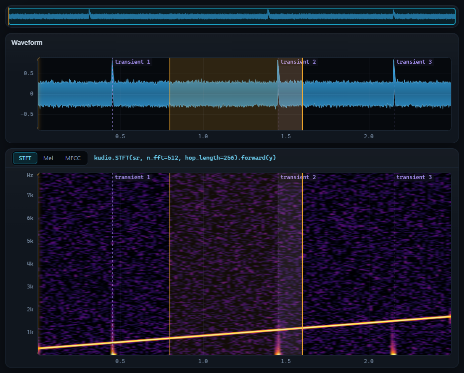
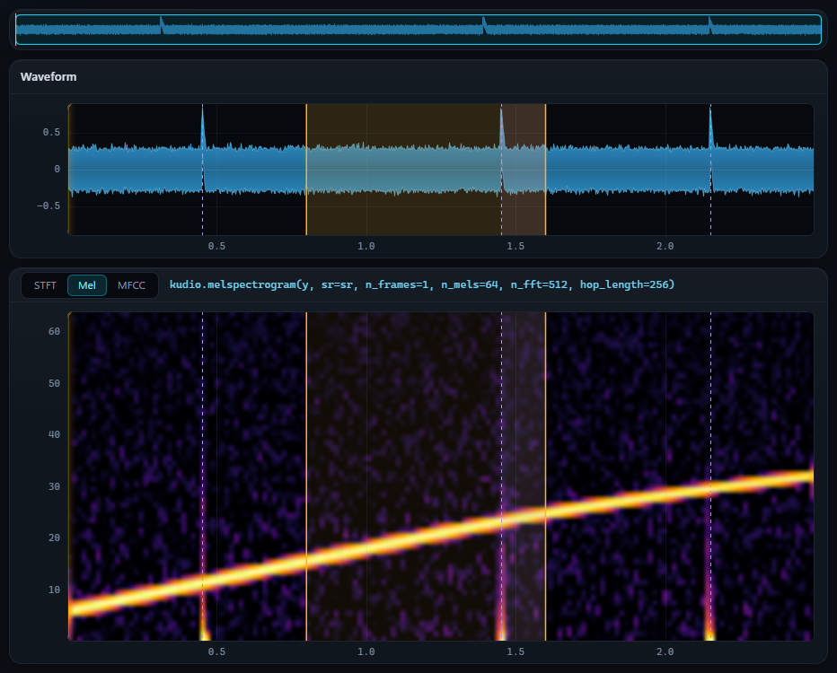
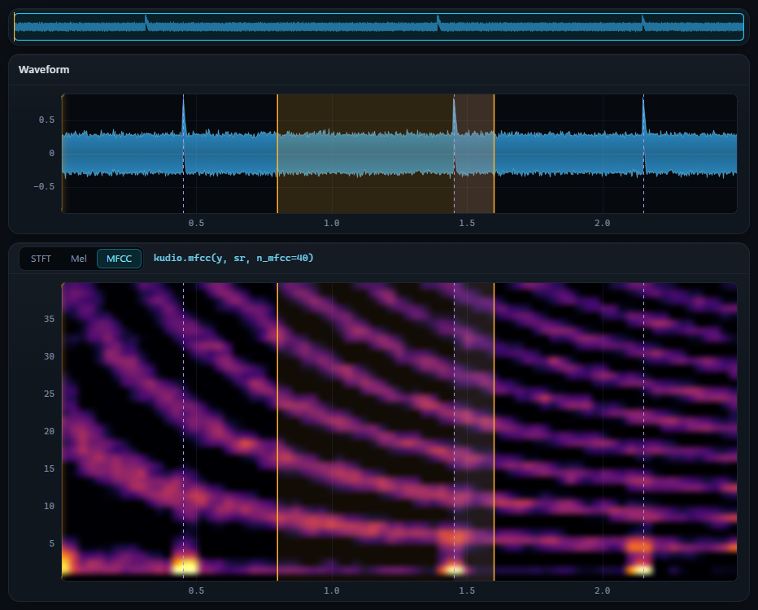
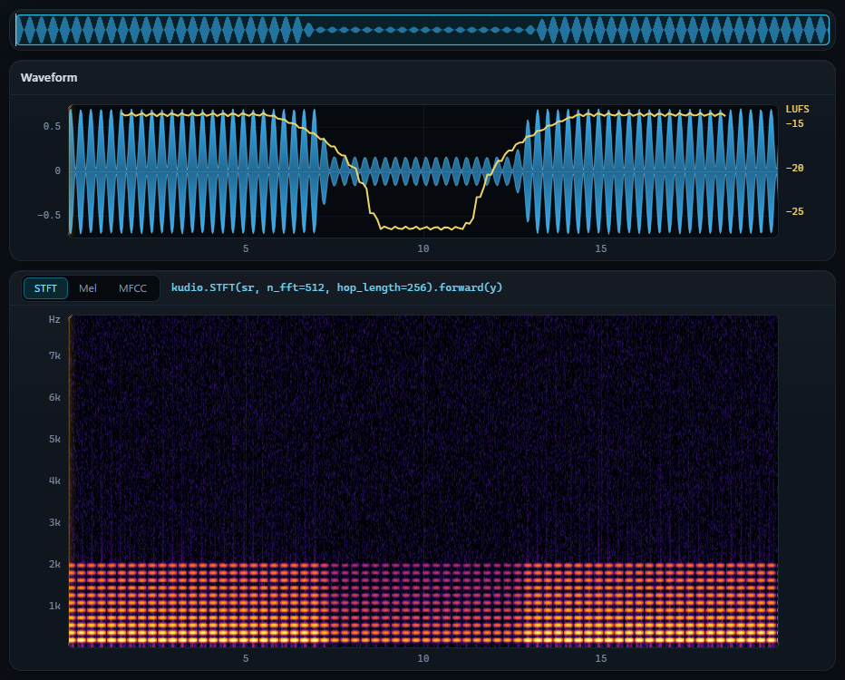
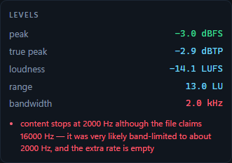

# Inspect

The first tool on the rail, and the one the window opens with. It sets how the
analysis image is computed, shows the selection as numbers, and reads the
levels of the clip: what it peaks at, how loud it is, and what is wrong with
the recording itself.

## The analysis image

The three buttons above the image switch between a log-power **STFT**, a
log-**mel** spectrogram and **MFCC**s. They come from the same kudio calls a
training script would use, and the caption beside the buttons is the exact
call, so the picture is the features a model would see:

=== "STFT"

    { .shot width="460" }

=== "Mel"

    { .shot width="460" }

=== "MFCC"

    { .shot width="460" }

The **Analysis** fields set the call's parameters: `n_fft` and `hop_length`
for the STFT and mel views, `n_mels` for the mel view and `n_mfcc` for the
MFCC one. A field that does not apply to the view on screen is greyed out. The
view and its settings are remembered for the next run.

The colours keep their scale while the clip is the same one. Denoise it or
change its gain and the image keeps the levels it had, so less noise shows as
a darker picture rather than being stretched back to the same brightness.
Another file, a new recording, another view or other Analysis settings start a
scale of their own, and so does an edit that changes the length by more than
50 ms: a cut, a crop, a trim.

The same image also shows two things that are not the clip: the picture of a
take as it is recorded, and a pitch contour from the Pitch panel.

## Loudness over time

{ .shot }

The Levels readout gives one integrated LUFS figure for the whole clip. That is
the number you normalise against, and no help at all in finding the moment
somebody leaned away from the microphone. Tick **Loudness over time** and the
short-term loudness (EBU Tech 3341, a 3 s window, a 100 ms hop) is drawn over
the waveform on its own LUFS axis, so "−31 LUFS here" is a number you can act
on rather than "about a third as tall".

Above, a take that drifts 13 dB and comes back. The Levels readout agrees:
`range 13.0 LU`.

Ticking the box costs nothing. The curve is measured with the rest of the
Levels readout, once for each version of the audio, whether the box is ticked
or not, and the range is read off it. Measured together on the same samples,
the curve and the Levels figures always describe the same version of the
clip, never two moments of an edit.

Two things it is deliberate about:

- The curve is not gated. Gating is what keeps pauses from dragging the
  *integrated* figure down; a curve with holes punched in it wherever the gate
  closed would describe a recording that stops existing between words. Real
  silence still breaks the line, because there the level really is nothing:
  below BS.1770's absolute gate of −70 LUFS, where a pause after sound only
  measures the weighting filter dying away.
- A clip shorter than the 3 s window has no curve. The box is greyed out and
  its tooltip says why, instead of ticking and doing nothing. Falling back to
  a 400 ms window would quietly answer a different question.

## Selection

**start** and **end** take an exact range in seconds, and the line under them
gives its length. **Select all** and **Clear** do what they say, as
++ctrl+a++ and ++esc++ do while the cursor is not in a field. Inside one,
++ctrl+a++ selects the field's text and ++esc++ only leaves the field.

## Levels

{ .shot .side }

The scores the Metrics panel computes
[against a clean reference](metrics.md#against-a-clean-reference), SNR,
SI-SDR, PESQ, STOI and the rest, need that reference beside the recording. A
synthetic dataset has one. A real recording never does: its "original" is the
noisy one, so scoring against it measures how much you changed the audio, not
whether you improved it.

`kudio.audio_report` needs no reference, so this readout is always live:

peak
:   the highest sample, in dBFS. It turns red when samples clipped or the
    peak is above −0.5 dBFS.

true peak
:   the peak of the waveform between the samples, in dBTP.

loudness
:   the integrated loudness, in LUFS.

range
:   the loudness range, in LU: how far the level wanders.

bandwidth
:   how high the content actually reaches, which is not always what the
    sample rate promises.

Under the figures go the problems with the recording itself. These are the
ones that quietly waste a dataset:

```text
· 4692 samples clipped (9.78% of the clip) — the recording was already
  too hot; no processing gets that back
· content stops at 3812 Hz although the file claims 16000 Hz — it was
  very likely upsampled from 8000 Hz, and the extra rate is empty
```

The true peak and the sample peak disagree more often than you would think.
Samples are points on a curve that passes between them, and the curve
overshoots, so a file with no sample at full scale can still clip in a
converter or a lossy encoder. `audio_report` cannot see that, since nothing in
the samples is wrong, so when the true peak reaches the usual −1 dBTP
delivery ceiling the readout shows it in red and adds a line of its own. When
kudio has already named clipped samples, or a peak past full scale or right
against it, that says enough, and the extra line is left out.

The Record panel runs `audio_report` on every take as it lands and lists the
same problems, while the microphone is still set up and recording again is
still an option; see [the check on every take](record.md#the-check-on-every-take).
The true-peak line is this readout's own and does not appear there.

All of this says whether the audio is technically sound, not whether it
sounds good. For that, the Metrics panel predicts what a listener would say,
with DNSMOS.
