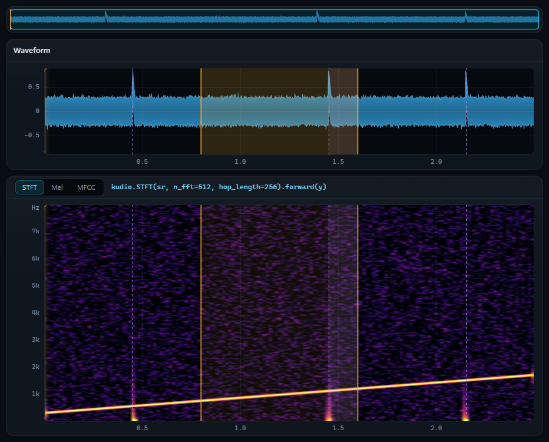
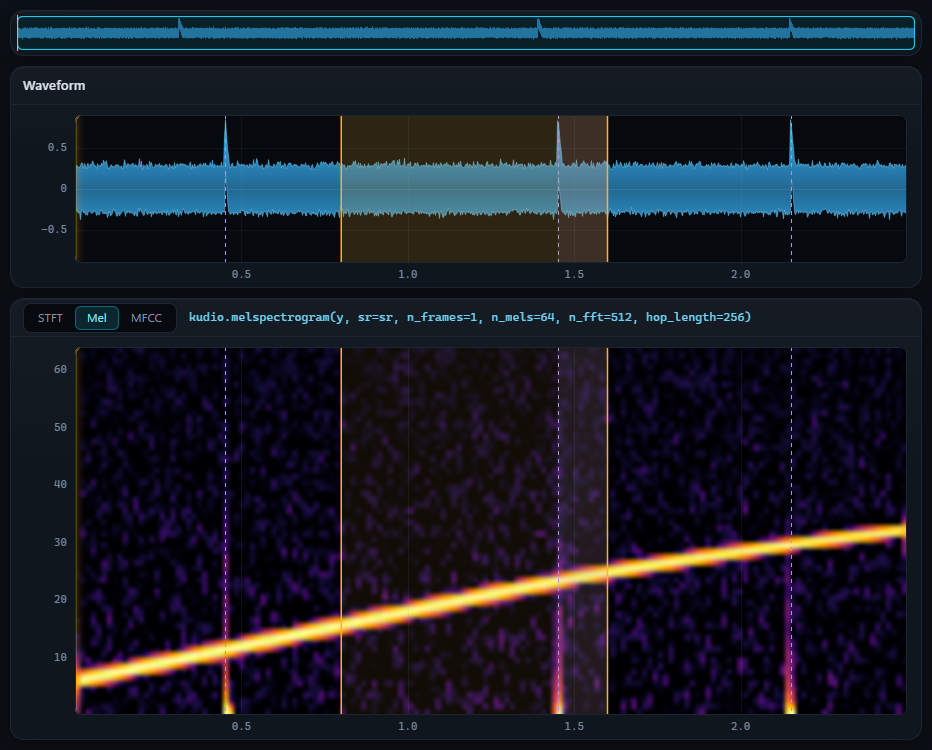
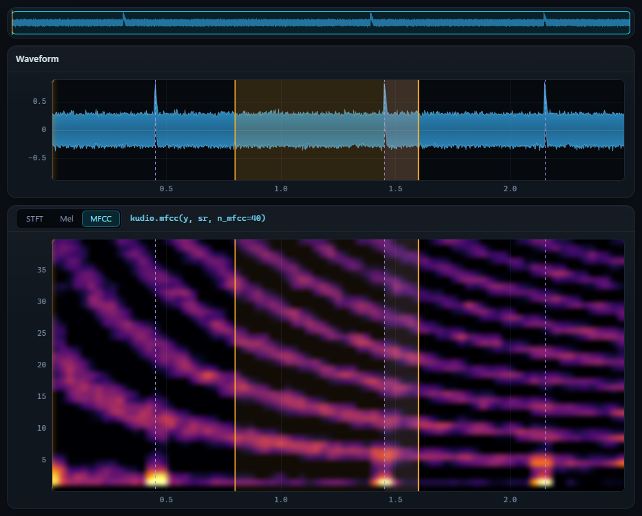
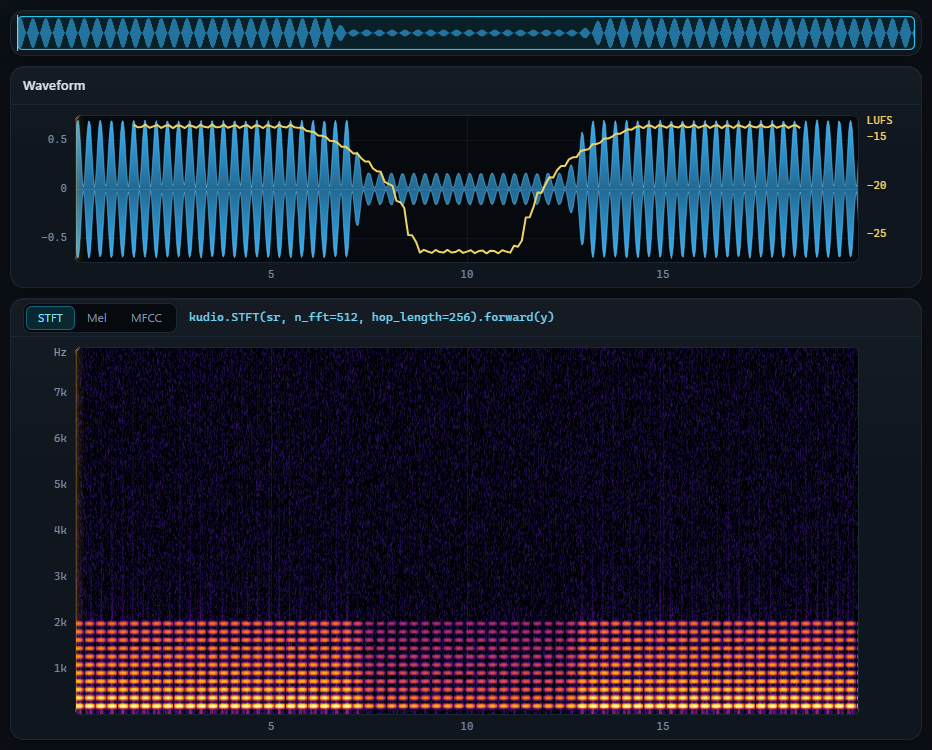
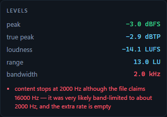

# 檢查

工具列上的第一個工具，也是視窗開啟時顯示的那一個。它設定分析圖怎麼計算、以數字顯示選取範圍，
並讀出音訊的音量：峰值多高、多大聲，以及錄音本身有什麼問題。

## 分析圖 {#the-analysis-image}

分析圖上方的三個按鈕在對數功率 **STFT**、對數 **mel** 頻譜圖與 **MFCC** 之間切換。
它們出自訓練腳本也會用的同一組 kudio 呼叫，按鈕旁的說明文字就是確切的呼叫，
所以畫面上看到的，就是模型會看到的特徵：

=== "STFT"

    { .shot width="460" }

=== "Mel"

    { .shot width="460" }

=== "MFCC"

    { .shot width="460" }

「分析」的欄位設定呼叫的參數：STFT 與 mel 視圖用 `n_fft` 與 `hop_length`，mel 視圖另有
`n_mels`，MFCC 視圖則是 `n_mfcc`。與目前視圖無關的欄位會變灰。視圖種類與它的參數會被記住，
下次啟動時沿用。

同一段音訊的色階會保持不變。做過降噪或調過增益之後，分析圖沿用原本的色階，所以雜訊變少看起來就是
畫面變暗，而不是又被拉回同樣的亮度。換一個檔案、新的一次錄音、換了視圖或改了「分析」的參數，
都會重新決定色階；讓長度變動超過 50 ms 的編輯也一樣，例如剪下、裁切或修剪靜音。

同一張圖也負責呈現兩樣不是這段音訊本身的東西：錄音進行中的畫面，以及「音高」面板畫的音高輪廓。

## 響度隨時間變化 {#loudness-over-time}

{ .shot }

「音量」讀數對整段音訊給出一個整合 LUFS 數值。那是做正規化的依據，但要找出某人離麥克風遠了一點
的那一刻，它完全幫不上忙。勾選「響度隨時間變化」，短期響度（EBU Tech 3341，3 秒視窗，
100 ms 跳距）會以獨立的 LUFS 軸畫在波形上。這樣讀到的是「這裡 −31 LUFS」，可以直接拿來決定
音量要補多少，而不是「大約三分之一高」。

上圖是一段音量漂移了 13 dB 又回來的錄音。「音量」讀數的結果一致：`範圍 13.0 LU`。

勾選這個方塊不會多花時間。曲線和「音量」讀數的其他數字一起量，音訊每變一個版本就量一次，
不管有沒有勾選；範圍則是直接從曲線讀出來的。既然是在同一份樣本上一起量的，曲線和「音量」的數字
描述的一定是同一個版本，不會是某次編輯前後的兩個時刻。

有兩點是刻意這樣設計的：

- 曲線不做閘控。閘控是為了不讓停頓拉低**整合**數值；如果閘門一關就在曲線上挖一個洞，
  畫出來的錄音就像在字與字之間消失了。真正的靜音仍然會讓線條中斷，因為那裡的音量確實是零：
  也就是低於 BS.1770 的絕對閘限 −70 LUFS 的地方，聲音之後的停頓在那裡量到的只是加權濾波器
  衰減的尾巴。
- 比 3 秒視窗短的音訊沒有曲線。核取方塊會變灰，提示會說明原因，而不是勾了卻什麼都沒發生。
  退而使用 400 ms 視窗，等於不知不覺回答了另一個問題。

## 選取範圍 {#selection}

「起點」與「終點」以秒為單位輸入精確的範圍，下面那一行是它的長度。「全選」與「清除」
就如字面所說，跟游標不在輸入欄位裡時按 ++ctrl+a++ 與 ++esc++ 一樣。游標在欄位裡時，
++ctrl+a++ 選的是欄位裡的文字，++esc++ 只會離開那個欄位。

## 音量 {#levels}

{ .shot .side }

「指標」面板[與乾淨參考訊號比較](metrics.md#against-a-clean-reference)的那些分數，像 SNR、
SI-SDR、PESQ、STOI，都需要在錄音旁放一個乾淨的參考訊號。合成資料集有參考訊號，
真實錄音永遠沒有：它的「原始版本」就是含噪的那一個，所以拿它來評分，量到的是你改動了音訊多少，
而不是你有沒有改善它。

`kudio.audio_report` 不需要參考訊號，所以這個讀數永遠是即時的：

峰值
:   最高的樣本值，單位 dBFS。有樣本削波，或峰值高於 −0.5 dBFS 時，數字會變成紅色。

true peak
:   樣本之間的波形峰值，單位 dBTP。

響度
:   整合響度，單位 LUFS。

範圍
:   響度範圍，單位 LU：音量漂移了多少。

頻寬
:   內容實際延伸到多高的頻率，這不一定是取樣率所宣稱的。內容在取樣率一半的 90% 以下就結束時，
    數字會變成紅色。

數字下方列出的是錄音本身的問題。這兩個例子，都是會默默浪費掉一個資料集的問題：

```text
· 有 4692 個樣本削波（佔整段的 9.78%）— 錄音時就已經太大聲，任何處理都救不回來
· 內容到 3812 Hz 就沒了，檔案卻標示 16000 Hz — 很可能是從 8000 Hz 升頻而來，
  多出來的取樣率是空的
```

true peak 與取樣峰值不一致的情況，比你想的還常見。樣本是一條曲線上的點，而這條曲線會從點與點
之間穿過並且超出，所以一個沒有任何樣本達到滿刻度的檔案，在轉換器或有損編碼器裡仍可能削波。
`audio_report` 看不到這一點，因為樣本本身沒有任何問題，所以 true peak 達到常見的 −1 dBTP
交付上限時，讀數會把它標成紅色，並另外加一行警告。如果 kudio 已經指出有樣本削波，
或峰值超過、緊貼滿刻度，那就已經說夠了，這一行不會再出現。

「錄音」面板會在每一次錄音進來時跑 `audio_report`，列出同樣的問題，趁麥克風還架著、還來得及重錄；
見[每次錄音後的檢查](record.md#the-check-on-every-take)。true peak 那一行只有這個讀數才有，
錄音面板不會顯示。

這些只說明音訊在技術上有沒有問題，不代表它聽起來好。要知道聽起來如何，「指標」面板會用
DNSMOS 預測聽者的評價。
