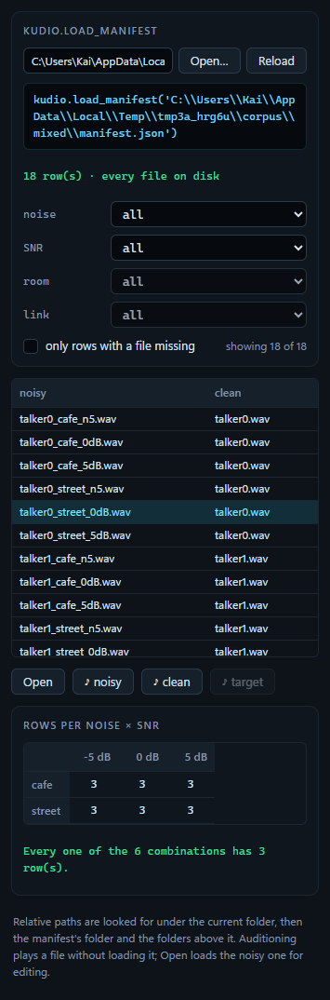

# Manifest

{ .shot .side }

A synthesised corpus is thousands of files whose names carry the clean file,
the noise and the SNR. The room, the link and the reverberant target are in
none of them. They are only in the `manifest.json` the
[Synthesize](synthesize.md) panel writes beside every corpus, and this panel
reads one back with `kudio.load_manifest`, the call under the path, as what it
is: rows of noisy, clean, noise, SNR, room, link and target.

Two questions are worth asking before anything is trained on a corpus, and the
panel answers both: is every file still there, and is the noise × SNR grid
covered?

## Opening one

- **File → Open manifest…**, or **Open…** in the panel itself.
- On the command line, `kudiostudio data/mixed/manifest.json`. A `.json` among
  the files named there opens in this panel; with several, the last one does.
- A `.json` dropped on the window, or picked in **File → Open…**, comes here
  as well, rather than failing as a file that is not audio.

Reading the manifest and looking for every file it names run in the
background, so a corpus of tens of thousands of rows does not freeze the
window. The status line says when the table is ready and how many rows it
holds. **Reload** reads the manifest again and looks for every file again:
after a synthesis run has written it again, say, or a folder has been moved
back.

## The table

| Column | From the manifest |
|---|---|
| noisy | `noisy`: the mixture |
| clean | `clean`: the clean file it was made from |
| noise | `noise`: the name of the noise file |
| SNR dB | `snr_db` |
| RT60 s | `rt60`: the room |
| link | `channel` |
| target | `target`: the reverberant target |

A dash is a value the row does not have: no room, no link, no target.

The folder that every path of one kind shares is left off, so the noisy column
reads `u0_babble_n5_rt300ms.wav` instead of the same long prefix ten thousand
times. The column header's tooltip names that folder, and a cell's tooltip
gives the full path of its file. A name too long for its column loses its
middle: a synthesised name starts with the clean file and ends with the SNR
and the room, and those are the parts worth keeping. The table is wider than
the panel, so the columns after clean are a sideways scroll away.

The table builds only the rows in view and fetches more as you scroll.

### Sorting

Click a column header to sort by it, ascending (▲); click again for
descending (▼), and a third time for the manifest's own order. SNR and RT60
sort by value. As text, "10" would come before "5", and "−5" would land
wherever the minus sign put it. Rows with no value go last whichever way the
column is turned, and rows that tie keep the order the corpus was written in.

### Filters

**noise**, **SNR**, **room** and **link** each show all the rows or only those
with one value. `none` is a value in its own right: the rows with no room, or
with no link. A filter whose column holds one value only is greyed out.
**only rows with a file missing** keeps just those rows, and the line beside it
says how many rows are shown out of how many.

### Opening a row and listening to it

Click a row to select it; ++arrow-up++ and ++arrow-down++ move through the
table. **Open**, a double-click or ++enter++ loads the row's noisy file into
the session for editing, as **File → Open…** would.

**♪ noisy**, **♪ clean** and **♪ target** loop one file of the selected row
without loading anything. The button stays down while it plays, and selecting
another row plays the same side of that one, so going down the table with the
arrow keys is a quick way to hear a corpus. Press the button again to stop;
anything else that plays stops it too, from Play to another panel's preview.
A button is greyed out when its file is not on disk, or, for ♪ target, when
the corpus was written without targets. Its tooltip says which.

## Missing files

### Where relative paths are looked for

Paths in a manifest are often relative, to whatever folder the synthesis ran
in, and nothing records which folder that was. They are looked for:

1. under the folder KudioStudio was started in, because that is what a
   relative path means to every other program;
2. under the manifest's own folder;
3. under each folder above that.

The third is the usual case. `Synthesizer('data/clean', 'data/noise',
out_path='data/mixed')`, run in a project folder, names its files
`data/mixed/spk1/…` and puts the manifest in `data/mixed`, two levels below
the folder those paths start from.

The whole manifest is read against one of those folders: the first that holds
every file it names, or failing that, the one that holds the most. I do not
look files up one at a time. Two projects built from the same clean set name
their mixtures alike, and a lookup per path would pair one project's mixtures
with the other's clean files while reporting every file present. The summary
under the call names the folder it settled on:

```text
6 row(s) · every file on disk · relative paths found under D:\work\denoise
```

An absolute path is used as it is.

### Rows with a file missing

A manifest outlives its files: a folder gets moved, half a run gets deleted, a
manifest gets copied to another machine. A file that is not found is drawn in
the warning colour, and the summary counts the rows that have one:

```text
6 row(s) · 1 with a file missing · relative paths found under D:\work\denoise
```

The cell's tooltip reads `not on disk:` and the path as the manifest has it.
For a relative path it adds the folder it was looked for under, when the
manifest settled on one. When nothing in the manifest was found anywhere, as
on another machine, there is no such folder, and the tooltip gives the path
alone.

**only rows with a file missing** lists just those rows. The grid under the table
then counts where the damage is, per noise × SNR, and stops saying anything
about coverage. A row whose noisy file is missing cannot be opened, but its
clean file and target can still be heard.

## The coverage grid

**Rows per noise × SNR**, under the table, has a row for each noise and a
column for each SNR, and counts the rows shown in each combination. A
combination with no rows is a hole, and its cell is filled with the warning
colour. Only SNRs that some row has
get a column: the manifest records what was written, not what was asked for.

The filters act on it in two ways. A noise or SNR filter narrows the grid to
that noise or SNR. A room or link filter keeps the grid as it is and changes
the counts, so a combination one room lacks shows as a 0 instead of quietly
disappearing. Double-click a cell to show just its rows.

The note under the grid reads the counts:

| The note | What it means |
|---|---|
| Every one of the 6 combinations has 3 row(s). | every combination equally often |
| Every one of the 6 combinations has 1 or 2 rows. | within one row of each other, as `regular` writes when the clean files do not divide evenly; in two rooms that is 2 or 4 |
| 3 of 6 noise × SNR combinations have no rows — 3 row(s) cannot cover 6 combinations; in reg mode that takes at least 6 clean files. | a regular corpus with fewer clean files than combinations; more clean files fill it |
| 3 of 6 noise × SNR combinations have no rows — 6 rows in 2 rooms are 3 per room, and each room repeats the same combinations, so they cannot cover 6; in reg mode that takes at least 6 clean files. | the same, in a corpus with rooms |
| 3 of 6 noise × SNR combinations have no rows, although 18 rows are enough to cover every one. … | not something one run writes: rows have gone missing, or the manifest is two runs merged |
| Every one of the 6 combinations has rows, but unevenly — 1 to 4 each. | a spread neither mode writes |

The first two are good news and show green; the others are in the warning
colour.

A corpus with several rooms holds each mixture once per room, with the same
noise and SNR in every room, and the grid counts every one of them. The note
reads the counts per room: three clean files in two rooms are six rows that
reach three combinations, not six, and that is too few clean files rather than
rows gone missing. The link does not count this way, since one run has one.
Pick a room in the **room** filter to see one pass over the clean files.

## A manifest that is refused

kudio reads a manifest without looking at the values, and one edited by hand
can hold a list where an SNR belongs. Left alone, that would fail halfway
through filling the table. So every row is checked first: `noisy` and `clean`
must be paths, `noise`, `channel` and `target` text or null, `snr_db` and
`rt60` a number or null. A manifest that fails is refused with the row and the
field named, and whatever the panel was showing stays:

```text
Could not read bad.json — ValueError: row 2: snr_db is list [5], expected a number or null
```

A row without `noisy` or `clean` is refused the same way, with kudio's reason.
