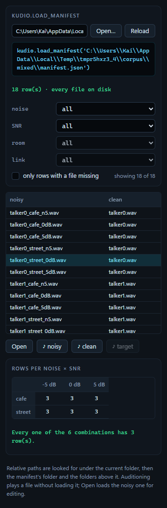

# Manifest

{ .shot .side }

合成出來的語料庫有成千上萬個檔案，檔名裡寫著乾淨檔案、雜訊與 SNR，但房間、鏈路與殘響目標音
都不在任何一個檔名裡。它們只記錄在[合成](synthesize.md)面板於每個語料庫旁寫出的
`manifest.json`。這個面板用 `kudio.load_manifest`（路徑下方那一行就是這個呼叫）把它讀回來，
照它本來的樣子呈現：一列一列的 noisy、clean、noise、SNR、房間、鏈路與 target。

在拿一個語料庫去訓練之前，有兩個問題值得先問，這個面板兩個都能回答：每個檔案都還在嗎？
雜訊 × SNR 的每種組合都有涵蓋到嗎？

## 開啟 manifest {#opening-one}

- 「檔案 → 開啟 manifest…」，或面板本身的「開啟…」。
- 從命令列：`kudiostudio data/mixed/manifest.json`。命令列上列出的檔案中，`.json`
  會在這個面板開啟；有好幾個時，開啟的是最後一個。
- 拖放到視窗上的 `.json`，或在「檔案 → 開啟…」中選的 `.json`，也會送到這裡，
  而不是被當成無法讀取的音訊檔。

讀取 manifest 與尋找它列出的每個檔案都在背景進行，所以幾萬列的語料庫也不會讓視窗卡住。
表格準備好時，狀態列會說明，並告訴你有幾列。「重新載入」會重新讀取 manifest 並再找一次每個檔案：
例如合成重新寫過它之後，或某個資料夾被移回原位之後。

## 表格 {#the-table}

| 欄 | 對應 manifest 的 |
|---|---|
| noisy | `noisy`：混合音 |
| clean | `clean`：它所用的乾淨檔案 |
| noise | `noise`：雜訊檔的名稱 |
| SNR dB | `snr_db` |
| RT60 s | `rt60`：房間 |
| link | `channel` |
| target | `target`：殘響目標音 |

破折號代表這一列沒有那個值：沒有房間、沒有鏈路或沒有目標音。

同一類路徑共用的資料夾會被省略，所以 noisy 欄顯示的是 `u0_babble_n5_rt300ms.wav`，
而不是把同一段長長的前綴重複一萬次。欄位標題的提示會說明省略的是哪個資料夾，
儲存格的提示則是該檔案的完整路徑。名稱太長、欄位放不下時，會省略中間的部分：
合成的檔名開頭是乾淨檔案，結尾是 SNR 與房間，這兩段才值得保留。表格比面板寬，
clean 之後的欄位要橫向捲動才看得到。

表格只建立畫面上看得到的列，捲動時再取得更多。

### 排序 {#sorting}

點欄位標題就依該欄排序，先是遞增（▲），再點一次是遞減（▼），第三次則回到 manifest 本身的順序。
SNR 與 RT60 依數值排序。若當成文字，"10" 會排在 "5" 前面，"−5" 則會因為負號而落在莫名的位置。
沒有值的列不論哪個方向都排在最後，值相同的列則維持語料庫寫出時的順序。

### 篩選 {#filters}

noise、SNR、room 與 link 四個篩選，各自可以顯示全部的列，或只顯示某一個值的列。`none`
本身也是一個值：沒有房間或沒有鏈路的那些列。欄位裡只有一種值時，該篩選會變灰。
「只顯示有檔案遺失的列」只留下那些列，旁邊那一行則說明目前顯示幾列、總共幾列。

### 開啟一列與試聽 {#opening-a-row-and-listening-to-it}

點一下某一列就選取它；++arrow-up++ 與 ++arrow-down++ 在表格中上下移動。按「開啟」、雙擊或
++enter++，會把這一列的 noisy 檔案載入工作階段以供編輯，就像「檔案 → 開啟…」一樣，
也會在同樣的情況下先詢問，見[在音訊被取代之前](../editing.md#before-a-clip-is-replaced)。

♪ noisy、♪ clean 與 ♪ target 會循環播放所選那一列的其中一個檔案，而不載入任何東西。
播放期間按鈕保持按下，改選另一列時，會改播那一列的同一個檔案，所以用方向鍵沿著表格往下走，
就能很快地把一個語料庫聽過一遍。再按一次按鈕就停止；其他任何播放也會讓它停下，
從「播放」到另一個面板的預覽都是。檔案不在磁碟上時按鈕會變灰，♪ target 在語料庫沒有寫出
目標音時也會變灰，按鈕的提示會說明是哪一種情況。

## 遺失的檔案 {#missing-files}

### 相對路徑去哪裡找 {#where-relative-paths-are-looked-for}

manifest 裡的路徑常常是相對路徑，相對於當初執行合成的資料夾，而沒有任何地方記錄那是哪個資料夾。
所以依序到這些地方找：

1. 啟動 KudioStudio 時所在的資料夾，因為對其他所有程式來說，相對路徑就是這個意思；
2. manifest 本身所在的資料夾；
3. 再往上的每一層資料夾。

第三種是最常見的情況。在專案資料夾執行 `Synthesizer('data/clean', 'data/noise',
out_path='data/mixed')`，檔案會被記錄成 `data/mixed/spk1/…`，manifest 則放在
`data/mixed`，比這些路徑的起點低兩層。

整份 manifest 只會對照其中一個資料夾來讀：第一個包含它列出的所有檔案的資料夾；如果沒有，
就用包含最多檔案的那一個。我不逐一查找每個檔案。用同一組乾淨檔案做出來的兩個專案，
混合音的檔名會很像，逐一查找的話，可能把一個專案的混合音配上另一個專案的乾淨檔案，
卻還回報每個檔案都在。路徑呼叫下方的摘要會寫出最後採用的資料夾：

```text
6 列 · 每個檔案都在磁碟上 · 相對路徑在 D:\work\denoise 下找到
```

絕對路徑則照原樣使用。

### 有檔案遺失的列 {#rows-with-a-file-missing}

manifest 還在、檔案卻不見了，是常有的事：資料夾被搬走、一次執行刪掉了一半、manifest 被複製到
另一台機器。找不到的檔案會以警示色顯示，摘要則計算有遺失檔案的列數：

```text
6 列 · 1 列有檔案遺失 · 相對路徑在 D:\work\denoise 下找到
```

儲存格的提示會寫 `不在磁碟上：` 加上 manifest 裡記的路徑。如果整份 manifest 已經選定了一個
資料夾，相對路徑的提示會再加上在哪個資料夾下找過。manifest 裡的檔案一個都找不到時，例如換了
一台機器，就沒有這個資料夾，提示只會寫出路徑本身。

勾選「只顯示有檔案遺失的列」，表格就只剩這些列。這時表格下方的涵蓋表計算的是損壞落在哪些
雜訊 × SNR 組合，而不是涵蓋情況。noisy 檔案遺失的列無法開啟，但它的乾淨檔案與目標音
仍然可以試聽。

## 涵蓋表 {#the-coverage-grid}

表格下方的「每種 雜訊 × SNR 的列數」，每種雜訊一列、每個 SNR 一欄，計算目前顯示的列落在
每種組合的數量。沒有任何列的組合就是一個缺口，那一格會填上警示色。只有至少一列用到的 SNR
才會有一欄：manifest 記錄的是實際寫出的東西，而不是當初要求的東西。

篩選以兩種方式影響它。雜訊或 SNR 篩選會把涵蓋表縮小到那種雜訊或那個 SNR。房間或鏈路篩選
則保留涵蓋表的形狀，只改變計數，所以某個房間缺少的組合會顯示為 0，而不是悄悄消失。
雙擊一格，就只顯示那一格的列。

涵蓋表下方的說明會解讀這些計數：

| 說明 | 意思 |
|---|---|
| 全部 6 種組合都有 3 列。 | 每種組合出現的次數相同 |
| 全部 6 種組合都有 1 或 2 列。 | 彼此相差不超過一列，這是乾淨檔案數無法整除時 `regular` 寫出的樣子；兩個房間時就是 2 或 4 列 |
| 3 / 6 種 雜訊 × SNR 組合沒有資料列 — 3 列無法涵蓋 6 種組合；在 reg 模式下至少需要 6 個乾淨檔案。 | 乾淨檔案比組合數少的 regular 語料庫；加入更多乾淨檔案就能補滿 |
| 3 / 6 種 雜訊 × SNR 組合沒有資料列 — 6 列分在 2 個房間，每個房間 3 列，而每個房間重複的是同樣的組合，所以涵蓋不了 6 種；在 reg 模式下至少需要 6 個乾淨檔案。 | 同上，發生在有房間的語料庫 |
| 3 / 6 種 雜訊 × SNR 組合沒有資料列，雖然 18 列已足以涵蓋全部。… | 這不是單次執行會寫出的結果：有資料列遺失了，或這份 manifest 是兩次執行合併而成 |
| 全部 6 種組合都有資料列，但不平均 — 每種 1 到 4 列。 | 兩種模式都不會寫出這樣的分布 |

前兩種是好消息，以綠色顯示；其他則以警示色顯示。

有好幾個房間的語料庫，每個混合音在每個房間各有一份，每個房間的雜訊與 SNR 都相同，涵蓋表會把它們
全部算進去。說明則依每個房間來解讀計數：三個乾淨檔案放進兩個房間是六列，但只涵蓋三種組合而不是六種，
這是乾淨檔案太少，不是資料列遺失。鏈路不這樣算，因為一次執行只有一種鏈路。在 room 篩選中選一個房間，
看到的就是乾淨檔案走過一輪的樣子。

## 被拒絕的 manifest {#a-manifest-that-is-refused}

kudio 讀取 manifest 時不檢查裡面的值，而手動編輯過的 manifest 可能在該放 SNR 的地方放了一個 list。
放著不管的話，會在填表格填到一半時才出錯。所以每一列都會先檢查：`noisy` 與 `clean` 必須是路徑，
`noise`、`channel` 與 `target` 必須是文字或 null，`snr_db` 與 `rt60` 必須是數字或 null。
沒通過的 manifest 會被拒絕，並指出是哪一列、哪個欄位，面板原本顯示的內容則保持不變：

```text
無法讀取 bad.json — ValueError: 第 2 列：snr_db 是 list [5]，應為數字或 null
```

缺少 `noisy` 或 `clean` 的列也會以同樣方式被拒絕，並附上 kudio 給的原因。
