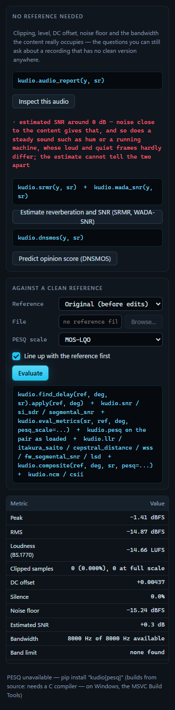

# Metrics

{ .shot .side }

Two kinds of question about the clip. Is the recording any good, which you
can ask of anything, and how close is it to a clean version of itself, which
needs that clean version. The top half answers the first with no reference
at all, the bottom half the second, and one table under both shows whichever
ran last. Each button comes with a line naming the kudio call behind it.

Every measurement here is of the whole clip. The selection makes no
difference.

## Inspect this audio

**Inspect this audio** runs `kudio.audio_report` on the clip and fills the
table:

| Row | What it is |
|---|---|
| Peak | the loudest sample, in dBFS; `silence` when every sample is zero |
| RMS | the average level, in dBFS |
| Loudness (BS.1770) | integrated loudness in LUFS. Without a figure the row says why: `silence` when every sample is zero, `n/a (shorter than 400 ms)` for a clip under one 400 ms gating block, and `n/a` for a clip with NaN or inf in it, or one so quiet that every block falls under BS.1770's −70 LUFS gate |
| Clipped samples | samples on a flat top at full scale, in runs of three or more, and their share of the clip; then, with a kudio that counts them, every sample at full scale one by one, which is the figure tools that count single samples give |
| DC offset | the mean sample value; a healthy recording sits at zero |
| Silence | the share of 30 ms frames more than 40 dB below the loud ones |
| Noise floor | the level of the quietest frames, the 10th percentile, in dBFS. `-inf dBFS` when a tenth of the frames or more are exact zeros, as in a clip with its pauses muted: then the floor really is digital silence |
| Estimated SNR | the loud frames (95th percentile) against the noise floor, so `+inf dB` beside a floor of `-inf`. An estimate from one signal, not a measurement against a clean one |
| Bandwidth | how high the content reaches, against what the sample rate allows |
| Band limit | where the content stops when the file was upsampled or went through a codec, and the rate it most likely came from; `none found` when it reaches the top |
| Sample grid | the spacing between sample values, as bits: an untouched 16-bit file gives 16, and gain raised after quantisation gives fewer, so a 16-bit file whose values all sit on every 16th step gives 12. It is not the effective number of bits, which noise and distortion set. `not judged` for float audio, audio processed after it was quantised, or fewer than 16 different values |
| Narrowband lines | how many lines stand 20 dB or more above their surroundings, and the strongest; a hum, a whistle, a machine's tone |
| Comb | lines at whole multiples of one frequency, its fundamental and which harmonics are there; one row a comb |
| Note | on a recording made above 48 kHz: loudness and WADA-SNR take in the ultrasound no one hears, so a floor above 20 kHz raises the loudness and moves the SNR; SRMR and DNSMOS are scored on a 16 kHz copy and see nothing above 8 kHz |

A sample or two touching full scale is not counted as clipping, and neither is
float audio that goes past 1.0 while still tracing its waveform. Only a flat
run pinned at the rail is information that is gone.

Under the button goes what is wrong with the recording, one line per problem,
in the warning colour:

| The line says | When |
|---|---|
| `… samples are not finite (NaN or inf)` | a corrupt clip. It comes alone, since every other figure is meaningless then |
| `the clip is digital silence` | every sample is zero |
| `… samples clipped (…% of the clip)` | any clipped run at all |
| `peaks at … dBFS, past full scale` | float audio above 0 dBFS that has not clipped yet. It will, the moment it is written to an integer format |
| `peaks at … dBFS, right against the ceiling` | a peak above −0.5 dBFS |
| `peaks at only … dBFS — very quiet` | a peak below −30 dBFS |
| `DC offset of …` | an offset above 0.01 either way |
| `content stops at … Hz, although a … Hz file holds up to … Hz` | a cliff in the spectrum: the band just under the edge stands 20 dB or more over the band just above it, and 40 dB or more over everything from there to the top. At the Nyquist frequency of a common rate it names that rate. A spectrum that falls off gently, as most microphones and rooms make it, is not a finding |
| `the band above … Hz mirrors the band under it` | the band over the old Nyquist is the one under it, folded, at the level linear interpolation leaves: an upsampling that added nothing |
| `every sample sits on a grid of … bits` | a grid coarser than 16 bits: a low-resolution converter, or gain raised after the audio was quantised |
| `…% of the clip is silence` | more than 60% silence |
| `estimated SNR around … dB` | an estimated SNR under 10 dB |

With none of them, the line reads:

```text
Nothing wrong with the recording itself. This says the audio is technically
sound, not that it sounds good — for that, try the DNSMOS button below.
```

The [Levels readout](inspect.md#levels) on the Inspect panel runs the same
check all the time, and shows the figures you look at most. This table has
the ones behind them, for when you want the noise floor or the DC offset as a
number.

## Reverberation and SNR

**Estimate reverberation and SNR (SRMR, WADA-SNR)** asks two more things of
the clip on its own, on a job, and fills the table with two rows:

`SRMR (higher is drier)`
:   `kudio.srmr`, the speech-to-reverberation modulation energy ratio: how
    much of the envelope's energy sits in the slow modulations syllables make,
    against the faster ones a room adds. It has no fixed range, so a figure
    means something only next to the same speech somewhere else: one take in
    two rooms, or before and after dereverberation. kudio scores it at 8 and
    16 kHz only, the two rates its authors' toolbox was validated at; at any
    other rate it is measured on a 16 kHz copy, and the row
    reads `SRMR (on a 16 kHz copy; higher is drier)`.

`WADA-SNR`
:   `kudio.wada_snr`, how far the speech sits above its noise, read from how
    peaked the sample values are. It is close up to about 15 dB; above about
    20 dB the shape of the speech decides more than the noise does, so I use
    it to sort recordings and read anything above 30 dB as clean.

A row with no figure says why in a few words: `silence`, `n/a — too short to
measure`, or `n/a — its pauses are digital silence` for a clip that was
noise-gated, edited or made with no noise at all, where WADA-SNR has no
noise in the pauses to read. Too short means under a second of sound for
WADA-SNR, and under one 256 ms window, once its silence is cut, for SRMR.
kudio's guide, under
[Inspecting a recording](https://recklight.github.io/Kudio/guide/inspection/),
has the rest.

## DNSMOS

`audio_report` says whether a recording is technically sound. Whether it
sounds good is a judgement, and without a listening panel the only way to one
is a model trained on listeners. **Predict opinion score (DNSMOS)** runs
DNSMOS (ITU-T P.835) through `kudio.dnsmos` and fills the table with three
scores on the usual 1 to 5 scale:

| Row | What it rates |
|---|---|
| SIG (speech) | the speech itself, ignoring the background |
| BAK (background) | how unobtrusive the background is |
| OVRL (overall) | the whole thing |
| Windows averaged | how many 9-second windows the scores are the mean of |

I show all three rather than one average because SIG and BAK move in opposite
directions under denoising. Suppress harder and the background gets cleaner
while the speech gets eaten, and an average would hide exactly the trade you
are trying to judge.

Under the button goes one line of plain words. It calls OVRL 4.0 and above
`clean`, 3.0 and above `usable`, 2.0 and above `poor`, and anything lower
`bad`, and adds a note when SIG and BAK are more than 0.7 apart:

```text
poor (OVRL 2.55) — the background is cleaner than the speech, which is what
over-aggressive denoising looks like
```

The other note, for SIG well above BAK, says the speech survived but the
background is still intrusive.

The model was trained at 16 kHz on 9.01-second windows, so the clip is
resampled to 16 kHz and scored a window at a time, one second apart. A clip
shorter than one window is repeated until it fills one, not padded with
silence, which the model would score as ruined speech: 2 s of audio becomes
16 s and seven windows.

### What DNSMOS needs

Two things, and neither comes with a plain install:

- onnxruntime, from `pip install "kudiostudio[dnsmos]"`;
- the model weights, `sig_bak_ovr.onnx`. They belong to Microsoft's
  DNS-Challenge and are distributed there, so neither kudio nor KudioStudio
  ships them. Clone <https://github.com/microsoft/DNS-Challenge> and point
  the `KUDIO_DNSMOS_DIR` environment variable at its `DNSMOS` folder before
  you start `kudiostudio`. The variable can also name the file itself. The
  panel calls `kudio.dnsmos(y, sr)` with no `model_dir`, so the variable is
  the only way it finds them.

Without either, the panel shows kudio's own message in full, because it says
where to get what is missing. [Troubleshooting](../troubleshooting.md) has
both messages and the commands.

## Against a clean reference

Every quality metric compares the clip with a clean version of it. A
synthetic dataset has one. A real recording never does: its original is the
noisy one, so scoring against it measures how much you changed the audio,
not whether you improved it.

**Reference** chooses what to compare against:

`Original (before edits)`
:   the clip as it was opened or recorded. This is a clean reference only when
    what you opened was clean. Open a clean take, add noise or a room in
    [Effects](effects.md), denoise it in [Enhance](enhance.md), and Evaluate
    scores the denoiser against where you started.

`File…`
:   a file chosen in **File**. It is read in mono and at the clip's sample
    rate, resampled if it has to be, so a reference at another rate still
    compares sample for sample.

**Evaluate** first measures the offset between the two (next section), then
fills the table with what numpy alone can give: `SNR`, `SI-SDR`,
`Segmental SNR`, and `Compared samples`, how many samples were scored. The
rest is computed on a job and joins the table when it finishes: PESQ, STOI
and SDR; Hu and Loizou's measures, `LLR`, `Itakura-Saito`, `Cepstral
distance`, `WSS` and `fwSegSNR`, which are defined at 8 and 16 kHz only; the
log-spectral distance `LSD`, with URGENT 2025's settings; with PESQ
installed, `CSIG`, `CBAK` and `COVL`, the ratings Hu and Loizou fitted to
listeners, with the PESQ that went into them on a row of its own; and `NCM`
and `CSII`, which, like STOI, predict intelligibility. NCM is defined at 8
and 16 kHz only. CSII takes any rate from 8 kHz and has a row for each level
of the reference: `high` for its frames at or above the reference's overall
RMS, `mid` for those within 10 dB under it, and `low` for the quieter rest,
pauses included. A back-end that is missing leaves its row saying so
([below](#which-metric-needs-what)). A row a measure cannot fill says why,
as `n/a — the reference is silent` does, and a clip or a reference with NaN
or inf samples in it is not scored at all: the status bar says which of the
two to repair.

## Lining up first

Every metric here but PESQ compares sample *i* of the reference with sample
*i* of the clip. PESQ finds the delay itself, and is scored on the two as they
were loaded, lined up or not. Here is one take scored against a copy of
itself delayed by 128 samples, 8 ms at 16 kHz:

```text
lined up       SI-SDR  +148.989 dB
not lined up   SI-SDR    -4.774 dB
```

Nothing in the second number says "these two are misaligned" rather than "the
processing destroyed the signal", and those mean opposite things. So the
offset is measured with `kudio.find_delay` on every Evaluate, and goes in the
table as the first row:

```text
Alignment          lags by 128 samples (8.0 ms), correlation 1.000
```

`lags` means the clip comes later than the reference, `leads` that it comes
earlier, and `polarity inverted` is added when one of the two is upside down.
An inverted copy is the same take with something in the chain flipped, which
is worth knowing, so it is reported rather than corrected.

**Line up with the reference first**, on by default, takes the offset out
before scoring: both signals are trimmed to the stretch they share, which is
why `Compared samples` can come out a little shorter than the clip. The
status bar says what was taken out:

```text
This clip lags by 128 samples (8.0 ms), correlation 1.000; lined up with the
reference before scoring.
```

Turn it off to leave the offset in: every metric but PESQ then compares the
two from their first samples, over the length of the shorter one, and PESQ
still gets both whole. The offset is still measured and reported, with a
warning row:

```text
⚠ Not aligned      8.0 ms of offset is left in; the scores below are mostly
                   measuring it
```

When the correlation at the best offset is under 0.5, the two are not the
same recording, whatever the switch says:

```text
⚠ Reference        these do not look like the same recording — the scores
                   below are about two unrelated signals
```

The panel then scores them without lining them up. Cross-correlation always
finds some best offset, and two unrelated signals aligned on it would give a
confident-looking number about nothing, which is worse than an obviously bad
one.

## Which metric needs what

| Metric | Needs | Notes |
|---|---|---|
| SNR, SI-SDR, Segmental SNR | nothing; numpy | always there |
| LLR, Itakura-Saito, Cepstral distance, WSS, fwSegSNR | nothing; numpy | 8 or 16 kHz only |
| LSD | nothing; numpy | always there |
| NCM, CSII | nothing; numpy and scipy | NCM at 8 or 16 kHz only; CSII from 8 kHz, one row for each level of the reference |
| CSIG, CBAK, COVL | `pip install "kudio[pesq]"` | 8 or 16 kHz only; wideband MOS-LQO inside at 16 kHz and raw narrowband at 8 kHz, whatever **PESQ scale** says |
| SRMR, WADA-SNR | nothing; numpy and scipy | no reference needed; SRMR on a 16 kHz copy at other rates |
| STOI | `pip install "kudiostudio[eval]"` | about 0.4 s of speech once silence is removed |
| SDR | `pip install "kudiostudio[eval]"` | BSS-SDR, from mir_eval |
| PESQ | `pip install "kudio[pesq]"` | builds from source and needs a C compiler, on Windows the MSVC Build Tools. 8 or 16 kHz only |
| DNSMOS | `pip install "kudiostudio[dnsmos]"` and the weights | [above](#what-dnsmos-needs) |

PESQ has an extra of its own because it compiles. Put in `[eval]` or `[all]`,
it would stop either from installing on a machine without a compiler.

The line under the table says which back-ends are there, and for each one
that is not, the command that installs it:

```text
PESQ unavailable — pip install "kudio[pesq]" (builds from source: needs a C
compiler — on Windows, the MSVC Build Tools)
```

The commands name kudio's extras. `kudiostudio[eval]` installs the same as
`kudio[eval]`, and PESQ has no KudioStudio extra at all. A row with no score
says which of three things happened, since they need different answers:

- `not installed`: the back-end is missing;
- `not defined at 44100 Hz (PESQ is 8 or 16 kHz)`: PESQ is installed, but
  the standard covers those two rates only;
- `could not be computed for this pair`: installed and defined, and it still
  failed on these two signals, such as STOI on a clip with too little speech
  in it.

Calling all three "not installed" would tell you to install what you already
have. The back-ends are looked for once per run, so restart `kudiostudio`
after installing one.

## PESQ: MOS-LQO or raw

PESQ comes on two scales, and **PESQ scale** chooses which one the table
shows. The row says which it is, `PESQ (MOS-LQO)` or `PESQ (raw P.862)`.

MOS-LQO
:   the default, and what kudio reports unless asked otherwise: the score
    mapped onto the MOS scale both standards define. At 16 kHz it is wideband
    PESQ (P.862.2), at 8 kHz narrowband. The wideband one is the `pesq`
    package's, without the correction ITU made to wideband PESQ in 2018,
    which raises it by 0.73 on average in ITU's own table.

raw P.862
:   the narrowband score before the P.862.1 mapping, from −0.5 to 4.5, which
    the ITU reference program prints ahead of the MOS-LQO. Papers quote both
    scales. At 16 kHz this means running PESQ in narrowband mode as well, since
    P.862.2 reports no raw score.

They are different scales, not different roundings. A raw 2.03 is about 1.66
MOS-LQO, so a table of raw scores set against a paper's MOS-LQO, or the other
way round, compares two numbers that cannot be compared. Check which one the
paper quotes before you put yours beside it.

**PESQ scale** does not reach CSIG, CBAK and COVL. They take the PESQ
published figures were made with, wideband MOS-LQO at 16 kHz and raw
narrowband at 8 kHz, and the row `PESQ inside them (...)` shows which one
and the figure. The fit itself was made on the raw narrowband score;
`kudio.composite(ref, deg, sr, mode="nb", scale="raw")` gives that variant,
outside the panel.
