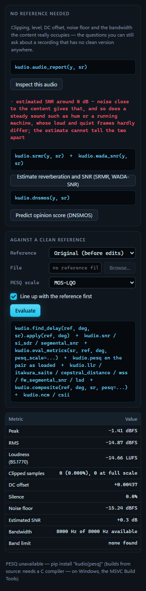

# 指標

{ .shot .side }

關於一段音訊，可以問兩種問題。一是這段錄音本身好不好，任何音訊都能問；二是它離自己的乾淨版本有多近，
這就得先有那個乾淨版本。面板上半部不需要任何參考訊號，回答第一種；下半部回答第二種；兩者下方共用
一張表格，顯示最後執行的那一項。每個按鈕旁邊都有一行，寫著它背後的 kudio 呼叫。

這裡的每項量測都針對整段音訊，選取範圍不影響結果。

## 檢查這段音訊 {#inspect-this-audio}

「檢查這段音訊」對整段音訊執行 `kudio.audio_report`，並填入表格：

| 列 | 意義 |
|---|---|
| 峰值 | 最大的樣本值，單位 dBFS；全部為零時顯示「靜音」 |
| RMS | 平均音量，單位 dBFS |
| 響度（BS.1770） | 整合響度，單位 LUFS。沒有數字時會寫出原因：全部為零時顯示「靜音」；短於一個 400 ms 閘控區塊時顯示「不適用（短於 400 ms）」；含有 NaN 或 inf 的音訊，或小聲到每個區塊都在 BS.1770 的 −70 LUFS 閘門以下的音訊，顯示「不適用」 |
| 削波樣本數 | 停在滿刻度平頂上的樣本，連續三個以上才算，以及它們佔整段的比例；kudio 有算的話，後面再列出逐一數到的滿刻度樣本數，也就是只數單一樣本的工具給的數字 |
| DC 偏移 | 樣本的平均值；健康的錄音應該落在零 |
| 靜音 | 30 ms 幀中，比大聲的幀低 40 dB 以上的比例 |
| 底噪 | 最安靜那些幀的音量，取第 10 百分位數，單位 dBFS。有一成以上的幀全是零時，例如停頓被靜音過的音訊，會顯示 `-inf dBFS`：這時底噪確實就是數位靜音 |
| 估計 SNR | 大聲的幀（第 95 百分位數）相對於底噪，所以底噪是 `-inf` 時這裡是 `+inf dB`。這是從單一訊號估計出來的，不是拿乾淨訊號比對量到的 |
| 頻寬 | 內容實際延伸到多高，以及取樣率允許到多高 |
| 頻寬上限 | 檔案升頻過或經過編解碼器時，內容在哪裡停止，以及它最可能來自的取樣率；內容到頂時顯示「沒有找到」 |
| 樣本格點 | 樣本值之間的格距，換成位元數：沒動過的 16 位元檔是 16，量化之後才加大增益會變少，所以一個 16 位元的檔案若每個值都落在每 16 階的格點上，就是 12。它不是有效位元數，有效位元數由雜訊和失真決定。浮點音訊、量化之後又處理過的音訊，或不同的值少於 16 個時，顯示「無法判斷」 |
| 窄頻線 | 比周圍高 20 dB 以上的線有幾條，以及最強的一條；嗡聲、哨音、機器的音調 |
| 梳狀 | 落在同一個頻率整數倍上的線，列出基頻和有哪幾個諧波；一個梳狀一列 |
| 附註 | 取樣率高於 48 kHz 的錄音才有：響度和 WADA-SNR 會把人聽不到的超音波也算進去，所以 20 kHz 以上的底噪會抬高響度、影響 SNR；SRMR 和 DNSMOS 是在 16 kHz 的副本上算的，8 kHz 以上都看不到 |

一兩個樣本碰到滿刻度不算削波；浮點音訊超過 1.0 但仍然描出完整波形，也不算。只有貼在上限的一段平頂，
才是資訊真的已經丟失了。

按鈕下方列出錄音本身的問題，一行一個，以警示色顯示：

| 顯示的文字 | 出現的條件 |
|---|---|
| `有 … 個樣本不是有限值（NaN 或 inf）` | 音訊已損壞。這時只會出現這一行，因為其他數字都沒有意義了 |
| `這段音訊是數位靜音` | 所有樣本都是零 |
| `有 … 個樣本削波（佔整段的 …%）` | 只要有任何一段削波 |
| `峰值 … dBFS，超過滿刻度` | 浮點音訊超過 0 dBFS 但還沒削波。一寫成整數格式就會削波 |
| `峰值 … dBFS，緊貼上限` | 峰值高於 −0.5 dBFS |
| `峰值只有 … dBFS — 非常小聲` | 峰值低於 −30 dBFS |
| `DC 偏移 …` | 偏移的絕對值超過 0.01 |
| `內容到 … Hz 就沒了，但 … Hz 的檔案可以裝到 … Hz` | 頻譜上的一道斷崖：邊緣正下方的頻帶比正上方高 20 dB 以上，也比從那裡到頂端的整段高 40 dB 以上。邊緣在常見取樣率的奈奎斯特頻率上時，會說出那個取樣率。大多數麥克風和房間造成的緩降不算 |
| `… Hz 以上的頻帶是下方頻帶的鏡像` | 舊奈奎斯特頻率以上的頻帶，是下方頻帶摺過去的樣子，位準符合線性內插留下的程度：升頻沒有加進任何東西 |
| `每個樣本都落在 … 位元的格點上` | 格點比 16 位元粗：低解析度的轉換器，或量化之後才調大增益 |
| `整段有 …% 是靜音` | 靜音超過 60% |
| `估計 SNR 約 … dB` | 估計 SNR 低於 10 dB |

一個都沒有時，那一行會寫：

```text
錄音本身沒有問題。這只表示音訊在技術上沒問題，不代表它聽起來好 — 若要評估聽感，
請試試下方的 DNSMOS 按鈕。
```

「檢查」面板上的[「音量」讀數](inspect.md#levels)隨時都在做同樣的檢查，並顯示最常看的那幾個數字。
這張表格則列出它們背後的數字，想知道底噪或 DC 偏移的確切數值時用得上。

## 殘響與 SNR {#reverberation-and-snr}

「估計殘響與 SNR（SRMR、WADA-SNR）」只靠這段音訊本身再回答兩件事，在背景工作中執行，
完成後在表格填入兩列：

`SRMR（越高越乾）`
:   `kudio.srmr`，語音對殘響調變能量比：包絡的能量有多少落在音節造成的慢速調變，
    相對於房間加上去的較快調變。它沒有固定的範圍，所以數字只有和同一段語音在別處的版本
    並列時才有意義：同一段錄音在兩個房間，或去殘響前後。kudio 只在 8 與 16 kHz 下
    計算它，這是作者工具箱驗證過的兩個取樣率；其他取樣率會在 16 kHz 的複本上量測，這一列會寫成「SRMR（在 16 kHz 的複本上量測；越高越乾）」。

`WADA-SNR`
:   `kudio.wada_snr`，語音比它的雜訊高出多少，從樣本值有多集中來讀出。大約 15 dB
    以下相當準；大約 20 dB 以上，決定結果的是語音本身的形狀而不是雜訊，所以我用它來排序
    錄音，30 dB 以上就當成乾淨。

沒有數字的那一列會用幾個字說明原因：「靜音」、「不適用 — 太短，無法量測」，
或是「不適用 — 停頓是數位靜音」，後者出現在做過噪音閘、剪輯過或完全沒有雜訊的片段，
WADA-SNR 在停頓裡讀不到雜訊。所謂太短，對 WADA-SNR 是不到一秒的聲音，對 SRMR 則是去掉靜音後
不到一個 256 ms 的視窗。其餘的說明在 kudio 指南的
[檢查錄音](https://recklight.github.io/Kudio/zh-TW/guide/inspection/)。

## DNSMOS {#dnsmos}

`audio_report` 回答的是錄音在技術上有沒有問題。聽起來好不好則是主觀判斷，沒有聽測小組時，
唯一的辦法是用聽者評分訓練出來的模型。「預測主觀分數（DNSMOS）」透過 `kudio.dnsmos` 執行
DNSMOS（ITU-T P.835），在表格中填入三個 1 到 5 分的分數：

| 列 | 評的是什麼 |
|---|---|
| SIG（語音） | 語音本身，不管背景 |
| BAK（背景） | 背景有多不干擾 |
| OVRL（整體） | 整體品質 |
| 平均的視窗數 | 這些分數是幾個 9 秒視窗的平均 |

三個分數我都列出來，而不是只給一個平均，因為降噪時 SIG 與 BAK 會往相反方向走。壓得越用力，
背景越乾淨，語音卻被吃掉，取平均正好會把你想判斷的那個取捨藏起來。

按鈕下方會有一行白話的結論。OVRL 4.0 以上叫「乾淨」，3.0 以上「可用」，2.0 以上「差」，
更低則是「很差」；SIG 與 BAK 相差超過 0.7 時，還會補上一句說明：

```text
差（OVRL 2.55） — 背景比語音還乾淨，這正是降噪下手太重的樣子
```

反過來，SIG 明顯高於 BAK 時，那句說明是語音保住了，但背景仍然干擾。

模型是以 16 kHz、9.01 秒的視窗訓練的，所以音訊會先重新取樣到 16 kHz，再一個視窗一個視窗地評分，
視窗之間相隔一秒。比一個視窗短的音訊會重複接起來直到填滿一個視窗，而不是補靜音，
因為模型會把靜音評成被破壞的語音：2 秒的音訊會變成 16 秒、七個視窗。

### DNSMOS 需要什麼 {#what-dnsmos-needs}

兩樣東西，基本安裝都不包含：

- onnxruntime，用 `pip install "kudiostudio[dnsmos]"` 安裝；
- 模型權重 `sig_bak_ovr.onnx`。它屬於 Microsoft 的 DNS-Challenge，也由那裡發布，所以 kudio 與
  KudioStudio 都沒有隨附。請 clone <https://github.com/microsoft/DNS-Challenge>，並在啟動
  `kudiostudio` 之前，把環境變數 `KUDIO_DNSMOS_DIR` 指向其中的 `DNSMOS` 資料夾。
  這個變數也可以直接指向模型檔本身。面板呼叫的是不帶 `model_dir` 的 `kudio.dnsmos(y, sr)`，
  所以這個變數是它找到權重的唯一途徑。

缺了任何一樣，面板會完整顯示 kudio 自己的訊息，因為那則訊息會告訴你缺的東西去哪裡拿。
兩種訊息與對應的指令都在[疑難排解](../troubleshooting.md)。

## 與乾淨參考訊號比較 {#against-a-clean-reference}

每個品質指標都是拿音訊與它的乾淨版本比較。合成資料集有乾淨版本，真實錄音永遠沒有：
它的原始版本就是含噪的那一個，所以拿它來評分，量到的是你改動了音訊多少，而不是你有沒有改善它。

「參考訊號」決定要和什麼比較：

`原始音訊（編輯之前）`
:   開啟或錄下時的音訊。只有當你開啟的本來就是乾淨的音訊時，它才算乾淨的參考訊號。
    先開一段乾淨的錄音，在[效果](effects.md)加上雜訊或房間，再到[增強](enhance.md)降噪，
    這時按「評估」，評的就是降噪器相對於起點的表現。

`檔案…`
:   在「檔案」欄選的檔案。它會以單聲道、以這段音訊的取樣率讀入，必要時重新取樣，
    所以取樣率不同的參考訊號照樣能逐樣本比較。

「評估」會先量測兩者之間的偏移（見下一節），再填入只靠 numpy 就能算的幾項：`SNR`、`SI-SDR`、
「分段 SNR」，以及實際評分了多少樣本的「比較的樣本數」。其餘的在背景工作中計算，完成後加進表格：
PESQ、STOI 與 SDR；Hu 與 Loizou 的指標 `LLR`、`Itakura-Saito`、「倒頻譜距離」、`WSS` 與
`fwSegSNR`，只定義在 8 與 16 kHz；對數頻譜距離 `LSD`，用的是 URGENT 2025 的設定；
裝了 PESQ 時的 `CSIG`、`CBAK` 與 `COVL`，也就是 Hu 與 Loizou 對聽者評分擬合出來的分數，
放進去的 PESQ 另外佔一列；以及和 STOI 一樣估計可懂度的 `NCM` 與 `CSII`。NCM 只定義在
8 與 16 kHz。CSII 接受 8 kHz 以上的任何取樣率，參考訊號的每一級各佔一列：高位準是不低於
參考訊號整體 RMS 的音框，中位準是比它低 10 dB 以內的音框，低位準是其餘更安靜的音框，
停頓也算在內。缺少後端的那一項，會在該列說明原因（見[下文](#which-metric-needs-what)）。
指標算不出來的列也會說明原因，例如「不適用 — 參考訊號是靜音」；音訊或參考訊號含有
NaN 或 inf 樣本時則完全不評分，狀態列會說要修復哪一個。

## 先對齊 {#lining-up-first}

這裡除了 PESQ，每個指標都是拿參考訊號的第 *i* 個樣本與這段音訊的第 *i* 個樣本比較。PESQ
會自己找出延遲，所以不管有沒有對齊，它都用載入時的兩段來評分。下面是一段錄音和它自己
延遲 128 個樣本（16 kHz 下是 8 ms）的副本比較的結果：

```text
對齊後     SI-SDR  +148.989 dB
未對齊     SI-SDR    -4.774 dB
```

光看第二個數字，分不出是「這兩段沒對齊」還是「處理把訊號毀了」，偏偏這兩者的意思正好相反。
所以每次按「評估」，都會用 `kudio.find_delay` 量測偏移，並放在表格的第一列：

```text
對齊               落後 128 個樣本（8.0 ms），相關係數 1.000
```

「落後」表示這段音訊比參考訊號晚，「超前」表示比較早；若其中一個上下顛倒，還會加上「極性相反」。
反相的副本仍是同一段錄音，只是處理鏈中某處把它翻轉了，這本身就值得知道，所以只回報、不自動修正。

「先與參考訊號對齊」預設開啟，會在評分前去除偏移：兩個訊號都修剪到彼此重疊的那一段，
所以「比較的樣本數」可能比整段音訊略少。狀態列會說去掉了多少：

```text
這段音訊比參考訊號落後 128 個樣本（8.0 ms），相關係數 1.000；評分前已對齊。
```

關掉它，就不去除偏移：除了 PESQ，每個指標都從兩者的第一個樣本開始、在較短那段的長度內
比較，PESQ 仍拿到完整的兩段。偏移仍然會被量測與回報，並多出一列警告：

```text
⚠ 未對齊           保留了 8.0 ms 的偏移；下方分數主要是在量測這個偏移
```

在最佳偏移處的相關係數低於 0.5 時，兩者就不是同一段錄音，不論開關怎麼設：

```text
⚠ 參考訊號         這兩者看起來不像同一段錄音 — 下方分數描述的是兩個無關的訊號
```

這時面板會直接評分，不做對齊。互相關總是找得到某個最佳偏移，把兩個無關的訊號照它對齊，
只會產生一個看起來很有把握、實際上毫無意義的數字，這比一個明顯很差的數字更糟。

## 哪個指標需要什麼 {#which-metric-needs-what}

| 指標 | 需要 | 備註 |
|---|---|---|
| SNR、SI-SDR、分段 SNR | 不需要額外安裝；numpy | 隨時可用 |
| LLR、Itakura-Saito、倒頻譜距離、WSS、fwSegSNR | 不需要額外安裝；numpy | 只支援 8 或 16 kHz |
| LSD | 不需要額外安裝；numpy | 隨時可用 |
| NCM、CSII | 不需要額外安裝；numpy 和 scipy | NCM 只支援 8 或 16 kHz；CSII 需要 8 kHz 以上，參考訊號的每一級各佔一列 |
| CSIG、CBAK、COVL | `pip install "kudio[pesq]"` | 只支援 8 或 16 kHz；不管「PESQ 尺度」怎麼選，16 kHz 裡面用寬頻 MOS-LQO，8 kHz 用窄頻 raw |
| SRMR、WADA-SNR | 不需要額外安裝；numpy 與 scipy | 不需要參考訊號；其他取樣率下 SRMR 在 16 kHz 的複本上量 |
| STOI | `pip install "kudiostudio[eval]"` | 去掉靜音後要有約 0.4 秒的語音 |
| SDR | `pip install "kudiostudio[eval]"` | BSS-SDR，來自 mir_eval |
| PESQ | `pip install "kudio[pesq]"` | 要從原始碼編譯，需要 C 編譯器，Windows 上則是 MSVC Build Tools。只支援 8 或 16 kHz |
| DNSMOS | `pip install "kudiostudio[dnsmos]"` 與模型權重 | 見[上文](#what-dnsmos-needs) |

PESQ 自成一個 extra，是因為它要編譯。若放進 `[eval]` 或 `[all]`，沒有編譯器的機器連那兩組都裝不起來。

表格下方那一行說明哪些後端已經裝好，沒裝的則附上安裝指令：

```text
PESQ 無法使用 — pip install "kudio[pesq]"（從原始碼編譯：需要 C 編譯器 — 在 Windows 上需要
MSVC Build Tools）
```

這些指令寫的是 kudio 的 extra。`kudiostudio[eval]` 裝的東西與 `kudio[eval]` 相同，PESQ 則沒有對應的
KudioStudio extra。沒有分數的列會說明是三種情況中的哪一種，因為處理方式各不相同：

- 「未安裝」：缺少後端；
- 「在 44100 Hz 下沒有定義（PESQ 僅支援 8 或 16 kHz）」：PESQ 已安裝，但標準只涵蓋這兩種取樣率；
- 「這一對無法計算」：已安裝、也有定義，卻仍然在這兩個訊號上失敗，例如語音太少的 STOI。

若三種情況都寫成「未安裝」，就等於叫你去裝已經裝好的東西。後端只在每次啟動時檢查一次，
所以裝好之後請重新啟動 `kudiostudio`。

## PESQ：MOS-LQO 還是 raw {#pesq-mos-lqo-or-raw}

PESQ 有兩種尺度，「PESQ 尺度」決定表格顯示哪一種。該列的名稱會寫明是哪一種：`PESQ (MOS-LQO)`
或 `PESQ (raw P.862)`。

MOS-LQO
:   預設值，也是 kudio 平常回報的：映射到兩份標準共同定義的 MOS 尺度上的分數。16 kHz 時是寬頻
    PESQ（P.862.2），8 kHz 時是窄頻。寬頻的是 `pesq` 套件算的，沒有套用 ITU 在 2018 年
    對寬頻 PESQ 做的更正；在 ITU 自己的表上，更正會讓它平均高 0.73。

raw P.862
:   經過 P.862.1 映射之前的窄頻分數，範圍 −0.5 到 4.5，ITU 參考程式會把它印在
    MOS-LQO 前面。論文兩種尺度都有人用。在 16 kHz 下選它，PESQ 也會以窄頻模式執行，因為 P.862.2 不回報 raw 分數。

兩者是不同的尺度，不是不同的捨入方式。raw 2.03 大約等於 1.66 MOS-LQO，所以拿一份 raw 分數去和
論文的 MOS-LQO 並列，或反過來，比的是兩個根本不能比的數字。把自己的結果放到論文旁邊之前，
先確認那篇論文引用的是哪一種。

「PESQ 尺度」管不到 CSIG、CBAK 與 COVL。它們用的是發表的數字所用的 PESQ：16 kHz 用寬頻
MOS-LQO，8 kHz 用窄頻 raw，「其中所用的 PESQ（…）」這一列會顯示是哪一種以及數字。當初擬合用的是
窄頻 raw 分數；要那個版本，請在面板之外用 `kudio.composite(ref, deg, sr, mode="nb", scale="raw")`。
