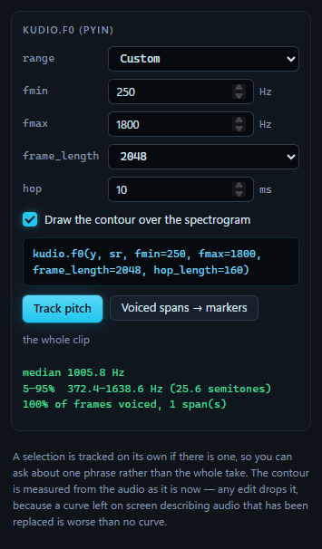
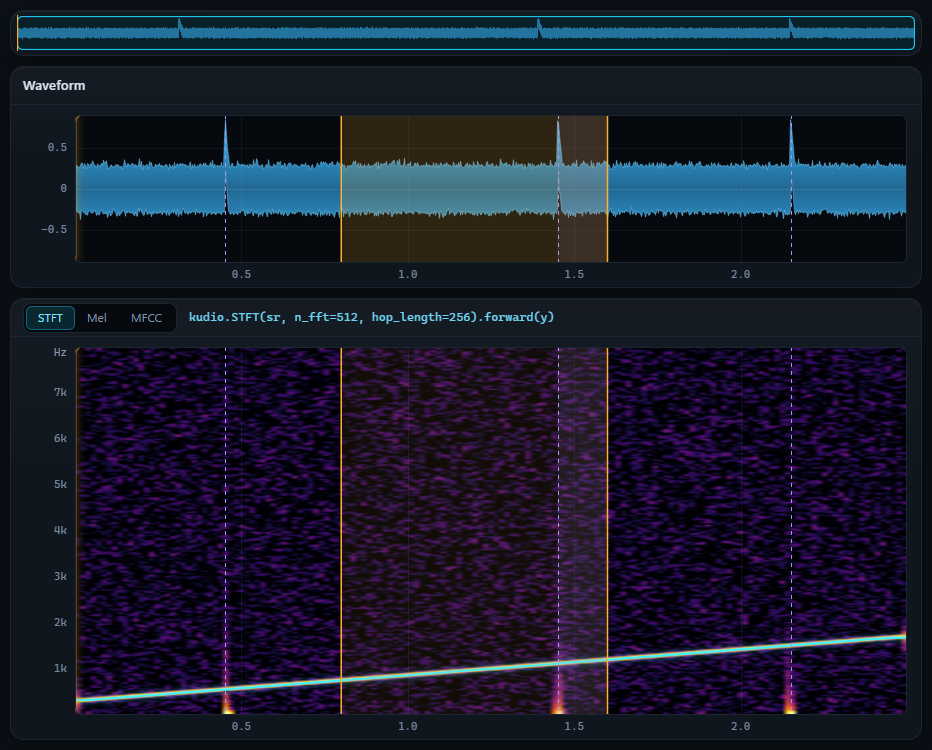

# Pitch

{ .shot .side }

A spectrogram shows the harmonic stack. It does not say which line is the
fundamental, and it stops helping the moment that line is weak: a phone band,
a high-pass, a low voice under the first few bins. **Track pitch** runs
`kudio.f0`, which is pYIN, over the clip or the selection, says where the
pitch sits and how much of the audio had one, and draws the contour over the
STFT view. The line above the buttons is the call it makes.

pYIN settles its voiced/unvoiced decision with a hidden Markov model over
everything it is given at once, so it runs as a job on a button rather than
following every edit. On my machine ten seconds of 16 kHz audio take about a
second, and the first run after the window is opened a second or so more. The
button reads **Tracking…** until it is done.

## The search range

The **range** list sets `fmin` and `fmax` together. **Speech (65–400 Hz)** is the
default, and kudio's own: a low male voice through a high female one.
**Low voice (60–250 Hz)**, **High voice (150–600 Hz)** and
**Singing / wide (50–1000 Hz)** cover the rest, and **Custom** is whatever you
type. Typing in either box switches the choice to **Custom** by itself, since
typing a bound is a way of choosing Custom, not of fighting it.

The range is the setting people get wrong, and getting it wrong does not fail.
A voice below `fmin` is not reported as missing; it is reported as something
plausible and untrue inside the range. So the presets are named and say what
they cover, rather than leaving a default in a box nobody reads.

The demo clip in these screenshots shows how far off that goes. It is a tone
sweeping from 300 to 1700 Hz. On **Speech** it comes back with a median of
333.3 Hz and 95% of the frames voiced, every number inside 65–400 Hz and none
of them true. On **Custom**, 250 to 1800 Hz, it comes back with 1005.8 Hz
across 372.4–1638.6 Hz, which is the sweep.

The boxes take `fmin` from 20 to 2000 Hz and `fmax` from 40 to 8000 Hz. kudio
refuses an `fmin` that is not below `fmax`, and an `fmax` above half the
clip's sample rate, where nothing survived sampling; the result line then
gives its reason in the warning colour.

## Frame and hop

`frame_length` is pYIN's analysis window in samples: 1024, 2048 (the
default), 4096 or 8192. pYIN compares a frame with itself one period later,
so the frame has to hold two periods of the lowest pitch you ask for. kudio
checks that, and refuses the combination rather than returning an empty track,
which would read as "this recording has no pitch":

```text
FeatureError: frame_length=2048 is too short for fmin=20 Hz at sr=48000:
two periods need 4802 samples. Raise frame_length or raise fmin.
```

Since the frame is counted in samples, the same `fmin` needs a longer frame at
a higher rate. The shortest `frame_length` that works:

| Sample rate | Speech | Low voice | High voice | Singing / wide | `fmin` 20 Hz |
|---|---|---|---|---|---|
| 8 kHz | 1024 | 1024 | 1024 | 1024 | 1024 |
| 16 kHz | 1024 | 1024 | 1024 | 1024 | 2048 |
| 22.05 kHz | 1024 | 1024 | 1024 | 1024 | 4096 |
| 44.1 or 48 kHz | 2048 | 2048 | 1024 | 2048 | 8192 |
| 88.2 or 96 kHz | 4096 | 4096 | 2048 | 4096 | none; raise `fmin` |

The default of 2048 fits every preset up to 48 kHz.

`hop` is the step between frames in milliseconds, 1 to 50, and 10 by default,
the usual resolution for a pitch contour. kudio takes it in samples, so the
caption converts it at the clip's rate: 10 ms is `hop_length=160` at 16 kHz
and 480 at 48 kHz. I keep the box in milliseconds so that one setting means
the same on every clip.

## What the summary says

After a run, a line under the buttons says what was measured, and under that
come three lines in green:

```text
median 1005.8 Hz
5–95%  372.4–1638.6 Hz (25.6 semitones)
100% of frames voiced, 1 span(s)
```

- The median of the voiced frames, not the mean. An octave error is a factor
  of two, and one of those moves a mean far enough to matter.
- The 5th to 95th percentile rather than the lowest and highest frame, because
  a single frame misjudged by an octave would set both extremes. The same span
  goes in semitones as well, the unit pitch is heard in: 60 Hz is a wide range
  at the bottom of a male voice and a narrow one at the top of a female voice,
  while twelve semitones is an octave anywhere.
- How much was voiced, and in how many runs. Voiced is not the same as speech:
  an `f` or an `s` is speech and has no pitch. A run shorter than 50 ms is
  left out of the count, since one voiced frame in the middle of a fricative
  is the estimator hiccupping, not a syllable.

The status bar has the same in one line:
`Pitch: median 1005.8 Hz  ·  372.4-1638.6 Hz (25.6 semitones)  ·  100% voiced`.

When nothing in the range is voiced, the panel says so in the warning colour
instead of quietly drawing nothing:

```text
Nothing voiced in this range. A voice below fmin is not found — it is
reported as something wrong above it, so an empty answer is the honest one.
Try a wider range.
```

## The contour

{ .shot }

The contour goes over the STFT view, on the clip's timeline, with gaps where
there is no pitch. An estimator asked "what is the pitch here" always answers,
for silence and for an `s` as well, and a line joined through those answers is
a picture of nothing. kudio leaves the unvoiced frames empty, and the drawing
leaves them as gaps rather than joining across them. Above, the demo sweep
tracked on **Custom**, 250–1800 Hz: the contour lies on the tone's own line.

**Draw the contour over the spectrogram** takes it down and puts it back. It
shows on the STFT view only. On a mel or MFCC image the vertical axis is a
band index, so "180" there means band 180, and a curve in Hz would land in the
wrong place, which is worse than no curve. Switch back to
[STFT](inspect.md#the-analysis-image) and it is there again.

## A selection or the whole clip

With a selection, only the selection is tracked, so you can ask about one
phrase rather than the whole take, and the numbers describe that phrase alone.
It is quicker too, since pYIN's time grows with the length it is given. The
contour and the voiced spans are put back where the selection sits on the
clip's timeline. With nothing selected, the whole clip is tracked.

The line above the result says which it was: `the whole clip`, or
`the selection, 0.800–1.600 s`. Selecting something else afterwards does not
change the result; it still describes the range that was tracked.

## Voiced spans as markers

**Voiced spans → markers** adds each voiced run to the
[marker list](../editing.md#markers), named `voiced 1`, `voiced 2` and so on:
the same runs the summary counts. From there they can be renamed, saved beside
the file, or exported as an Audacity label track like any other marker.

Pressed again, after tracking with other settings say, the new spans take the
place of the markers it added the last time, so the list never holds two sets
of voiced spans on top of each other. Every other marker stays: yours, the
ones **Find speech** made, and any of its own you have renamed or moved since,
which it counts as yours. The button is greyed out until a run has found
something voiced.

**Find speech** in the marker list answers a different question, with
`kudio.vad`: where somebody is talking. Voiced spans are where there is a
pitch, so the fricatives and the pauses inside speech fall between them.

## What takes the contour down

The contour describes the audio as it was when you pressed **Track pitch**. A
curve left on screen describing audio that has since been replaced is worse
than no curve, so:

- Any change to the audio drops the contour and the result together: an
  edit, **Undo**, **Revert to original**, another file, a take landing from
  the [Record](record.md) panel. The result line empties and
  **Voiced spans → markers** greys out. A run that finishes after the audio
  changed under it is thrown away.
- [A/B](../editing.md#ab-against-the-original) hides the contour while the
  original is on the plots, since the original is not what was measured, and
  keeps the result. Back on the edit, the contour is there again.
- A take hides it, with everything else that belongs to the clip, while the
  plots show the take arriving. A take that lands drops it, as any new audio
  does; a Stop that captured nothing, or a device that fails as it closes,
  brings it back.
- The mel and MFCC views hide it without dropping it.
- Selecting, zooming and playing leave it alone.
