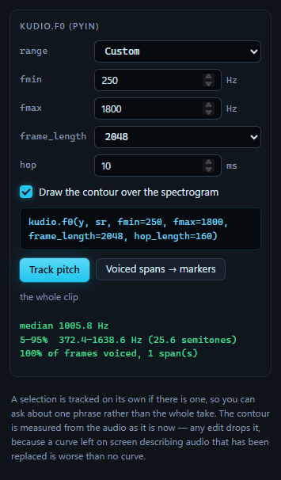
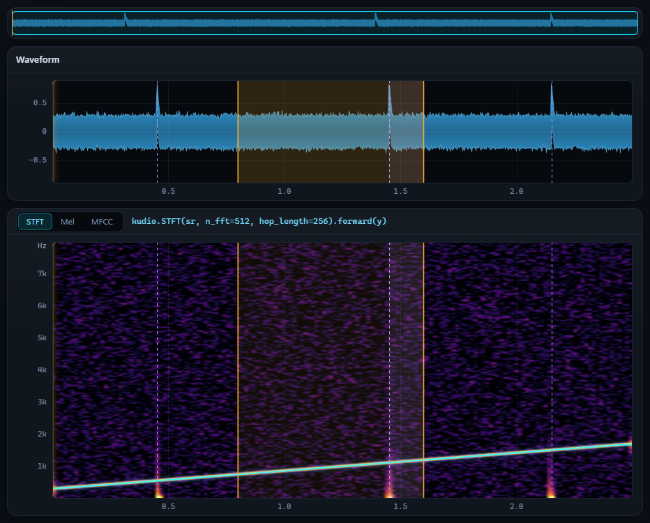

# 音高

{ .shot .side }

頻譜圖看得到整組諧波，卻不會告訴你哪一條才是基頻，而且只要那一條變弱就幫不上忙了：
電話頻帶、高通濾波，或是低沉的聲音落在最下面那幾個頻率格裡。「追蹤音高」會對整段音訊或
選取範圍執行 `kudio.f0`（也就是 pYIN），告訴你音高落在哪裡、有多少部分有音高，並把輪廓畫在
STFT 視圖上。按鈕上方那一行就是它執行的呼叫。

pYIN 用一個隱藏式馬可夫模型，一次看過交給它的全部音訊，再決定哪裡有聲、哪裡無聲，所以它是按鈕
觸發的一項工作，而不是每次編輯都自動跟著重算。在我的電腦上，10 秒的 16 kHz 音訊大約要 1 秒，
開啟視窗後的第一次會再多 1 秒左右。算完之前，按鈕會顯示「追蹤中…」。

## 搜尋範圍 {#the-search-range}

「範圍」一次設定 `fmin` 與 `fmax`。「語音（65–400 Hz）」是預設值，也是 kudio 本身的預設：
從低沉的男聲到高亢的女聲。「低音聲線（60–250 Hz）」、「高音聲線（150–600 Hz）」與
「歌唱 / 寬範圍（50–1000 Hz）」涵蓋其他情況，「自訂」則是你自己輸入的值。在任一個欄位輸入數值，
選項會自動切到「自訂」：都自己打數字了，就是要自訂，不該還要另外回去切選項。

範圍是最常設錯的設定，而設錯並不會失敗。低於 `fmin` 的聲音不會被回報成「找不到」，而是被回報成
範圍內某個看似合理、其實不對的值。所以這些預設都有名稱，並把涵蓋範圍寫出來，而不是在一個沒人
會看的欄位裡放個預設值。

這份說明截圖用的示範音訊，正好看得出會錯到什麼程度。它是一個從 300 Hz 掃到 1700 Hz 的音。
用「語音」追蹤，得到的中位數是 333.3 Hz，95% 的幀為有聲，每個數字都在 65–400 Hz 之內，
卻沒有一個是對的。換成「自訂」的 250 到 1800 Hz，得到的是 1005.8 Hz，分布在
372.4–1638.6 Hz，這才是那段掃頻。

欄位接受的 `fmin` 是 20 到 2000 Hz，`fmax` 是 40 到 8000 Hz。kudio 會拒絕兩種情況：`fmin`
不小於 `fmax`；以及 `fmax` 超過音訊取樣率的一半，那上面的東西在取樣時就已經不存在了。
這時結果欄會以警示色寫出原因。

## 幀長與跳距 {#frame-and-hop}

`frame_length` 是 pYIN 的分析視窗長度，以樣本數計：1024、2048（預設）、4096 或 8192。
pYIN 會把一幀與自己晚一個週期的版本比較，所以幀長必須容納你要求的最低音高的兩個週期。
kudio 會檢查這一點，遇到不合的組合就拒絕，而不是回傳一條空的軌跡，否則看起來會像
「這段錄音沒有音高」：

```text
FeatureError: frame_length=2048 is too short for fmin=20 Hz at sr=48000:
two periods need 4802 samples. Raise frame_length or raise fmin.
```

幀長是以樣本數計算的，所以同樣的 `fmin`，取樣率越高就需要越長的幀。可行的最短 `frame_length`
如下：

| 取樣率 | 語音 | 低音聲線 | 高音聲線 | 歌唱 / 寬範圍 | `fmin` 20 Hz |
|---|---|---|---|---|---|
| 8 kHz | 1024 | 1024 | 1024 | 1024 | 1024 |
| 16 kHz | 1024 | 1024 | 1024 | 1024 | 2048 |
| 22.05 kHz | 1024 | 1024 | 1024 | 1024 | 4096 |
| 44.1 或 48 kHz | 2048 | 2048 | 1024 | 2048 | 8192 |
| 88.2 或 96 kHz | 4096 | 4096 | 2048 | 4096 | 都不行，請提高 `fmin` |

預設的 2048，在 48 kHz 以下可以涵蓋每一個預設範圍。

`hop` 是幀與幀之間的間隔，單位毫秒，範圍 1 到 50，預設 10，這是音高輪廓常用的解析度。
kudio 收的是樣本數，所以說明文字會依音訊的取樣率換算：10 ms 在 16 kHz 是 `hop_length=160`，
在 48 kHz 是 480。我讓這個欄位用毫秒，是為了讓同一個設定在每段音訊上代表同樣的意思。

## 摘要說了什麼 {#what-the-summary-says}

執行完之後，按鈕下方有一行說明量測的是哪一段，再下面是三行綠色的結果：

```text
中位數 1005.8 Hz
5–95%  372.4–1638.6 Hz（25.6 個半音）
100% 的幀為有聲，1 個區段
```

- 有聲幀的中位數，而不是平均值。八度誤判差的是兩倍，只要一次就足以把平均值拉偏。
- 第 5 到第 95 百分位數，而不是最低與最高的那一幀，因為只要有一幀誤判了八度，就會同時決定
  兩端的極值。同一段範圍也換算成半音，那才是人耳感受音高的單位：60 Hz 在男聲的低音區是很寬的
  範圍，在女聲的高音區卻很窄，而 12 個半音不論在哪裡都是一個八度。
- 有多少是有聲的，分成幾段。有聲不等於語音：`f` 或 `s` 是語音，卻沒有音高。短於 50 ms 的段落
  不計入，因為擦音中間冒出一個有聲幀，多半是估計器一時判斷錯了，不是真的有一個音節。

狀態列會用一行顯示同樣的內容：
`音高：中位數 1005.8 Hz  ·  372.4-1638.6 Hz（25.6 個半音）  ·  100% 的幀為有聲`。

範圍內完全沒有有聲的部分時，面板會以警示色明白說出來，而不是默默什麼都不畫：

```text
這個範圍內沒有有聲的部分。低於 fmin 的聲音不會被找到 — 它會被回報成高於 fmin
的某個錯誤值，所以空的答案才是誠實的。請試試更寬的範圍。
```

## 輪廓 {#the-contour}

{ .shot }

輪廓畫在 STFT 視圖上，對齊音訊本身的時間軸，沒有音高的地方會留下缺口。估計器被問到
「這裡的音高是多少」時一定會回答，靜音與 `s` 也不例外，把這些答案連成一條線，那幾段線其實
什麼都沒量到。kudio 把無聲的幀留空，畫圖時也保留這些缺口，而不是跨過去連起來。上圖是用「自訂」
250–1800 Hz 追蹤的示範掃頻：輪廓正好落在那個音本身的線上。

「在頻譜圖上繪製輪廓」可以把它收起來，再放回去。它只在 STFT 視圖上顯示。在 mel 或 MFCC 圖上，
縱軸是頻帶索引，「180」代表的是第 180 個頻帶，以 Hz 表示的曲線會落在錯誤的位置，那比沒有曲線
更糟。切回 [STFT](inspect.md#the-analysis-image) 它就會再出現。

## 選取範圍或整段音訊 {#a-selection-or-the-whole-clip}

有選取範圍時，只追蹤選取範圍，可以只量某一句，而不是整段錄音，數字也只描述那一句。
這樣也比較快，因為交給 pYIN 的音訊越長，它花的時間就越多。輪廓與有聲區段會放回選取範圍在音訊
時間軸上的位置。沒有選取時，追蹤的是整段音訊。

結果上方那一行會寫出是哪一種：`整段音訊`，或 `選取範圍，0.800–1.600 秒`。之後再選取別的地方，
結果不會改變，它描述的仍然是當初追蹤的那一段。

## 把有聲區段變成標記 {#voiced-spans-as-markers}

「有聲區段 → 標記」把每一段有聲的部分加進[標記清單](../editing.md#markers)，依序命名為
`voiced 1`、`voiced 2`，也就是摘要裡數到的那幾段。加進去之後，就跟其他標記一樣可以重新命名、
存在檔案旁，或匯出成 Audacity 標籤軌。

再按一次時，例如換了設定重新追蹤之後，新的區段會取代這個按鈕上一次加入的那批標記，
清單裡不會疊著兩批有聲區段。其他標記都不動：你自己加的、「尋找語音」找到的，以及這個按鈕加的
但你之後改過名稱或移動過的，都算是你的。在追蹤到有聲的部分之前，這個按鈕是灰色的。

標記清單上的「尋找語音」用 `kudio.vad` 回答的是另一個問題：哪裡有人在說話。有聲區段是有音高
的地方，所以語音裡的擦音與停頓會落在它們之間。

## 什麼會讓輪廓消失 {#what-takes-the-contour-down}

輪廓描述的是你按下「追蹤音高」那時的音訊。畫面上留著一條描述已被取代音訊的曲線，
比沒有曲線更糟，所以：

- 音訊有任何改變，輪廓與結果都會一起拿掉：一次編輯、「復原」、「還原為原始音訊」、
  換一個檔案，或是從[錄音](record.md)面板進來的一次錄音。結果欄會清空，「有聲區段 → 標記」
  也會變灰。追蹤還在執行時音訊就已經改變的話，那次的結果會直接丟掉。
- [A/B](../editing.md#ab-against-the-original) 在兩張圖顯示原始音訊時把輪廓藏起來，因為原始音訊
  不是當初量測的對象，但結果會保留。切回編輯版本後，輪廓就會再出現。
- 錄音進行中，輪廓會跟其他屬於原本音訊的東西一起藏起來，讓兩張圖顯示正在進來的錄音。錄好的音訊
  進來時，輪廓就跟遇到任何新音訊一樣被拿掉；按下停止卻什麼都沒錄到，或裝置在關閉時出錯，輪廓會回來。
- mel 與 MFCC 視圖只是把它藏起來，並不會拿掉。
- 選取、縮放與播放都不會影響它。
