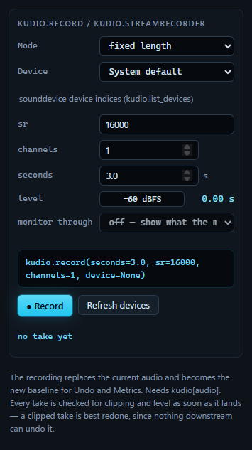
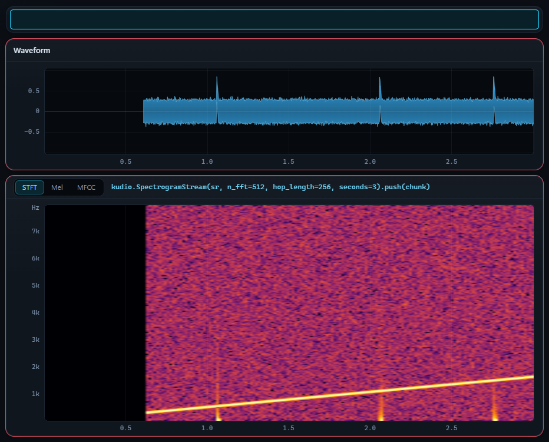

# Record

{ .shot .side }

Two ways to get a take from a microphone into the window. On **fixed length**
the panel records for as many seconds as you ask and hands the take over when
it is done. On **until stopped** it opens the device, shows the level and the
audio as it arrives, and keeps going until you press Stop. The line above the
buttons is
the kudio call the chosen mode makes, so the same capture can go into a
script.

Every take is checked the moment it lands, and it replaces the clip that was
open.

## Fixed length, or until you stop

| Mode | kudio behind it | The button | While it runs |
|---|---|---|---|
| **fixed length** | `kudio.record`, on sounddevice | **● Record**, then **Recording…** | nothing to watch until the take returns |
| **until stopped** | `kudio.StreamRecorder`, on PyAudio | **● Start**, then **■ Stop** | the level meter, the time so far, and the plots rolling |

They answer different questions. A fixed length is one blocking call: you say
how long up front, and nothing can be observed until it returns. That suits a
scripted capture, three seconds for every prompt in a list, and is no use to
a person at a microphone. An open-ended take hands its audio back as it
arrives, so the level is visible before the take is committed. That is the
only moment a clipped recording can still be prevented rather than
diagnosed, and the reason the second mode exists.

`seconds` belongs to the fixed length, from 0.1 s to 3600 s. While an
open-ended take runs, **Mode** and **monitor through** are locked.

What each one needs:

- A fixed length runs on sounddevice, which the plain install brings in.
- An open-ended take runs on PyAudio. The plain install has it on Windows. On
  Linux and macOS it is the `[audio]` extra, and since PyPI has no prebuilt
  PyAudio there, pip compiles it: install PortAudio's headers first
  (`sudo apt install portaudio19-dev`, or `brew install portaudio`). The
  [Extras](../getting-started.md#extras) table has the command.
- On Linux both need PortAudio's library, `libportaudio2`, which most desktop
  installs already have.

Without PyAudio the device list for **until stopped** holds one choice,
**Last input device (PyAudio names no default)**, the status bar asks whether
`kudio[audio]` is installed (that extra and `kudiostudio[audio]` both bring
PyAudio in), and **● Start** names the missing package instead of recording.

## Device, rate and channels

**Device** lists the inputs for the mode on screen, and the line under it says
which numbering it shows. The two backends number devices independently: an
index from `kudio.list_devices` is a sounddevice index and means another
device to PyAudio. So the list follows the mode, rather than one list whose
numbers are right for only one of them, and each mode keeps its own choice:
switching **Mode** goes back to the device last chosen in that mode, or to the
first in its list, never to the same number from the other side. **Refresh
devices** reads the list again, after you plug in a USB microphone for
instance.

**System default** comes first. On a fixed length it is `device=None`, and
sounddevice opens the input the system calls its default. On an open-ended
take it is the index PyAudio gives for its default input, and the call above
the buttons shows that number. Given no index, `kudio.StreamRecorder` opens the
last input PyAudio lists, which need not be the one the system records from
once a webcam or a line input is attached too. When PyAudio names no default
input, the first choice reads **Last input device (PyAudio names no
default)**, because that is what it then opens.

`sr` takes any rate you type, and offers 48000, 44100, 32000, 22050, 16000
and 8000; it starts at 16000.

- A fixed length asks sounddevice for exactly that rate. A device that will
  not run at it fails, and the status bar says why.
- An open-ended take treats it as a request. A device that refuses it opens at
  the first of 16000, 22050 and 44100 Hz it accepts, or failing those at its
  own default, and the status bar says which rate the take is running at:
  `Recording at 44100 Hz — press Stop when done.`

`channels` is how many the device is opened with, 1 to 8 (an open-ended take
falls back to one when the device has fewer). The take is mixed down to mono
when it lands, because the window holds mono audio.

## The level meter

**level** moves during an open-ended take. Every 50 ms it shows the peak of
the latest block from the device, in dBFS, with the seconds captured so far
beside it. It is a peak and not an average because the peak is what clips.
The bar runs from −60 dBFS to 0; below −60 the difference between quiet and
silent stops being worth looking at, so the reading stays at −60.

The [check on every take](#the-check-on-every-take) gives the two levels to
stay between. A peak above −0.5 dBFS is "right against the ceiling", one more
gain stage from clipping, and a peak under −30 dBFS is "very quiet", with few
bits left to carry the signal. Before the take you mean to keep, record a
throwaway one: say the loudest line, watch where it peaks, stop, and set the
input gain from that.

## Watching a take arrive

{ .shot }

While an open-ended take runs, the waveform and the analysis image show its
last 3 seconds, newest at the right. There is no timeline yet, so the time
axis reads 0 to 3 s, and both plots are right-aligned on the present: while
the window is still filling, the waveform starts partway across rather than
at zero, so one instant sits at the same place on both plots.

The image follows the [analysis view](inspect.md#the-analysis-image) and its
`n_fft`, `hop_length` and `n_mels`, and the caption beside the view buttons
names the call:

```python
kudio.SpectrogramStream(sr, n_fft=512, hop_length=256, seconds=3).push(chunk)
```

The MFCC view shows the STFT instead, and the caption adds
`# MFCC has no live form; showing the STFT`. MFCCs are a compressed feature
for a model, not a picture of a room, and there is nothing in them to watch
while you talk.

How it keeps up:

- The recorder is read every 50 ms, and every sample that arrived goes through
  the transform once. `SpectrogramStream` keeps a ring of columns and computes
  each one when the samples for it come in, rather than transforming the whole
  window again several times a second for a picture that has already scrolled
  away.
- The page gets a picture every fourth time audio arrives. Skipping the
  analysis would lose audio; skipping a picture loses nothing anyone can see.
- The colour range is fixed at −75 to −15 dBFS per bin, rather than picked
  from what is on screen. A range picked again for every picture, about five
  times a second, would only say how bright a bin is next to the last three
  seconds. With a fixed one a colour is a level, so two takes can be
  compared. The top sits well under 0 because a broadband sound at −20 dBFS
  spreads its energy over hundreds of bins and no single one gets near full
  scale.
- Changing the view or any of its settings during a take, `n_fft`,
  `hop_length` or `n_mels` among them, starts the picture again. A rolling
  view cannot analyse what has already scrolled past, and a window whose left
  half was computed one way and its right half another would be worse than a
  blank start.

The markers, the selection, the playhead, the overview strip, the
[loudness curve](inspect.md#loudness-over-time) and a pitch contour belong to
the clip, not to the take, so they come down while it runs. The plots stop
taking the mouse, since there is nothing yet to select or click on, and both
are outlined in the warning colour.

When you press Stop, the last picture stays on screen until the recorded take
replaces it, rather than blanking out the end of what was just recorded. The
take then opens like a file: the whole of it on screen, and a colour scale of
its own.

A Stop that captured nothing, or a device that fails as it closes, leaves the
clip that was open where it was, and the plots go back to it as it was before
the take: the same zoom, its markers, selection and loudness curve, and the
pitch contour if one was drawn.

## Monitor through

**monitor through** runs an open-ended take through `kudio.StreamEnhancer` on
its way to the plots, so you can see what a denoiser makes of the room while
you are still in it. Choose it before **● Start**; the method is fixed for the
take. On **fixed length** it is greyed out, since there is nothing to watch.

| Choice | The plots show |
|---|---|
| **off — show what the microphone sends** | the raw input |
| **Wiener (decision-directed)**, **MMSE-STSA**, **log-MMSE**, **OM-LSA** | that method's output |

Only these four can run on a stream. The gain each one applies to a frame
depends on that frame and on state carried over from the frame before, so it
can be worked out as the audio arrives. The other denoisers need the whole
spectrogram at once, and are in the [Enhance](enhance.md) panel.

Under the list, a line says how much is coming off and how far the display
runs behind:

```text
log-MMSE — removing 12.5 dB right now  ·  32 ms behind
```

The dB figure is the smoothed RMS level of the raw blocks minus that of the
denoised ones. The delay is one analysis frame of 512 samples: 32 ms at
16 kHz, 11 ms at 48 kHz. The noise estimate has only heard what has arrived
so far, so the first second of a take is always its worst second.

The take itself is committed **raw**, exactly as recorded. Monitoring is a way
of looking, the same rule [A/B](../editing.md#ab-against-the-original)
follows: what you see is a view, not an edit. The take is not played back
while it records either, so the denoiser changes the picture and never what
you hear. To keep a denoised copy, run the same method from Enhance once the
take has landed.

If the denoiser cannot start, the status bar says why and the take runs
without it. If it fails partway, the line under the list turns to
`live monitoring stopped — see the log` in the warning colour, and the plots
carry on with the raw audio. A display that stops updating looks like a dead
microphone, which is a worse thing to believe than "the denoising stopped".

## The check on every take

As soon as a take lands, `kudio.audio_report` reads it, the same check behind
the [Levels](inspect.md#levels) readout, and the result goes under the
buttons:

```text
peak -6.0 dBFS  ·  -18.2 LUFS  ·  take looks clean
```

A take with something wrong in it lists the problems instead, in the warning
colour, and the status bar repeats the first one after `Recorded, but:`.

```text
peak +0.0 dBFS  ·  -7.3 LUFS
· 11721 samples clipped (12.21% of the clip) — the recording was already
  too hot; no processing gets that back
```

| It reports | When |
|---|---|
| samples clipped | runs of samples pinned flat at full scale |
| right against the ceiling | a peak above −0.5 dBFS, with nothing clipped |
| very quiet | a peak under −30 dBFS |
| DC offset | a mean further than 0.01 from zero |
| content stops at … Hz | nothing above 90% of half the sample rate |
| …% of the clip is silence | more than 60% of it |
| estimated SNR around … dB | a noise floor less than 10 dB under the content |
| digital silence | nothing but zeros |

I run it on the take rather than leave it to the Metrics panel because the
timing is the point. A clipped take cannot be repaired, and the only fix,
recording it again, is possible only while the microphone is still set up and
the person who spoke is still in the room.

## What a take replaces

A take replaces the clip that is open and becomes the baseline for
everything after it: **Undo** starts again from the take, A/B and **Revert to
original** go back to it, and the Metrics panel takes it as the original. The
previous clip's markers are cleared, since they point at moments that are
gone.

So when the open clip holds something no file does, **● Record** (or
**● Start**) asks first, before the microphone opens: **Record over the open
clip?** That is the case after an edit that has not been saved since, and for
a take that was never written to a file. **Cancel** leaves everything as it
was. A clip just opened, or saved since its last edit, is replaced without a
question, because the file still holds it; so is one undone back to a point a
file holds.

The take is called `recording` and has no file behind it, so it does not join
**Files**; **File → Save As…** writes it out. An
[exported script](../editing.md#your-edits-as-a-script) of edits made on it
starts from a placeholder `SOURCE` for the same reason, and says so.

A Stop that captured nothing says so in the status bar,
`Nothing was captured — check the input device.`, and the clip that was open
stays open and comes back on the plots.

## The length cap

An open-ended take ends by itself after an hour. `kudio.StreamRecorder` caps a
take at 3600 s so that a recorder left running cannot fill the memory: an hour
of 48 kHz mono is about 690 MB of samples before anything is done with them.
At the cap the status bar says `Reached the recorder's length cap — stopping.`,
and the hour that was recorded lands and is checked like any other take. A
fixed length cannot ask for more than the same 3600 s.
