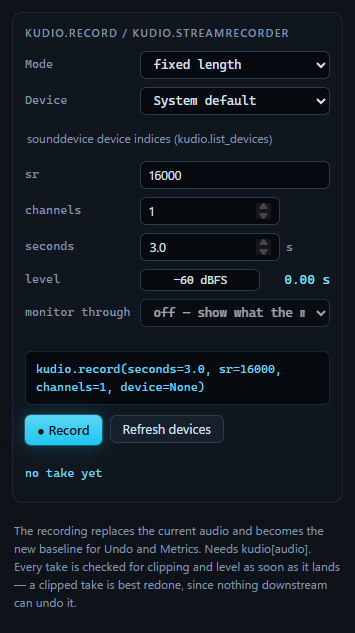
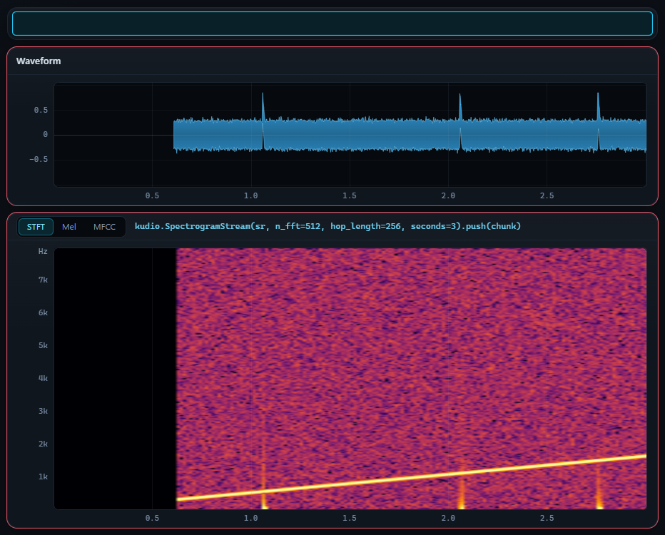

# 錄音

{ .shot .side }

把麥克風的聲音錄進視窗有兩種方式。「固定長度」照你指定的秒數錄，錄完才把音訊交出來；
「錄到停止為止」會開啟裝置，邊錄邊顯示音量與進來的音訊，直到你按停止。按鈕上方那一行是
目前模式會執行的 kudio 呼叫，同樣的錄音方式可以直接寫進腳本。

每次錄音一進來就會先檢查，並且取代原本開著的音訊。

## 固定長度，或錄到停止為止 {#fixed-length-or-until-you-stop}

| 模式 | 背後的 kudio | 按鈕 | 錄音中看得到 |
|---|---|---|---|
| 「固定長度」 | `kudio.record`，透過 sounddevice | 「● 錄音」，接著變成「錄音中…」 | 錄完之前沒有東西可看 |
| 「錄到停止為止」 | `kudio.StreamRecorder`，透過 PyAudio | 「● 開始」，接著變成「■ 停止」 | 音量表、已錄的秒數，以及滾動的兩張圖 |

這兩種模式回答的是不同的問題。固定長度是一次會卡住、直到錄完才返回的呼叫：事先講好要錄多久，
返回之前什麼都看不到。這適合照腳本錄音，例如清單上每個提示句各錄三秒，對坐在麥克風前的人
卻沒有幫助。錄到停止為止則是音訊一進來就交出來，所以在這次錄音定案之前就看得到音量。
要在錄音削波之前防止它，而不是事後才診斷出來，只有這個時間點來得及，這也是第二種模式存在的理由。

`seconds` 只用於固定長度，範圍 0.1 到 3600 秒。錄到停止為止的錄音進行中，「模式」與
「監聽經過」會鎖住。

兩種模式各自需要的東西：

- 固定長度用 sounddevice，基本安裝就有。
- 錄到停止為止用 PyAudio。Windows 的基本安裝已經包含；Linux 與 macOS 上則是 `[audio]`
  這個 extra，而且 PyPI 在這兩個系統上沒有預先編譯的 PyAudio，pip 會現場編譯，所以要先裝
  PortAudio 的標頭檔（`sudo apt install portaudio19-dev`，或 `brew install portaudio`）。
  指令見[選用套件組](../getting-started.md#extras)的表格。
- 在 Linux 上，兩種模式都需要 PortAudio 的函式庫 `libportaudio2`，大多數桌面環境已經有了。

沒有 PyAudio 時，「錄到停止為止」的裝置清單只有一個選項「最後一個輸入裝置（PyAudio 沒有指定預設輸入）」，
狀態列會問是否已安裝 `kudio[audio]`（這個 extra 與 `kudiostudio[audio]` 都會裝上 PyAudio），
按「● 開始」則會說出缺少的套件，而不會開始錄音。

## 裝置、取樣率與聲道 {#device-rate-and-channels}

「裝置」列出目前模式能用的輸入裝置，下面那一行說明顯示的是哪一套編號。兩個後端各自替裝置編號：
`kudio.list_devices` 給的是 sounddevice 的索引，同一個數字在 PyAudio 那邊是另一個裝置。
所以清單跟著模式走，而不是只給一份、編號只對其中一邊有效的清單；每個模式也各自記得自己選的裝置：
切換「模式」時，會回到在那個模式最後選的裝置，沒選過就是清單的第一項，不會把另一邊的同一個編號
帶過來。插上 USB 麥克風之後，按「重新整理裝置」重新讀取清單。

清單第一項是「系統預設」。固定長度用的是 `device=None`，由 sounddevice 開啟系統設定的預設輸入。
錄到停止為止用的是 PyAudio 給的預設輸入裝置的索引，按鈕上方的呼叫會寫出這個編號。
`kudio.StreamRecorder` 沒拿到索引時，會開啟 PyAudio 列出的最後一個輸入裝置；另外接了網路攝影機或
線路輸入時，那不一定是系統錄音用的那一個。PyAudio 沒有指定預設輸入時，第一項會改成
「最後一個輸入裝置（PyAudio 沒有指定預設輸入）」，因為這時開啟的就是它。

`sr` 可以輸入任何取樣率，清單提供 48000、44100、32000、22050、16000 與 8000，預設 16000。

- 固定長度向 sounddevice 要求的就是這個取樣率。裝置不支援時會失敗，狀態列會說明原因。
- 錄到停止為止則把它當成一個請求。裝置不接受時，會以 16000、22050、44100 Hz
  當中第一個它接受的取樣率開啟，都不行就用裝置自己的預設值；狀態列會寫出這次錄音實際用的取樣率：
  `正在以 44100 Hz 錄音 — 完成時請按停止。`

`channels` 是開啟裝置時用的聲道數，1 到 8（裝置的聲道比要求的少時，錄到停止為止會退回
單聲道）。錄音進來時會混成單聲道，因為視窗裡的音訊都是單聲道。

## 音量表 {#the-level-meter}

「level」這一列在錄到停止為止的錄音進行中才會動。它每 50 ms 顯示一次裝置最新送來那一段音訊的
峰值，單位 dBFS，旁邊是目前已經錄了幾秒。顯示峰值而不是平均值，是因為會削波的是峰值。
刻度從 −60 dBFS 到 0；低於 −60 之後，「很小聲」與「沒有聲音」的差別已經不值得看，
讀數就停在 −60。

[每次錄音後的檢查](#the-check-on-every-take)給了兩個界線，音量應該落在它們之間：
峰值高於 −0.5 dBFS 會被說成「緊貼上限」，再多一級增益就會削波；低於 −30 dBFS 則是
「非常小聲」，能拿來承載訊號的位元所剩無幾。正式錄之前，先錄一次試音：念最大聲的那一句，
看峰值到哪裡，按停止，再依此調整輸入增益。

## 看著錄音進來 {#watching-a-take-arrive}

{ .shot }

錄到停止為止的錄音進行中，波形與分析圖顯示的是最後 3 秒，最新的在右邊。這時還沒有時間軸可言，
所以時間軸標的是 0 到 3 秒，兩張圖都以「當下」為準靠右對齊：視窗還沒填滿時，波形從中間某處
開始，而不是從 0 開始，同一個瞬間在兩張圖上才會落在同一個位置。

這張圖沿用[分析圖](inspect.md#the-analysis-image)的設定：目前的視圖，以及 `n_fft`、
`hop_length`、`n_mels`。視圖按鈕旁的說明文字會寫出這次的呼叫：

```python
kudio.SpectrogramStream(sr, n_fft=512, hop_length=256, seconds=3).push(chunk)
```

MFCC 視圖這時改顯示 STFT，說明文字後面會加上 `# MFCC has no live form; showing the STFT`。
MFCC 是給模型用的壓縮特徵，不是房間的樣子，你說話時盯著它也看不出什麼。

它怎麼跟得上：

- 每 50 ms 從錄音器讀一次，每個進來的樣本都只做一次轉換。`SpectrogramStream` 保存一圈
  環狀的頻譜欄，某一欄的樣本到齊時才算出那一欄，而不是每秒好幾次把整個視窗重算一遍，
  只為了畫一張早已捲走的圖。
- 音訊每進來四次，頁面才收到一張圖。略過分析會漏掉音訊；略過一張圖，誰也看不出少了什麼。
- 色階固定在每個頻率格 −75 到 −15 dBFS，而不是依畫面上的內容決定。如果每張圖都重新決定色階，
  大約一秒五次，顏色只能說明某一格比最近三秒亮或暗；固定之後，一種顏色就代表一個音量，
  兩次錄音也能互相比較。上限遠低於 0，是因為 −20 dBFS 的寬頻聲音會把能量分散到好幾百個
  頻率格，沒有任何一格會接近滿刻度。
- 錄音中改了視圖或它的任何一項設定，包括 `n_fft`、`hop_length` 與 `n_mels`，畫面都會從頭開始。
  滾動的視圖無法回頭分析已經捲過去的部分，而左半邊用一種設定、右半邊用另一種設定算出來的視窗，
  比從空白重新開始更糟。

標記、選取範圍、播放頭、總覽條、[響度曲線](inspect.md#loudness-over-time)與音高輪廓都屬於
原本的音訊，不屬於這次錄音，所以錄音中都會收起來。錄音中兩張圖也不回應滑鼠，因為還沒有東西
可以選取或點擊，外框則變成警示色。

按下停止後，最後一張畫面會留著，直到錄好的音訊取代它，而不是把剛錄完的結尾清成一片空白。
接著這次錄音就像開啟一個檔案一樣：整段顯示在畫面上，並有自己的色階。

按下停止卻什麼都沒錄到，或是裝置在關閉時出錯，原本開著的音訊就還是原樣，兩張圖會回到錄音前的
樣子：同樣的縮放、它的標記、選取範圍與響度曲線，畫過音高輪廓的話也一樣。

## 監聽經過 {#monitor-through}

「監聽經過」讓錄到停止為止的錄音先經過 `kudio.StreamEnhancer`，再送到兩張圖上，
所以人還在那個房間裡，就能看到降噪器會把它處理成什麼樣子。請在按「● 開始」之前選好；
錄音進行中方法是固定的。「固定長度」模式下它是灰色的，因為錄音中沒有東西可看。

| 選項 | 兩張圖顯示 |
|---|---|
| 「關閉 — 顯示麥克風送來的原始訊號」 | 原始輸入 |
| **Wiener (decision-directed)**、**MMSE-STSA**、**log-MMSE**、**OM-LSA** | 該方法的輸出 |

只有這四種能處理串流。它們對某一幀套用的增益，只取決於這一幀，以及從前一幀帶過來的狀態，
所以可以邊收音邊算。其他降噪器需要一次拿到整張頻譜圖，放在[「增強」](enhance.md)面板。

清單下方有一行，說明目前去除了多少，以及畫面落後多少：

```text
log-MMSE — 目前去除 12.5 dB  ·  延遲 32 ms
```

dB 數字是原始區塊經過平滑的 RMS 音量，減去降噪後區塊的 RMS 音量。延遲是一個 512 個樣本的
分析幀：16 kHz 時是 32 ms，48 kHz 時是 11 ms。雜訊估計只聽過目前已經進來的部分，
所以一次錄音的第一秒，永遠是效果最差的一秒。

錄音本身會照錄製時的樣子**原封不動**地提交。監聽只是一種觀看方式，跟
[A/B](../editing.md#ab-against-the-original) 是同一個規則：你看到的是一個視圖，
不是一次編輯。錄音進行中也不會把聲音播出來，所以降噪器改變的是畫面，從來不是你聽到的東西。
想留下降噪後的版本，等錄音完成之後，到「增強」用同一種方法處理。

降噪器無法啟動時，狀態列會說明原因，錄音照常進行，只是不降噪。若是中途失敗，清單下方那一行
會變成警示色的 `即時監聽已停止 — 請見記錄`，兩張圖改為繼續顯示原始音訊。畫面要是停住不動，
人會以為是麥克風壞了，這比知道「降噪停了」更糟。

## 每次錄音後的檢查 {#the-check-on-every-take}

錄音一進來，`kudio.audio_report` 就會讀過一遍，跟[「音量」](inspect.md#levels)讀數背後是
同一個檢查，結果顯示在按鈕下方：

```text
峰值 -6.0 dBFS  ·  -18.2 LUFS  ·  錄音看起來沒有問題
```

有問題的錄音則改列出問題，以警示色顯示，狀態列也會在「已錄音，但：」後面重複第一個問題。

```text
峰值 +0.0 dBFS  ·  -7.3 LUFS
· 有 11721 個樣本削波（佔整段的 12.21%）— 錄音時就已經太大聲，
  任何處理都救不回來
```

| 回報的內容 | 條件 |
|---|---|
| 樣本削波 | 一連串樣本被平平地壓在滿刻度上 |
| 緊貼上限 | 峰值高於 −0.5 dBFS，但沒有削波 |
| 非常小聲 | 峰值低於 −30 dBFS |
| DC 偏移 | 平均值離零超過 0.01 |
| 內容到 … Hz 就沒了 | 半個取樣率的 90% 以上沒有任何內容 |
| 整段有 …% 是靜音 | 超過 60% |
| 估計 SNR 約 … dB | 底噪與內容相差不到 10 dB |
| 數位靜音 | 全部都是零 |

我把這個檢查放在錄音當下，而不是留給「指標」面板，因為時機才是重點。削波的錄音無法修復，
唯一的辦法是重錄，而只有在麥克風還架著、說話的人還在現場時，才重錄得了。

## 錄音會取代什麼 {#what-a-take-replaces}

錄音會取代目前開著的音訊，並且成為之後一切的基準：「復原」從這次錄音重新開始，
A/B 與「還原為原始音訊」回到的是它，「指標」面板也把它當成原始音訊。原本那段音訊的標記會被
清除，因為它們指向的時刻已經不存在。

所以當目前的音訊有任何檔案都沒保存的內容時，按「● 錄音」（或「● 開始」）會在麥克風開啟之前先問：
「要錄音取代目前開啟的音訊嗎？」，按「取消」就什麼都不變。開啟檔案時也會同樣詢問，
什麼情況下會問，見[在音訊被取代之前](../editing.md#before-a-clip-is-replaced)。

這次錄音的名稱是 `recording`，背後沒有檔案，所以不會加入「檔案」清單；要用「檔案 → 另存新檔…」
把它寫出來。也因為這樣，對它所做的編輯[匯出成腳本](../editing.md#your-edits-as-a-script)時，
`SOURCE` 會是一個佔位用的值，匯出時也會說明。

按下停止卻什麼都沒錄到時，狀態列會顯示 `沒有錄到任何東西 — 請檢查輸入裝置。`，
原本開著的音訊仍然開著，也會回到兩張圖上。

## 長度上限 {#the-length-cap}

錄到停止為止的錄音，滿一小時會自己停下。`kudio.StreamRecorder` 把一次錄音的上限定在 3600 秒，
讓忘了關的錄音器不會把記憶體塞滿：48 kHz 單聲道錄一小時，在做任何處理之前就有大約 690 MB
的樣本。到達上限時，狀態列顯示 `已達錄音器的長度上限 — 停止中。`，錄到的這一小時會像其他錄音
一樣進來，並接受同樣的檢查。固定長度最多也只能要求同樣的 3600 秒。
