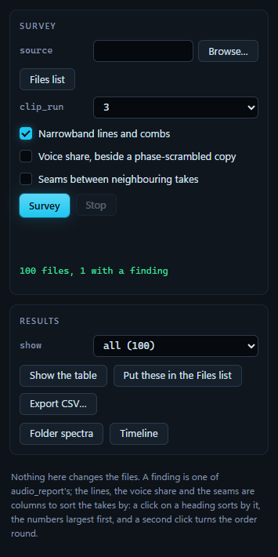
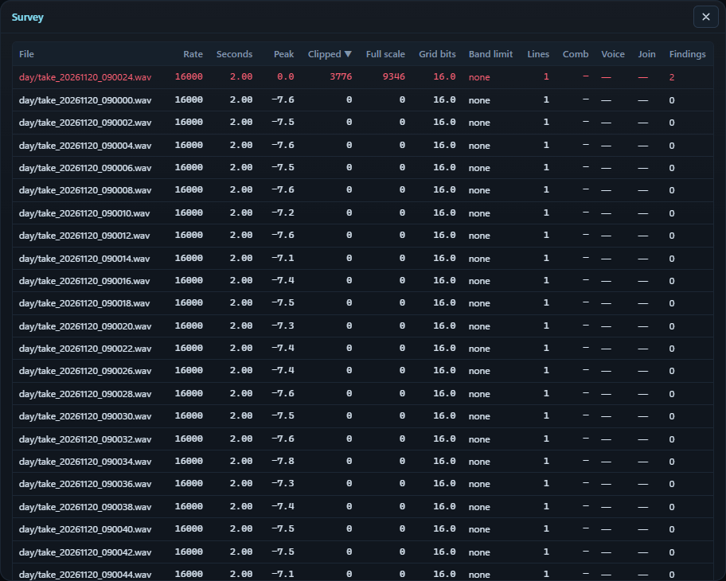
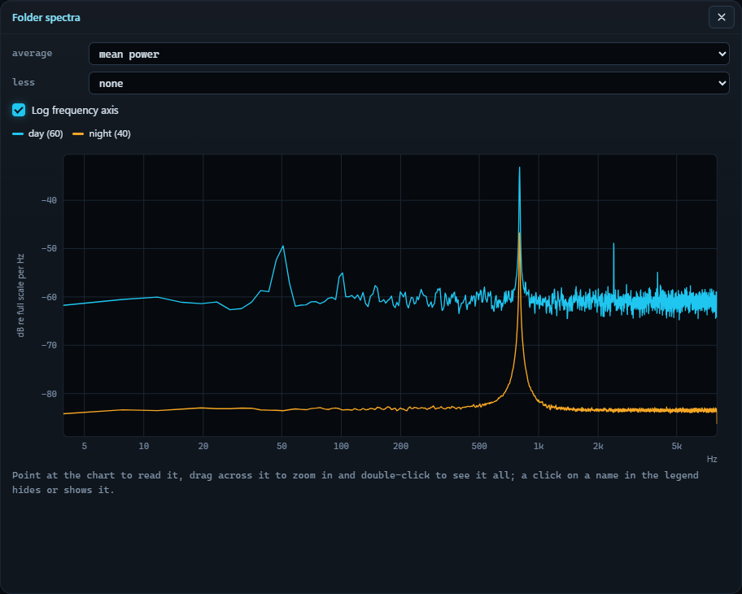
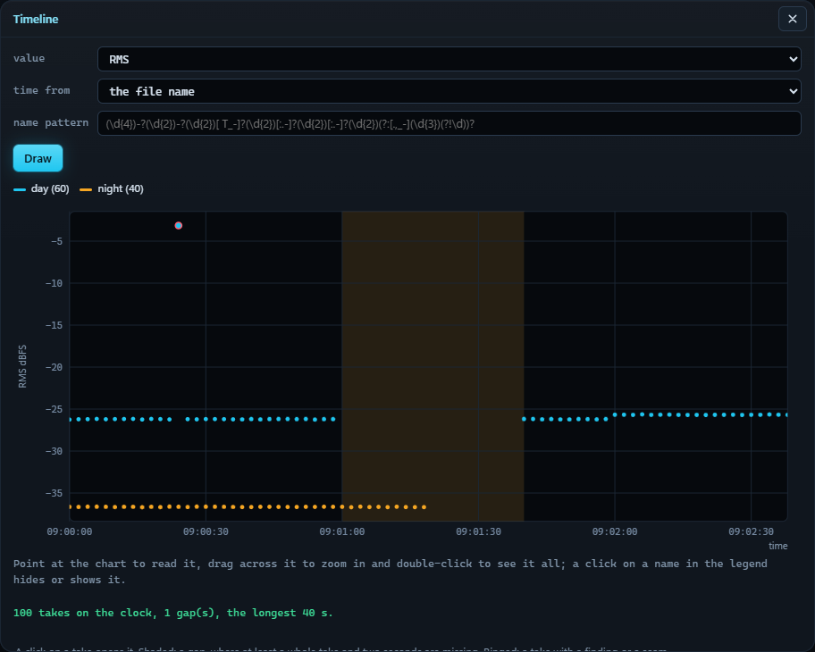

# Survey

{ .shot .side }

The [Metrics](metrics.md) panel inspects the clip that is open. A corpus of a
few thousand takes needs the same check on every one of them, laid out so the
clipped ones, the band-limited ones or the ones with a hum can be picked out
and opened one at a time. That is this panel: `kudio.audio_report` on every
file of a folder or of the Files list, as a table that sorts and filters, and
two views across the files, the folders' spectra and a timeline.

Nothing here changes a file.

## Running it

| Setting | What it does |
|---|---|
| `source` | a folder, read with its subfolders, or a pattern such as `takes/*_s1.wav`. **Files list** empties it, and the survey runs over the files in Files instead |
| `clip_run` | how many samples in a row at full scale count as clipping: 3 is kudio's own, 2 or 1 match tools that count shorter runs or every sample at the rail |
| **Narrowband lines and combs** | `kudio.tonal_lines` on every take: the lines and combs columns. |
| **Voice share, beside a phase-scrambled copy** | the voice column, [below](#the-voice-share). Off at first, since it runs the voice detector twice a take |
| `detector` | `kudio.speech_ratio`, or Silero VAD where it is installed; the box is there only then, [below](#silero-vad) |
| **Seams between neighbouring takes** | the join column, [below](#seams). Off at first: it means something only for one recording cut into files |

**Survey** starts it, and the line under the buttons counts the files as it
goes. **Stop** stops it after the file being read, and the table holds what
was read up to there. When it ends, the line says how many files it read and
how many have a finding; a file that would not load is a row of its own, with
the reason.

## The table

**Show the table** opens it over the plots, where it has the room.

{ .shot }

| Column | What it is |
|---|---|
| File | the name, with as much of its folder as it takes to tell it from another file of the same name |
| Rate, Seconds | the sample rate and the length |
| Peak | the loudest sample, in dBFS |
| Clipped | samples in flat runs of `clip_run` or more at full scale |
| Full scale | every sample at full scale, one by one |
| Grid bits | the spacing between sample values, as bits: 16 for an untouched 16-bit file, fewer when gain was raised after quantisation; [Metrics](metrics.md#inspect-this-audio) has the details |
| Band limit | where the content stops, and the rate the file was likely upsampled from; `none` when it reaches the top |
| Lines, Comb | how many narrowband lines stand 20 dB over their surroundings, and the fundamental of the comb whose lines stand highest |
| Voice | the share of the take called speech, and the same share on its scrambled copy; [below](#the-voice-share) says what it does and does not show |
| Join | the step into this take from the one before it, as a multiple of the steps at the end of that one; `repeat` when it opens with samples the one before already holds; `—` when the join is not judged, [below](#seams) |
| Findings | how many lines `audio_report` has about the take |

A row with a finding or a seam is in the warning colour. A click on a heading
sorts the table by that column, names from A to Z and numbers largest first;
a second click turns the order round. Rows with nothing in that column, and
files that did not load, stay at the end either way.

**show** narrows the table to the files with any finding, or with one in
particular: clipped, band-limited, a coarse grid, narrowband lines, rises and
falls (the voice share over its copy's, [below](#the-voice-share)), or a seam. The count beside each says how many there are before you pick it.

A click on a row opens that file. **Put these in the Files list** makes the
rows on show, in the order on show, the Files list, so ++arrow-down++ goes
through them one by one. **Export CSV…** writes every row to one file, and a
line per folder, with how many files fall under each filter, to a second file
beside it with `_folders` added to the name.

## The voice share

A detector tuned for speech calls some share of any recording speech, so a
share on its own says little. Each take is also scrambled, every bin of its
spectrum given a random phase. The copy keeps the take's long-term spectrum
and loses how it rises and falls in time, so its share is what the detector
makes of a steady sound with that spectrum. A take whose share stands more
than 10 points above its copy's rises and falls more than that: speech does,
and so do knocks, a machine that cycles on and off, and noise switched on and
off, all of which come out far above their copies. A voice that never
pauses, such as a held sung note, can stay as low as its copy.

So the column and the **rises and falls** filter pick out takes to listen
to. A take has a voice once you have heard one in it, not before.

The detector is `kudio.speech_ratio`, judged on 100–4000 Hz, so that ultrasonic noise does not count.

### Silero VAD

With the silero-vad package installed, a `detector` box appears under the
voice share and offers Silero VAD beside kudio's own detector:

```bash
pip install silero-vad
```

It is MIT-licensed and carries its model in the package, so nothing more is
fetched when it runs; it does bring PyTorch with it, a large download, which
is why KudioStudio neither needs nor installs it.

The two judge differently. `kudio.speech_ratio` counts the frames that stand
a set number of decibels over the clip's own quiet floor without a spectrum
as flat as noise, by rule, at the take's own rate. Silero VAD is a neural
network trained on speech. The take is brought to 16 kHz, band-passed to
100–4000 Hz and scaled to an RMS of 0.05, so a distant voice reaches it as
loud as a near one, and it is scored 512 samples (32 ms) at a time, a window
counting as speech from a probability of 0.5. It is slower, and what it
gives is still a share to hold against its scrambled copy's, not a verdict.

## Seams

This column is for one recording cut into files, as a recorder that writes
a long stream a file at a time does. There each file should carry on where
the one before stopped: a clean cut joins near ×1, and a big jump at the cut,
or a cut that repeats samples, means samples were lost or written twice.

Two neighbouring takes in the list, from the same folder at the same rate,
are compared: the step from the last sample of the first to the first sample
of the next, against the median step in the last 1024 samples of the first.
A step more than 20 times the median is a seam. A take that opens with 64
samples the end of the one before already holds is a repeat, and a seam too.

Takes recorded one at a time do not join, and with smooth content every one
of them would show as a seam, so the check is off unless you tick it. When
more than half the steps in those last 1024 samples are zero, as in digital
silence or a quiet ending on a coarse grid, the median step is zero and the
join is not judged.

## Folder spectra

{ .shot }

**Folder spectra** averages each folder's takes into one spectrum and lays
them over each other: two classes of recording, two places, a machine on and
off. Each take's spectrum is a Welch average of 4096-sample Hann windows
overlapping by half, in power per hertz, so folders at different rates sit
at the same height for the same sound. Takes shorter than 4096 samples are
left out.

- **average**: **mean power** lets the loud takes weigh most, as they would
  in a model trained on the folder; **median of the takes** is the typical
  take, which one loud take cannot move.
- **less** takes one folder's spectrum from all the others, so the chart
  shows what each holds over it. Folders at another rate than the one taken
  away are left out, and the line under the chart says how many.
- **Log frequency axis** spreads the low octaves, as on the analysis image.

Point at the chart and the line under it reads every folder at that
frequency. Drag across it to zoom in, and double-click to see it all again. A
click on a folder's name in the legend hides it, and the axes fit what is
left.

## Timeline

{ .shot }

**Timeline** puts every take at the time it began, a dot each, a colour for
each folder, with one value for each take on the vertical axis. A recorder
that stopped, a setting that changed every few hundred takes or a scene that
changed in the afternoon shows here and nowhere in the table.

- **value**: the RMS or peak level; the level in a band, in dBFS, from the
  take's spectrum, between the two frequencies **band from** and **band to**
  give (0 for the top); the number of narrowband lines; the comb's
  fundamental; the voice share over its copy's, in points; or the join.
- **time from**: **the file name** reads the date and time in it;
  **when the file was written** takes the time the file was last changed,
  which is when the take ended, less its length.
- **name pattern** is for names the default does not read. It is a regular
  expression whose groups are year, month, day, hour, minute and second, in
  that order, and milliseconds if there are any. Empty, it reads
  `20261120_093015`, `2026-11-20T09:30:15` and the like, with `.250` or
  `_250` after for milliseconds. Exactly three digits count as milliseconds,
  so a take counter after the time (`_093015_0007`) is not read as a
  fraction of a second.

A shaded stretch is a gap: within one folder, at least a whole take and at
least two seconds missing between the end of one take and the start of the
next. The two seconds absorb names that give whole seconds only. A ringed
dot is a take with a finding or a seam. The line under the chart counts the
takes, the gaps and the longest of them, and the takes whose time could not
be read. A click on a dot opens that take; dragging and the legend work as
on the folder spectra.
