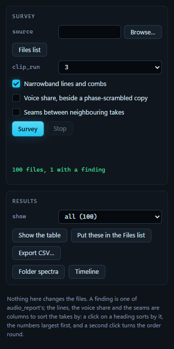
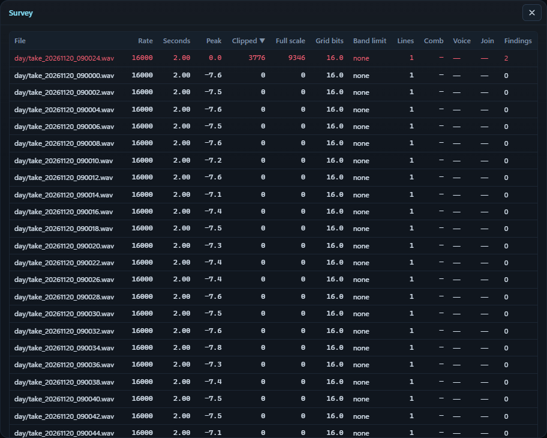
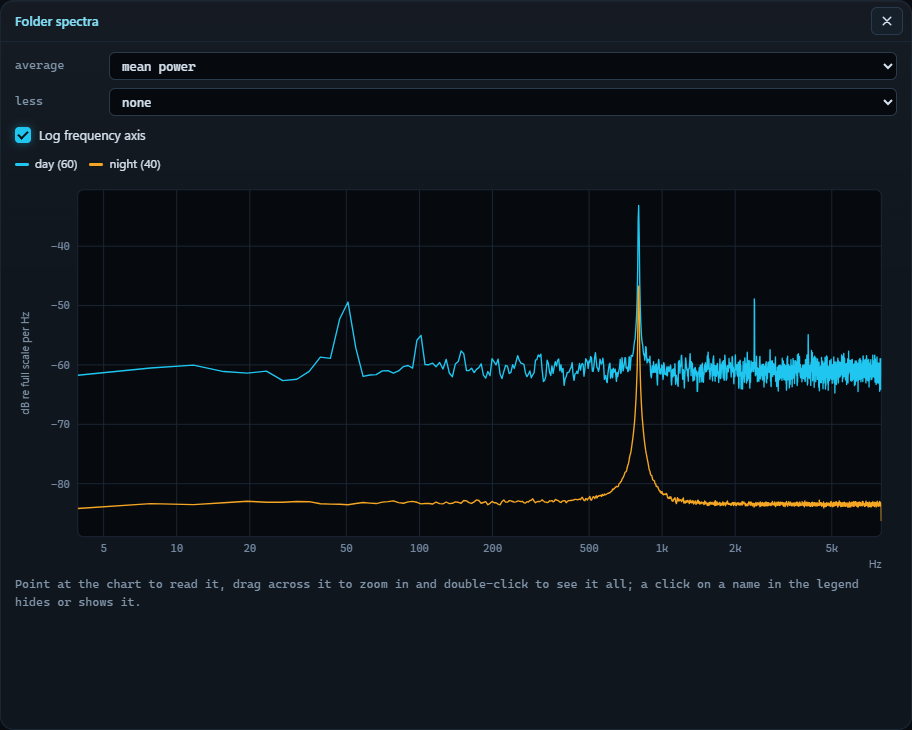
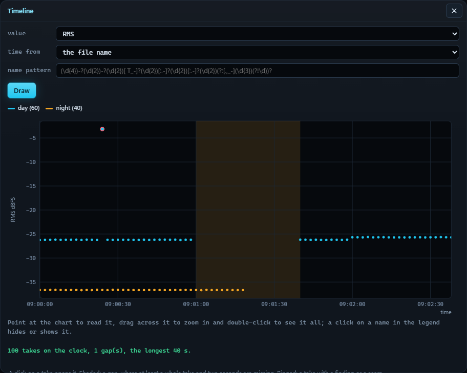

# 整批檢查

{ .shot .side }

[指標](metrics.md)面板檢查的是目前開著的音訊。幾千支錄音的語料，每一支都需要同樣的檢查，而且要
排得讓人能挑出削波的、頻寬被限制的、有嗡聲的，再一支一支打開來看。這個面板就是做這件事：對一個
資料夾或檔案清單裡的每個檔案跑 `kudio.audio_report`，排成可以排序和篩選的表格，另外有兩個橫跨
所有檔案的檢視：各資料夾的頻譜，以及時間軸。

這裡不會改動任何檔案。

## 執行 {#running-it}

| 設定 | 作用 |
|---|---|
| 來源 | 一個資料夾，連同子資料夾一起讀；或是萬用字元，例如 `takes/*_s1.wav`。按「檔案清單」會清空它，改為檢查「檔案」清單裡的檔案 |
| `clip_run` | 連續幾個樣本停在滿刻度才算削波：3 是 kudio 自己的定義，2 或 1 對應只數較短連續段、或每個碰到上限的樣本都算的工具 |
| 窄頻線和梳狀 | 對每支檔跑 `kudio.tonal_lines`，填窄頻線和梳狀兩欄 |
| 人聲比例，並列相位打散的對照 | 人聲那一欄，見[下文](#the-voice-share)。預設關閉，因為每支檔要跑兩次人聲偵測 |
| 偵測器 | `kudio.speech_ratio`，或已安裝時的 Silero VAD；只有裝了才會出現這一欄，見[下文](#silero-vad) |
| 相鄰檔案之間的接縫 | 接縫那一欄，見[下文](#seams)。預設關閉：只對一條被切成多個檔的錄音有意義 |

按「整批檢查」開始，按鈕下面那一行會邊跑邊數檔案。按「停止」會在讀完目前這支檔之後停下，表格裡是
到那裡為止讀到的。結束時，那一行會說讀了幾支、幾支有發現；讀不進來的檔案自己佔一列，並寫出原因。

## 表格 {#the-table}

按「顯示表格」會在圖的位置打開表格，那裡空間比較大。

{ .shot }

| 欄位 | 意義 |
|---|---|
| 檔案 | 檔名，前面加上足以和同名檔案區分的資料夾 |
| 取樣率、秒 | 取樣率與長度 |
| 峰值 | 最大的樣本，單位 dBFS |
| 削波 | 連續 `clip_run` 個以上停在滿刻度的平頂樣本 |
| 滿刻度 | 逐一數到的滿刻度樣本 |
| 格點位元 | 樣本值之間的格距，換成位元數：沒動過的 16 位元檔是 16，量化之後才加大增益會變少；細節見[指標](metrics.md#inspect-this-audio) |
| 頻寬上限 | 內容在哪裡停止，以及檔案最可能是從哪個取樣率升頻來的；內容到頂時顯示「沒有」 |
| 窄頻線、梳狀 | 比周圍高 20 dB 以上的窄頻線有幾條，以及線最突出的那個梳狀的基頻 |
| 人聲 | 這支檔被判為語音的比例，以及它打散相位的副本被判為語音的比例；它看得出和看不出什麼，見[下文](#the-voice-share) |
| 接縫 | 從上一支檔進到這一支的那一步，是上一支結尾幾個樣本間步距的幾倍；這一支開頭的樣本在上一支裡已經出現過時，顯示「重複」；不判斷時顯示 `—`，見[下文](#seams) |
| 發現 | `audio_report` 對這支檔有幾條發現 |

有發現或接縫的列以警示色顯示。點欄位標題就依那一欄排序，檔名由 A 到 Z、數字由大到小；再點一次順序
反過來。那一欄沒有值的列，以及讀不進來的檔案，不論哪個方向都排在最後。

「顯示」可以把表格縮小到有任何發現的檔案，或某一種發現：削波、頻寬被限制、格點粗、有窄頻線、
有起伏（人聲比例高於副本，見[下文](#the-voice-share)）、有接縫。每個選項旁的數字，是選之前就算好的檔案數。

點一列就打開那個檔案。「把這些放進檔案清單」會把目前顯示的列，依顯示的順序，變成檔案清單，
這樣就能用 ++arrow-down++ 一支一支看下去。「匯出 CSV…」把每一列寫成一個檔案，並在旁邊另寫
一個檔名加上 `_folders` 的檔案，每個資料夾一行，列出各種篩選條件下的檔案數。

## 人聲比例 {#the-voice-share}

為語音調校的偵測器，在任何錄音裡都會判出一部分是語音，所以單看比例說明不了什麼。每支檔也會被
打散，頻譜的每個 bin 都給一個隨機相位。副本保有原檔的長時間頻譜，但失去它在時間上的起伏，所以
副本的比例，就是偵測器對「同樣頻譜的穩定聲音」的判斷。比例比副本高出超過 10 個百分點的檔，起伏
比那樣的聲音多：語音會，敲擊、會循環開關的機器、開開關關的雜訊也會，而且都會遠高於副本。反過來，
不停頓的聲音，例如一直唱著的長音，可能和副本一樣低。

所以這一欄和「有起伏」篩選是用來挑出要聽的檔。一支檔要聽到了人聲，才算有人聲。

偵測器是 `kudio.speech_ratio`，只看 100–4000 Hz，超音波雜訊就不會被算進去。

### Silero VAD {#silero-vad}

裝了 silero-vad 套件，人聲比例下面就會出現「偵測器」，除了 kudio 自己的偵測器，還能選 Silero VAD：

```bash
pip install silero-vad
```

它是 MIT 授權，模型包在套件裡，執行時不會再下載任何東西；但它會連帶裝上 PyTorch，檔案很大，
所以 KudioStudio 不需要它，也不會幫你裝。

兩者判斷的方式不同。`kudio.speech_ratio` 依規則，在原取樣率上數出比整段安靜底噪高出一定分貝、
而且頻譜不像雜訊那樣平的音框。Silero VAD 是用語音訓練出來的神經網路：檔案先降到 16 kHz、帶通到
100–4000 Hz、調到 RMS 0.05，讓遠處的人聲和近處的一樣大聲，再每 512 個樣本（32 ms）評一次分，
機率 0.5 以上的小窗算語音。它比較慢，而它給的仍然是一個要和打散副本比較的比例，不是結論。

## 接縫 {#seams}

這一欄是給一條被切成多個檔的錄音用的，例如把長時間錄音一段一段寫成檔案的錄音器。這時每個檔應該
接著上一個停下的地方：切得乾淨的接縫值在 ×1 附近；切口跳一大步，或切口重複了樣本，就表示有樣本
遺失或寫了兩次。

清單裡相鄰、同一個資料夾、同一個取樣率的兩支檔會拿來比較：前一支最後一個樣本到後一支第一個樣本
的那一步，對上前一支最後 1024 個樣本裡步距的中位數。超過中位數 20 倍就是接縫。後一支開頭的 64 個
樣本，在前一支的結尾裡已經出現過，就是重複，也算接縫。

分開錄的檔案本來就接不上，內容平滑的話每一支都會被標成接縫，所以這項檢查預設關閉，要勾選才會做。
最後 1024 個樣本裡有一半以上的步距是零時，例如數位靜音，或格點粗、聲音又小的結尾，步距的中位數就是零，
這時接縫不判斷。

## 資料夾頻譜 {#folder-spectra}

{ .shot }

「資料夾頻譜」把每個資料夾的檔案平均成一條頻譜，疊在一起看：兩類錄音、兩個地點、機器開和關。
每支檔的頻譜是 4096 個樣本的 Hann 窗、重疊一半的 Welch 平均，單位是每 Hz 的功率，所以不同取樣率
的資料夾，同樣的聲音會落在同樣的高度。短於 4096 個樣本的檔不列入。

- 「平均方式」：「功率平均」讓大聲的檔份量最重，和用這個資料夾訓練模型時一樣；「各檔的中位數」是
  典型的一支檔，單一支大聲的檔拉不動它。
- 「減去」把其他資料夾都減去某一個資料夾的頻譜，圖上就是每個資料夾比它多出什麼。取樣率和被減去的
  資料夾不同的不畫，圖下那一行會說有幾個。
- 「對數頻率軸」把低頻的幾個八度拉開，和分析圖上一樣。

滑鼠移到圖上，圖下那一行會讀出每個資料夾在那個頻率的值。拖曳一段可以放大，雙擊回到全部。點圖例裡
資料夾的名稱可以把它藏起來，座標軸會配合剩下的重新調整。

## 時間軸 {#timeline}

{ .shot }

「時間軸」把每支檔放在它開始的時間，一支一個點，每個資料夾一種顏色，縱軸是每支檔的一個數值。
錄音器停過、每幾百支換一次的設定、下午換了的場景，都會在這裡出現，在表格裡卻看不出來。

- 「數值」：RMS 或峰值位準；某個頻段的位準，單位 dBFS，由那支檔的頻譜算出，頻段由「頻段從」和
  「頻段到」決定（0 表示到頂）；窄頻線的條數；梳狀的基頻；人聲比例比副本高出的百分點；或接縫。
- 「時間取自」：「檔名」讀檔名裡的日期和時間；「檔案寫入的時間」用檔案最後修改的時間，那是錄音
  結束的時間，所以再減去檔案長度。
- 「檔名樣式」給預設讀不懂的檔名用。它是正規表示式，群組依序是年、月、日、時、分、秒，有毫秒的話
  再加一個。留空時可以讀 `20261120_093015`、`2026-11-20T09:30:15` 這類寫法，後面接 `.250` 或
  `_250` 表示毫秒。剛好三位數才算毫秒，所以時間後面的流水號（`_093015_0007`）不會被讀成幾分之一秒。

陰影是空檔：同一個資料夾裡，前一支結束到下一支開始之間，至少少了一整支檔，而且超過兩秒。兩秒是為了
容納只寫到整秒的檔名。加框的點是有發現或接縫的檔。圖下那一行列出時間軸上有幾支檔、幾個空檔、最長
的空檔多久，以及幾支讀不到時間。點一個點就打開那支檔；拖曳和圖例的用法和資料夾頻譜一樣。
