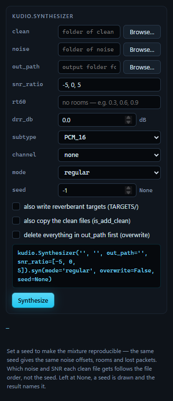

# Synthesize

{ .shot .side }

A denoiser learns from pairs: a noisy file and the clean one behind it. This
panel makes them. It mixes every clean file with noise at the SNRs you ask
for, can put the speech in a room first and send the mixture down a phone or
VoIP link after, and writes a `manifest.json` beside the result that records
what each file was made from. The line above **Synthesize** is the
`kudio.Synthesizer` call behind the run.

It works on folders and never touches the clip that is open. A run goes on in
the background, so the window stays usable meanwhile, and the form is read
once, when you press **Synthesize**: changing it halfway through changes
nothing in the run.

## What happens to each file

```text
clean speech → room (rt60) → + noise (snr_ratio) → link (channel) → file
```

That is the order a microphone meets them in. The room acts on the speech
before the noise is added, so the SNR is measured against the reverberant
speech. The link comes last and carries the whole mixture, noise and all,
because a wire carries whatever reached the microphone.

## Folders

| Field | What it takes |
|---|---|
| `clean` | the folder of clean speech |
| `noise` | the folder of noise recordings |
| `out_path` | the folder the corpus is written to |

Type a path or use **Browse…**. Both input folders are read with all their
subfolders, and only WAV files count, `.WAV` included; a FLAC or MP3 in there
is left out. The output mirrors the clean folder's subfolders, so two talkers'
`u0.wav` stay two files.

### Overwrite empties the folder

**delete everything in out_path first (overwrite)** is off by default, so the
call above **Synthesize** carries `overwrite=False`, and a folder that already
holds something is left exactly as it is. Nothing is written, and kudio's
reason is the status line and the second line of the result:

```text
data\mixed is not empty, so nothing was synthesised. Pass overwrite=True to replace it, or point out_path= somewhere else.
```

Tick it to build a corpus again in the same folder. It is
`syn(overwrite=True)`, and it acts on the folder rather than on single files:
if `out_path` holds anything at all, the whole folder is deleted before the
run starts, files that have nothing to do with the corpus included. I want a
corpus folder to hold exactly one run, so that the manifest beside it
describes every file in it, but deleting a folder is something to ask for,
not something that happens because a box was left as it came.

kudio will not empty a folder that is the root of a drive, or that holds the
working directory, your home folder or any of the input files. The run stops
instead, with the reason:

```text
Synthesis failed — SynthesisError: refusing to empty data before synthesising:
it holds the input data\clean\spk1\u0.wav. Point out_path= at a folder of its own.
```

## SNRs

`snr_ratio` takes the SNRs in dB, separated by commas or semicolons, and
starts at `-5, 0, 5`. Each value is an axis of the corpus. Fractions are fine,
and the file name spells them so that the extension stays the only dot in it:

| SNR | In the file name |
|---|---|
| 5 | `_5dB` |
| 0 | `_0dB` |
| 2.5 | `_2p5dB` |
| −5 | `_n5` |

A fraction is never rounded off for a tidier name: 2.5 and 2.7 both written as
2 would be two outputs with one name, and one would overwrite the other. An
entry that is not a number stops the run before it starts, and the status bar
says `Bad SNR list` with the entry that failed.

## Rooms

`rt60` is empty by default, and empty means no room at all. Give it
reverberation times in seconds, `0.3, 0.8` say, and each becomes another axis:
every file the mode would write is written once per room, in either mode, so
two rooms double the corpus. The room shows in the name as `_rt300ms`.

Every output file gets a room of its own from `kudio.rir`, with the same RT60
and DRR and a tail drawn from the seed and the file's path. One room repeated
over a whole corpus is a single acoustic condition, and a model trained on it
learns that room.

`drr_db`, the direct-to-reverberant ratio, runs from −20 to +30 dB and is 0 by
default. It is distance in a readable unit: +10 and above is a close
microphone, 0 is a metre or two away, and negative is the far end of a hall.
It only does something when there are rooms.

### Reverberant targets

The clean file is the dry target, so a model trained against it is asked to
remove the room as well as the noise. **also write reverberant targets
(TARGETS/)** writes the same speech with the room left on beside each mixture:
in `TARGETS/` inside `out_path`, laid out like the mixtures and under the same
names. That is for training a model to remove the noise and leave the room, a
different and easier problem. The manifest records each one as the row's
`target`.

Targets need `rt60`. With no room the clean file already is that signal, and
the run does not start:

```text
Reverberant targets need rt60 — with no room the clean file already is that signal.
```

## The link

`channel` sends every finished mixture down a link: the third kind of damage,
neither added like noise nor convolved like a room.

| `channel` | What it is |
|---|---|
| `none` | no link, the default |
| `telephone` | 300–3400 Hz at 8 kHz, through G.711 μ-law |
| `telephone_a` | the same with A-law |
| `voip` | G.711 μ-law with 5% of the packets lost, in runs of 4 packets on average, each gap filled by repeating the last packet that arrived |
| `mu_law`, `a_law` | the companding alone, without the band limit |

A file comes back from the link at the length and sample rate it went in with.
The link is not an axis. A corpus is recorded over a phone line or it is not,
so one link holds for the whole run, and it goes into the manifest rather than
the file names. The packets `voip` drops are drawn per file from the seed.
[Lost packets](effects.md#lost-packets) on the Effects page goes into what
loss, bursts and the repeat do to speech.

## Regular or inc

| `mode` | Outputs | 200 clean files, 4 noises, 3 SNRs, 2 rooms |
|---|---|---|
| `regular` | one per clean file and room, the noises and SNRs taken in turn | 400 |
| `inc` | every clean × noise × SNR combination, in every room | 4800 |

`regular` is the one I use for training sets. Every clean file is used once
per room, and the noises and SNRs rotate over the clean files so that any 12
clean files in a row (4 noises × 3 SNRs) meet each combination exactly once. A
regular corpus with fewer clean files than there are combinations cannot hold
them all, and the coverage grid in the [Manifest](manifest.md) panel shows
which ones it lacks. `inc` writes the full product, which grows quickly, and
suits a test set where every condition should meet every talker.

## Seed

`seed` at −1 shows as None, and a different seed is drawn every run. The
result line ends with the seed the run used, given or drawn, and after a draw
the status line names it too:

```text
Synthesis complete — 6 file(s) from seed 1408151732; the same seed writes the same corpus again.
```

Type that number into `seed` and the same settings write the same corpus byte
for byte.

The seed decides where in each noise recording the crop starts, each file's
room, and the packets `voip` loses. Which noise and SNR go with which clean
file does not depend on it: that follows the order of the files.

## Subtype

`subtype` is how the files are written: `PCM_16`, the default, `PCM_24` or
`FLOAT`. A mixture is a sum, and a loud talker at a low SNR can land past full
scale. `PCM_16` clips there, and so does `PCM_24`, with a finer step. The
status line then says how many files went over, and how far:

```text
3 of 12 file(s) went past full scale and were clipped as PCM_16 (worst peak 1.30, +2.3 dBFS).
Lower the clean level, raise the SNR, or write subtype='FLOAT' to keep them.
```

`FLOAT` keeps the values past 1.0 instead of clipping them.

## Copying the clean files

**also copy the clean files (is_add_clean)** copies each clean file into
`RAW_DATA/` inside `out_path`, laid out like the clean folder and named
`<name>_raw.wav`, so the corpus folder carries its references along. Ticked,
it shows in the call as `is_add_clean=True`.

`TARGETS/` and `RAW_DATA/` both sit inside the output folder. Anything that
later collects every WAV under it collects those as well, the
[Batch](batch.md) panel included, so a training script is better off reading
the corpus through its manifest.

## What a run leaves

Three clean files in `data/clean/spk1/`, `babble` and `fan` in `data/noise/`,
three SNRs, two rooms, the `telephone` link and reverberant targets:

```python
kudio.Synthesizer('data/clean', 'data/noise', out_path='data/mixed', snr_ratio=[-5, 0, 2.5], rt60=[0.3, 0.8], drr_db=0.0, channel='telephone', write_targets=True).syn(mode='regular', overwrite=False, seed=7)
```

```text
data/mixed/
├── manifest.json
├── spk1/
│   ├── u0_babble_n5_rt300ms.wav
│   ├── u0_babble_n5_rt800ms.wav
│   ├── u1_fan_0dB_rt300ms.wav
│   ├── u1_fan_0dB_rt800ms.wav
│   ├── u2_babble_2p5dB_rt300ms.wav
│   └── u2_babble_2p5dB_rt800ms.wav
└── TARGETS/
    └── spk1/
        └── the same six names
```

The line under the form sums it up, and the status line says
`Synthesis complete — 6 file(s).`:

```text
6 file(s) written to data/mixed  ·  manifest.json beside them  ·  down a telephone link  ·  6 reverberant target(s) in TARGETS/  ·  seed 7
```

The count is of files on disk, not of outputs asked for. Two outputs with one
name leave one file, and that happens when one clean file asks for the same
name twice: an RT60 typed twice, in either mode, or in an `inc` run an SNR
typed twice or two noise files of the same name in different subfolders. The
status line then gives both numbers and how many outputs shared a name, rather
than report a corpus that is not there.

Two different clean files never share a name that way. A clean `a_b.wav` with
noise `c` and a clean `a.wav` with noise `b_c` would both be
`a_b_c_0dB.wav`, so kudio gives the name to the first clean file that asks for
it and leaves the other out of the run and out of the manifest. Kept, it would
give the manifest a row pairing the mixture with a clean file it was not made
from, and a training script has no way to tell that row from a real one. The
warning under the line says how many clean files were left out and names the
first of them.

Whatever kudio warns about during a run is listed under that line, a warning
a line: the clean files it left out, the outputs that shared a name, with one
of them as an example, or an output folder it would not empty. Clipping is the
exception, since the line and the status line already give it in full. When
nothing was written, the warning is the status line; otherwise the status line
says how many warnings there are, unless it is already about clipping or a
shared name.

### The manifest

`manifest.json` holds one record per mixture:

```json
{
  "noisy": "data/mixed/spk1/u0_babble_n5_rt300ms.wav",
  "clean": "data/clean/spk1/u0.wav",
  "noise": "babble",
  "snr_db": -5,
  "rt60": 0.3,
  "channel": "telephone",
  "target": "data/mixed/TARGETS/spk1/u0_babble_n5_rt300ms.wav"
}
```

The room, the link and the target are in none of the file names, which is why
the panel writes this file. `rt60`, `channel` and `target` are `null` when the
run had none. Paths are spelled the way the run was given them, so relative
folders give relative paths, measured from the folder KudioStudio was started
in. A run that wrote nothing writes no manifest. The [Manifest](manifest.md)
panel reads it back as a table and checks every file in it against the disk.

## While it runs

One synthesis runs at a time. From the moment a run starts, **Synthesize** is
greyed out and reads **Synthesizing…** until the run is done. Quitting waits
for the run to finish, as it does for a [batch](batch.md#quitting-while-it-runs).
