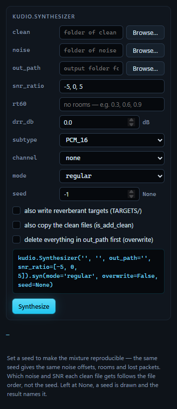

# 合成

{ .shot .side }

降噪模型是從成對的資料學的：一個含噪檔案，和它背後的乾淨檔案。這個面板就是用來做這些資料的。
它把每個乾淨檔案依你指定的 SNR 與雜訊混合，可以先把語音放進一個房間，混好之後再送進電話或
VoIP 鏈路，最後在結果旁寫一份 `manifest.json`，記錄每個檔案是由哪些素材做出來的。
「合成」按鈕上方那一行，就是這次執行背後的 `kudio.Synthesizer` 呼叫。

它處理的是資料夾，從不碰目前開啟的音訊。合成在背景執行，期間視窗照樣可以用；表單只在按下
「合成」的那一刻讀取一次，執行到一半再改表單，不會影響這次執行。

## 每個檔案經過的步驟 {#what-happens-to-each-file}

```text
乾淨語音 → 房間（rt60）→ + 雜訊（snr_ratio）→ 鏈路（channel）→ 檔案
```

這正是麥克風收到它們的順序。房間先作用在語音上，之後才加入雜訊，所以 SNR 是相對於含殘響的語音
量測的。鏈路排在最後，傳送的是整個混合音，連同雜訊一起，因為線路傳的是麥克風收到的一切。

## 資料夾 {#folders}

| 欄位 | 內容 |
|---|---|
| `clean` | 乾淨語音的資料夾 |
| `noise` | 雜訊錄音的資料夾 |
| `out_path` | 語料庫要寫到的資料夾 |

直接輸入路徑，或按「瀏覽…」。兩個輸入資料夾連同所有子資料夾都會讀取，但只收 WAV 檔，
`.WAV` 也算；裡面的 FLAC 或 MP3 會被略過。輸出會照乾淨資料夾的子資料夾結構排列，
所以兩位說話者各自的 `u0.wav` 仍是兩個檔案。

### 覆寫會清空資料夾 {#overwrite-empties-the-folder}

「先刪除 out_path 裡的所有東西（overwrite）」預設不勾，所以「合成」上方的呼叫裡會帶著
`overwrite=False`，已經有東西的資料夾會原封不動。什麼都不會寫出，kudio 給的原因會成為狀態列，
也是結果的第二行：

```text
data\mixed 不是空的，所以什麼都沒有合成。傳入 overwrite=True 以清空它，或把 out_path= 指到別的地方。
```

要在同一個資料夾重新建立語料庫，就勾選它。它就是 `syn(overwrite=True)`，作用的對象是整個資料夾，
而不是個別檔案：只要 `out_path` 裡有任何東西，執行前整個資料夾都會被刪除，與語料庫無關的檔案也一樣。
我希望一個語料庫資料夾只裝一次執行的結果，這樣旁邊那份 manifest 描述的就是裡面的每一個檔案；
但刪除整個資料夾應該是你明確要求的事，而不是勾選框維持原樣就會發生的事。

如果資料夾是磁碟根目錄，或包含工作目錄、你的家目錄或任何一個輸入檔，kudio 不會清空它，
而是停下來並說明原因：

```text
合成失敗 — SynthesisError: refusing to empty data before synthesising:
it holds the input data\clean\spk1\u0.wav. Point out_path= at a folder of its own.
```

## SNR {#snrs}

`snr_ratio` 填入以 dB 為單位的 SNR，用逗號或分號隔開，預設是 `-5, 0, 5`。每個值都是語料庫的一個軸。
可以用小數，檔名會改寫小數點，讓副檔名前的那個點維持是檔名裡唯一的點：

| SNR | 在檔名中 |
|---|---|
| 5 | `_5dB` |
| 0 | `_0dB` |
| 2.5 | `_2p5dB` |
| −5 | `_n5` |

小數不會為了檔名好看而被捨去：2.5 與 2.7 都寫成 2 的話，就是兩個輸出共用一個檔名，
其中一個會蓋掉另一個。不是數字的項目會讓執行在開始前就停下，狀態列顯示「SNR 清單有誤」
與出錯的那一項。

## 房間 {#rooms}

`rt60` 預設是空的，空的就代表完全不加房間。填入以秒為單位的殘響時間，例如 `0.3, 0.8`，
每個值就多一個軸：不論哪種模式，該模式會寫出的每個檔案都會在每個房間各寫一次，
所以兩個房間會讓語料庫加倍。檔名裡會以 `_rt300ms` 標示房間。

每個輸出檔都有自己的房間，由 `kudio.rir` 產生：RT60 與 DRR 相同，殘響尾巴則由 seed 與檔案路徑決定。
整個語料庫重複使用同一個房間，等於只有一種聲學條件，用它訓練的模型學到的就是那個房間。

`drr_db` 是直達聲與殘響比，範圍 −20 到 +30 dB，預設 0。它是用容易理解的單位表示距離：+10 以上是
近距離麥克風，0 是一兩公尺外，負值則是音樂廳的遠端。只有在有房間時才有作用。

### 殘響目標音 {#reverberant-targets}

乾淨檔案是乾聲目標，用它訓練的模型必須同時去除房間與雜訊。「同時寫出殘響目標音（TARGETS/）」
會在每個混合音旁寫出保留房間的同一段語音：放在 `out_path` 裡的 `TARGETS/`，結構與混合音相同，
檔名也相同。這是給「只去除雜訊、保留房間」的訓練用的，那是另一個比較簡單的問題。
manifest 會把每一個記錄為該列的 `target`。

目標音需要 `rt60`。沒有房間時，乾淨檔案本身就是那個訊號，執行不會開始：

```text
殘響目標音需要 rt60 — 沒有房間時，乾淨檔案本身就是那個訊號。
```

## 傳輸鏈路 {#the-link}

`channel` 讓每個混合好的檔案都經過一條鏈路：這是第三種劣化，既不像雜訊是加上去的，
也不像房間是摺積進去的。

| `channel` | 內容 |
|---|---|
| `none` | 不經過鏈路，預設值 |
| `telephone` | 8 kHz 下 300–3400 Hz，經過 G.711 μ-law |
| `telephone_a` | 同上，改用 A-law |
| `voip` | G.711 μ-law，5% 的封包成串遺失，平均一串 4 個，每個缺口都以最後收到的封包重複補上 |
| `mu_law`、`a_law` | 只有壓伸，不做頻帶限制 |

檔案經過鏈路後，長度與取樣率都和進去時一樣。鏈路不是一個軸：同一個語料庫不會一半走電話線、
一半不走，所以一次執行只用一種鏈路，記錄在 manifest 裡，而不在檔名中。`voip` 掉哪些封包，
是依 seed 為每個檔案各自抽的。遺失比例、連續掉包與重複補洞對語音的影響，
見「效果」頁的[掉封包](effects.md#lost-packets)。

## regular 或 inc {#regular-or-inc}

| `mode` | 輸出 | 200 個乾淨檔、4 種雜訊、3 個 SNR、2 個房間 |
|---|---|---|
| `regular` | 每個乾淨檔案在每個房間各一份，雜訊與 SNR 依序輪替 | 400 |
| `inc` | 每一種 乾淨 × 雜訊 × SNR 的組合，每個房間各一份 | 4800 |

做訓練集我用 `regular`。每個乾淨檔案在每個房間各用一次，雜訊與 SNR 在乾淨檔案之間輪替，
所以任意連續 12 個乾淨檔案（4 種雜訊 × 3 個 SNR）剛好各遇到每種組合一次。乾淨檔案比組合數少的
regular 語料庫無法涵蓋全部組合，[Manifest](manifest.md) 面板的涵蓋表會顯示缺了哪些。
`inc` 把所有組合乘開來全部寫出，每多一個條件，檔案數就再乘一次，適合每種條件都要搭配每位說話者的
測試集。

## Seed {#seed}

`seed` 設為 −1 時顯示 None，每次執行都會抽一個不同的 seed。結果那一行的最後會寫出這次用的 seed，
不論是自己設的還是抽的；抽出來的，狀態列也會寫出：

```text
合成完成 — 6 個檔案，seed 為 1408151732；相同的 seed 會再寫出相同的語料庫。
```

把這個數字填進 `seed`，相同的設定就會逐位元組寫出相同的語料庫。

seed 決定每段雜訊從哪裡開始擷取、每個檔案的房間，以及 `voip` 掉哪些封包。哪種雜訊與 SNR
配給哪個乾淨檔案則與 seed 無關，那是依檔案的順序決定的。

## Subtype {#subtype}

`subtype` 是檔案的寫出格式：`PCM_16`（預設）、`PCM_24` 或 `FLOAT`。混合音是兩者相加，
大聲的說話者配上低 SNR 時可能超過滿刻度。`PCM_16` 會在那裡削波，`PCM_24` 也會，只是步階更細。
這時狀態列會說明有幾個檔案超過、超過多少：

```text
3 / 12 個檔案超過滿刻度，以 PCM_16 寫出時被削波（最大峰值 1.30，+2.3 dBFS）。
請降低乾淨音訊的音量、提高 SNR，或改寫成 subtype='FLOAT' 以保留它們。
```

`FLOAT` 則保留超過 1.0 的值，不會削波。

## 複製乾淨檔案 {#copying-the-clean-files}

「同時複製乾淨檔案（is_add_clean）」會把每個乾淨檔案複製到 `out_path` 裡的 `RAW_DATA/`，
結構與乾淨資料夾相同，檔名為 `<name>_raw.wav`，讓語料庫資料夾自己帶著參考訊號。勾選時，
呼叫裡會出現 `is_add_clean=True`。

`TARGETS/` 與 `RAW_DATA/` 都在輸出資料夾裡面。之後任何收集該資料夾下所有 WAV 的工具，
包括[批次](batch.md)面板，都會把它們一起收進去，所以訓練腳本最好透過 manifest 讀取語料庫。

## 一次執行留下什麼 {#what-a-run-leaves}

`data/clean/spk1/` 裡有三個乾淨檔，`data/noise/` 裡有 `babble` 與 `fan`，三個 SNR、兩個房間、
`telephone` 鏈路，並寫出殘響目標音：

```python
kudio.Synthesizer('data/clean', 'data/noise', out_path='data/mixed', snr_ratio=[-5, 0, 2.5], rt60=[0.3, 0.8], drr_db=0.0, channel='telephone', write_targets=True).syn(mode='regular', overwrite=False, seed=7)
```

```text
data/mixed/
├── manifest.json
├── spk1/
│   ├── u0_babble_n5_rt300ms.wav
│   ├── u0_babble_n5_rt800ms.wav
│   ├── u1_fan_0dB_rt300ms.wav
│   ├── u1_fan_0dB_rt800ms.wav
│   ├── u2_babble_2p5dB_rt300ms.wav
│   └── u2_babble_2p5dB_rt800ms.wav
└── TARGETS/
    └── spk1/
        └── 同樣的六個檔名
```

表單下方那一行做了總結，狀態列則顯示 `合成完成 — 6 個檔案。`：

```text
已將 6 個檔案寫入 data/mixed  ·  manifest.json 在旁邊  ·  經過 telephone 鏈路  ·  6 個殘響目標音在 TARGETS/  ·  seed 為 7
```

這裡計算的是磁碟上實際存在的檔案，而不是要求產生的輸出數。兩個輸出同名時只會留下一個檔案，
這發生在同一個乾淨檔案兩次要求同一個檔名的時候：`rt60` 裡同一個值打了兩次，兩種模式都會；
在 `inc` 模式下，SNR 打了兩次，或不同子資料夾裡有同名的雜訊檔，也會。這時狀態列會同時列出
兩個數字以及有幾個輸出同名，而不是回報一個不存在的語料庫。

不同的乾淨檔案則不會這樣共用檔名。乾淨的 `a_b.wav` 配雜訊 `c`，與乾淨的 `a.wav` 配雜訊 `b_c`，
都會是 `a_b_c_0dB.wav`；kudio 把這個檔名留給第一個要求它的乾淨檔案，另一個不合成，也不進
manifest。留下來的話，manifest 裡就會有一列把混合音配上一個根本不是它來源的乾淨檔案，
訓練腳本完全分不出這一列和正常的列有什麼不同。表單下方的警告會說有幾個乾淨檔案被略過，
並寫出第一個是哪一個。

執行期間 kudio 發出的警告，會列在那一行下面，一個警告一行：被略過的乾淨檔案、同名的輸出
（附上其中一個當例子），或它不肯清空的輸出資料夾。削波例外，因為那一行與狀態列已經完整說明了。
什麼都沒寫出時，警告本身就是狀態列；有寫出檔案時，狀態列會說有幾個警告，除非它已經在說削波或同名的事。

### Manifest {#the-manifest}

`manifest.json` 對每個混合音記一筆：

```json
{
  "noisy": "data/mixed/spk1/u0_babble_n5_rt300ms.wav",
  "clean": "data/clean/spk1/u0.wav",
  "noise": "babble",
  "snr_db": -5,
  "rt60": 0.3,
  "channel": "telephone",
  "target": "data/mixed/TARGETS/spk1/u0_babble_n5_rt300ms.wav"
}
```

房間、鏈路與目標音都不在檔名裡，所以這個面板才要寫出這份檔案。執行時沒有房間、鏈路或目標音，
對應的 `rt60`、`channel`、`target` 就是 `null`。路徑照執行時給的寫法記錄，所以相對路徑的資料夾
會得到相對路徑，以啟動 KudioStudio 時所在的資料夾為基準。什麼都沒寫出的執行不會寫 manifest。
[Manifest](manifest.md) 面板會把它讀回成表格，並逐一確認裡面的檔案是否還在磁碟上。

## 執行期間 {#while-it-runs}

同一時間只會有一個合成在執行。一開始執行，「合成」按鈕就會變灰並顯示「合成中…」，直到做完為止。
結束程式時會等合成做完，與[批次](batch.md#quitting-while-it-runs)相同。
