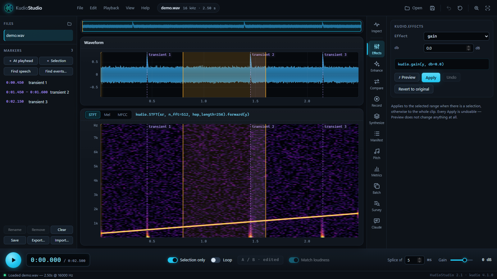
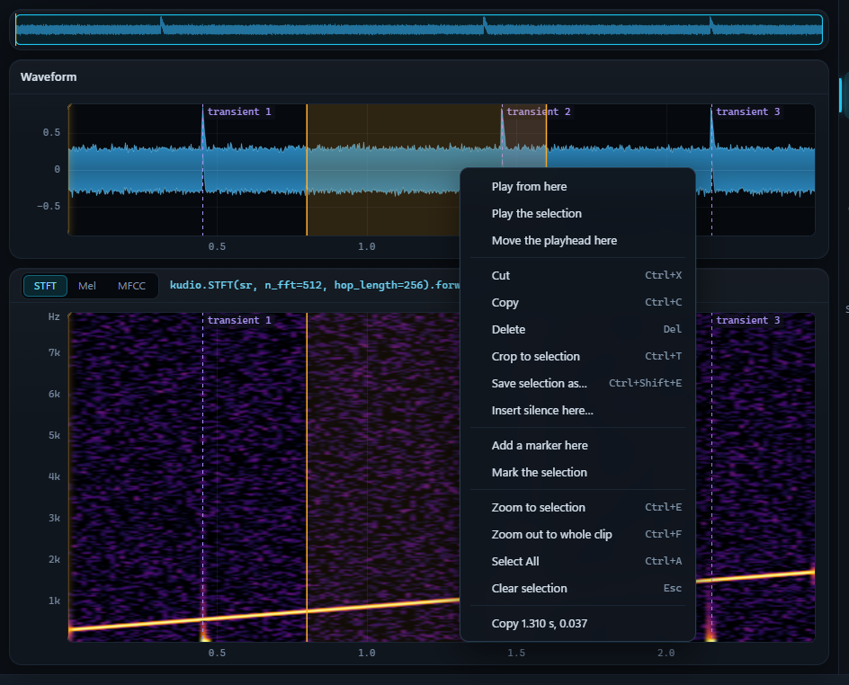
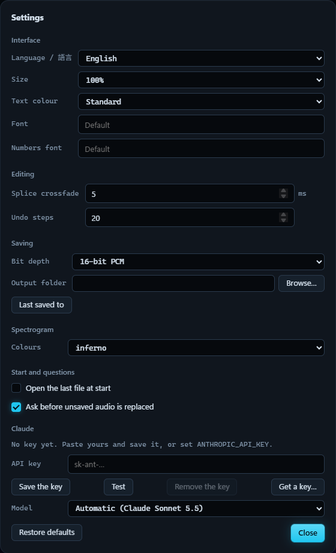

# The window

{ .shot }

## The parts of it

**The top bar** holds the menus, the name, sample rate and length of the clip
that is open, and the buttons used most: **Open**, then five icons whose
tooltips name them, **Save audio as**, **Undo**, **Revert to original**,
**Zoom to selection** and **Zoom out to whole clip**.

**Files**, on the left, lists every file opened in this session. Once they
come from more than one folder, they sit under a heading for each folder with
the number of its files beside it, since a corpus of takes named alike reads
as one long list otherwise. Click one to switch to it, and its **×** to take
it off the list; ++arrow-down++ and ++arrow-up++ step to the next file and the
one before. The folder button beside the heading adds more files, and
**File → Open folder…** adds every audio file in a folder and its subfolders.
Switching asks first when the open clip holds an edit or a take no file does:
[Before a clip is replaced](editing.md#before-a-clip-is-replaced).

**Markers**, under it, are named points and ranges that stay put, unlike a
selection. [Markers](editing.md#markers), on the editing page, covers them.

**The plots** fill the middle:

- the **overview strip** along the top shows the whole clip, with the stretch
  on screen marked. Drag the mark to move along the clip, or click anywhere
  else in the strip to jump there.
- the **waveform**, and under it the **analysis image**: an STFT, a mel
  spectrogram or MFCCs, switched with the three buttons above it. Beside them
  is the kudio call that computed the image, as you would write it in a
  script.
- move the pointer over either plot and its corner reads out the time and the
  value under it. On the waveform that is the amplitude. On the image it is
  the frequency for an STFT, the band for a mel spectrogram and the
  coefficient for MFCCs, those two counted from 0.

The two plots share their time axis, the selection, the playhead and the
markers, so whatever you do on one shows on the other.

**The rail** on the right lists the tools, and the **panel** beside it shows
the one chosen. [Inspect](panels/inspect.md) comes first; panels that other
packages add come last, under a rule.

**The transport** along the bottom plays the clip. **The status bar** under it
says what the last action did. The dot at its left is green while nothing is
running and amber while a job runs, such as a denoise or a batch; the job's
name then shows on the right, before the version numbers. The dot turns red if
the page loses its connection to the program. The versions of KudioStudio and
kudio are at the far right.

## Selecting, zooming and moving

Select
:   Drag across either plot. Within a few pixels of a selection's edge the
    pointer turns into a double arrow, and dragging there moves that edge
    instead of starting a new selection. For an exact range, type the start
    and end into **Selection** in the Inspect panel. ++ctrl+a++ selects
    everything and ++esc++ clears the selection.

    ++shift++ + click carries the selection to the click, from whichever end
    is further away; with nothing selected, it selects from the playhead to
    the click. Click at the start, then ++shift++ + click at the end, is
    easier than a long drag on a zoomed plot.

Move the playhead
:   Click either plot. Clicking while it plays carries on playing from there.
    ++home++ goes back to the start.

Zoom
:   The wheel zooms around the pointer, and ++plus++ and ++minus++ around the
    playhead. ++ctrl+e++, or a double-click on either plot, fills the plots
    with the selection; ++ctrl+f++, or a double-click with nothing selected,
    shows the whole clip again.

Zoom the vertical axis
:   On the analysis image, the wheel over its vertical axis, or ++ctrl++ +
    wheel anywhere on it, narrows that axis around the pointer, so the lowest
    few hundred hertz of an STFT can fill the plot. A double-click on the axis
    shows all of it again.

Scroll
:   ++shift++ + wheel, a sideways swipe on a touchpad, a drag with the middle
    button or with ++alt++ held, ++arrow-left++ and ++arrow-right++, or the
    overview strip.

## The right-click menu

A right click on the waveform or the analysis image opens a menu for that
point. "Here" in it is where you clicked, wherever the playhead is:

{ .shot }

- **Play from here**, or **Stop** while it plays; **Play the selection**;
  **Move the playhead here**.
- With a selection: cut, copy, delete, crop and save it as its own file.
- With something copied: **Paste over the selection**, which is ++ctrl+v++,
  and **Paste here**, which inserts at the point and leaves what is selected
  alone; what was pasted is then the selection. **Insert silence here…** asks
  for the length and inserts it at the point the same way.
- **Add a marker here**, and **Mark the selection**, which makes the
  selection a region marker.
- Zoom to the selection, zoom out, select all, clear the selection.
- **Copy** with the time and the value under the pointer: the sample value
  on the waveform, the frequency, Mel band or MFCC coefficient on the
  analysis image. It goes to the clipboard as text, for notes or a
  spreadsheet.
- **Reset the frequency range**, when the vertical axis is zoomed.

What does not apply, cutting with nothing selected for one, is left out
rather than greyed, so the menu stays short. Each item runs the same command
as the menu bar and the keys, so it can be undone and goes into the exported
script, and the keys are shown beside the items that have one.

On the analysis image's vertical axis the menu is the axis's own: reset the
range; **Finer frequency detail** and **Finer time detail**, which double or
halve n_fft and the hop with it, so the overlap between frames stays as it
was; and STFT, Mel or MFCC. MFCC has no n_fft to change, so only the view is
offered there.

## Playing

++space++ plays and stops. What plays depends on two switches on the
transport:

- **Selection only**, on by default: with a selection, play just that. Off, or
  with nothing selected, play from the playhead to the end.
- **Loop** (++ctrl+l++): play the same range again when it reaches the end.

Playback that runs to the end puts the playhead back where it started, so
++space++ again repeats what you just heard.

**Gain**, at the right of the transport, sets the playback level, from
−24 dB to +12 dB. It changes what you hear and never the audio, so nothing you
save is louder for it.

The **A / B** button and **Match loudness** beside it compare your edit with
the file as it was opened; [A/B against the original](editing.md#ab-against-the-original)
explains both. **Splice xf** is the crossfade at every cut and paste, in
milliseconds: [Every join crossfades](editing.md#every-join-crossfades).

## Shortcuts

| Key | Action |
|---|---|
| ++ctrl+o++ / ++ctrl+shift+s++ | Open / Save As |
| ++ctrl+shift+e++ | Save the selection as its own file |
| ++ctrl+q++ | Quit, after a running job, never in the middle of one |
| ++ctrl+z++ | Undo the last edit |
| ++ctrl+y++ / ++ctrl+shift+z++ | Redo what Undo took out |
| ++ctrl+x++ / ++ctrl+c++ / ++ctrl+v++ / ++del++ | Cut / copy / paste / delete the selection |
| ++ctrl+t++ | Crop to the selection |
| ++ctrl+a++ / ++esc++ | Select all / clear the selection |
| ++space++ | Play / stop |
| ++home++ | Playhead back to the start |
| ++ctrl+l++ | Loop on / off |
| ++ctrl+b++ | A/B against the original |
| ++ctrl+e++ / ++ctrl+f++ | Zoom to the selection / zoom out to the whole clip |
| ++plus++ / ++minus++ | Zoom in / out around the playhead |
| ++arrow-left++ / ++arrow-right++ | Scroll along the clip |
| ++arrow-down++ / ++arrow-up++ | The next file in Files / the one before |
| ++ctrl+comma++ | Settings |
| ++ctrl+equal++ / ++ctrl+minus++ / ++ctrl+0++ | The whole window larger / smaller / at 100% |
| ++f1++ | This guide, in the browser |

The keys reach the window only when the focus is not in a field that takes
text, a number or a choice. A window-wide ++ctrl+c++ would take copy away from
every path field in the panels, and ++space++ would stop you typing a file name
with a space in it.

## Settings

**Edit → Settings…** (++ctrl+comma++) holds what the window keeps from one
start to the next. A change takes effect as it is made, so the dialog has no
OK button: **Close** closes it, and **Restore defaults** puts every setting
here back but the language. The analysis view is kept as well, and set where
it is used, above the spectrogram.

{ .shot }

| Setting | What it does | Starts at |
|---|---|---|
| **Language / 語言** | English or Traditional Chinese. The window switches at once, open panels included, and the dialog opens again in the new language. Named in both, so it can be found from either | the system's language when there is a translation for it, else English |
| **Size** | Makes the whole window larger or smaller, the plots' labels included, in five steps from 90% to 150%. ++ctrl+equal++ and ++ctrl+minus++ step through them, ++ctrl+0++ goes back to 100%. The layout needs about 1100 × 640 at the size chosen, so 150% wants a window of 1650 × 960 or more; a smaller one is enlarged only as far as it has room for, the status line says so, and making the window larger shows the rest | 100% |
| **Text colour** | Four sets for the text, the hints and the plots' figures: Standard, Bright for a dim screen, Warm for the evening, and High contrast. Warnings stay red and passes green, since the colour is what they say | Standard |
| **Font** | The font of the interface. Type the name of any installed font; the box shows it in that font, and a name that is not installed leaves the window's own | the window's own |
| **Numbers font** | The font of figures, times, parameter names and code. A font whose digits are all one width keeps columns of numbers lined up | the window's own |
| **Splice crossfade** | The crossfade at every join, the same value as **Splice xf** on the transport: [Every join crossfades](editing.md#every-join-crossfades) | 5 ms |
| **Undo steps** | How many edits Undo can take back, 1 to 100. Each step keeps a copy of the clip, and an hour of 48 kHz mono is 690 MB, so a long take wants fewer. Fewer than are kept now drops the oldest | 20 |
| **Bit depth** | What Save As and Save selection as write: 16-bit PCM, 24-bit PCM or 32-bit float. FLAC holds no floating point, so float to a `.flac` name is written as 24-bit and the status line says so. The exported script writes the same depth | 16-bit PCM |
| **Colours** | The spectrogram's colour map. inferno, magma, viridis and cividis get lighter evenly from one end to the other, so a level looks the same anywhere on the plot; gray is for printing | inferno |
| **Output folder** | Where every save dialog starts: Save As, the exported image and script, markers, and the files panels and plugins write. **Last saved to** empties it, and the dialogs start in the folder last saved to again. A save never starts in a folder that cannot be written to, such as a read-only share of recordings: the status line names that folder once and the dialog starts in your home folder | empty |
| **Open the last file at start** | Opens the file the window last had when it is started with no file named, if the file is still there | off |
| **Ask before unsaved audio is replaced** | Off, opening a file or recording over an edit no file holds goes ahead without the question in [Before a clip is replaced](editing.md#before-a-clip-is-replaced) | on |
| **API key**, **Model** | Claude's key and model for the [Claude](panels/ask-claude.md) panel: **Save the key**, **Test**, which lists the models the key can use, **Remove the key**, and **Get a key…** for the Console. The key goes to the system's credential store, not to this file | none; Automatic |

In a browser the size is the page's own and does not touch the browser's zoom,
which still works on top of it.
