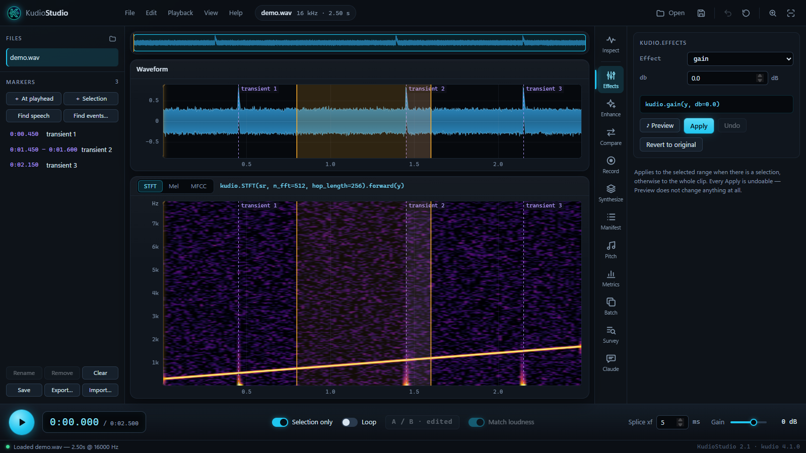
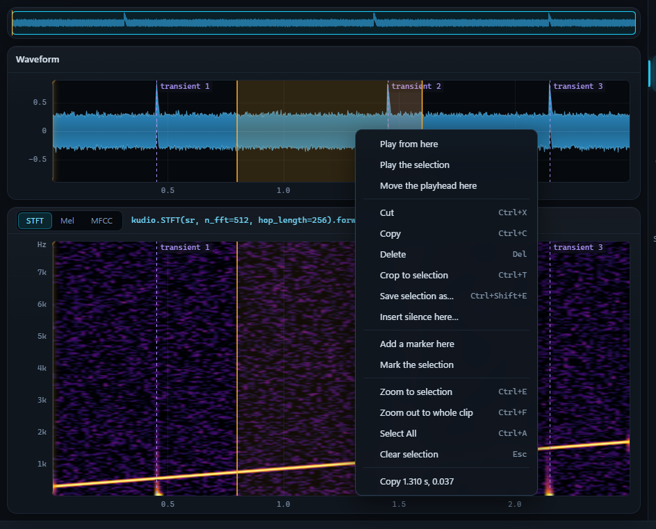
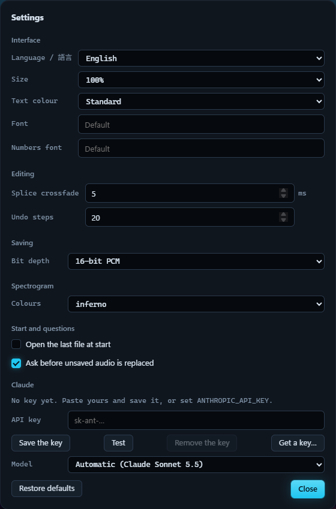

# 視窗導覽

{ .shot }

## 視窗的各個區塊 {#the-parts-of-it}

**上方列**是選單、目前音訊的檔名、取樣率與長度，以及最常用的幾個按鈕：「開啟」，
後面五個只有圖示，游標停在上面才會顯示名稱，依序是另存音訊、復原、還原為原始音訊、
縮放至選取範圍、縮小至整段音訊。

左側的**檔案**列出這次開過的每個檔案。檔案來自不只一個資料夾時，會依資料夾分組，標題旁是
那個資料夾的檔案數；一整批檔名很像的錄音，不分組的話看起來就是一長串同樣的名字。點一下就切換
過去，按它的 **×** 則從清單移除；++arrow-down++ 與 ++arrow-up++ 切到下一個和上一個檔案。
標題旁的資料夾按鈕可以再加入檔案，「檔案 → 開啟資料夾…」則加入一個資料夾和其子資料夾裡的
每個音檔。目前的音訊若有任何檔案都沒保存的編輯或錄音，切換前會先詢問，
說明見[在音訊被取代之前](editing.md#before-a-clip-is-replaced)。

下面的**標記**是具名的時間點與範圍，跟選取範圍不同，它們會一直留著。標記另有說明：
[標記](editing.md#markers)。

中間是**圖**：

- 最上面的**總覽條**顯示整段音訊，並標出畫面上正在看的那一段。拖曳那個標示可以沿著音訊移動，
  點總覽條上其他位置則直接跳過去。
- **波形**，以及它下方的**分析圖**：STFT、mel 頻譜圖或 MFCC，用上方的三個按鈕切換。
  按鈕旁邊是算出這張圖的 kudio 呼叫，寫法就跟腳本裡一樣。
- 游標移到任一張圖上，角落會顯示游標所在的時間與數值。波形上是振幅；分析圖上，STFT 顯示頻率，
  mel 頻譜圖顯示第幾個頻帶，MFCC 顯示第幾個係數，後兩者都從 0 起算。

兩張圖共用時間軸、選取範圍、播放頭與標記，所以你對其中一張做的事，另一張也會跟著顯示。

右側的**工具列**列出各個工具，旁邊的**面板**顯示目前選的那一個。[檢查](panels/inspect.md)
排第一；其他套件加入的面板排在最後，在一條分隔線下方。

最下方的**傳輸列**負責播放，再下面的**狀態列**說明上一個動作做了什麼。狀態列最左邊的小圓點
平常是綠色，有工作在跑時（例如降噪或批次處理）變成琥珀色，工作名稱會出現在右側、
版本號碼前面；頁面與程式斷線時，小圓點會變成紅色。最右邊是 KudioStudio 與 kudio 的版本。

## 選取、縮放與移動 {#selecting-zooming-and-moving}

選取
:   在任一張圖上拖曳。游標靠近選取範圍的邊緣幾個像素內時會變成左右箭頭，這時拖曳移動的是
    那一側的邊緣，而不是重新選取。要精確的範圍，就在「檢查」面板的「選取範圍」輸入起點與終點。
    ++ctrl+a++ 全選，++esc++ 清除選取。

    ++shift++ + 點擊會把選取範圍延伸到點擊的位置，移動的是離點擊處較遠的那一端；
    沒有選取時，則從播放頭選到點擊處。放大後要選一長段，先點起點、再 ++shift++ + 點終點，
    比一路拖過去方便。

移動播放頭
:   點一下任一張圖。播放中點擊，會從那裡繼續播放。++home++ 回到開頭。

縮放
:   滾輪以游標為中心縮放，++plus++ 與 ++minus++ 則以播放頭為中心。++ctrl+e++
    或在任一張圖上雙擊，讓選取範圍填滿畫面；++ctrl+f++，或沒有選取時雙擊，回到整段音訊。

縮放縱軸
:   在分析圖的縱軸上滾動滾輪，或在圖上任何地方按住 ++ctrl++ 滾動，縮放的是縱軸，
    以游標為中心，例如把 STFT 最低的幾百赫茲放大到填滿整張圖。在縱軸上雙擊就顯示整個範圍。

捲動
:   ++shift++ + 滾輪、觸控板橫向滑動、按住滑鼠中鍵或按住 ++alt++ 拖曳、
    ++arrow-left++ 與 ++arrow-right++，或用總覽條。

## 右鍵選單 {#the-right-click-menu}

在波形圖或分析圖上按右鍵，會出現針對那個位置的選單。選單裡的「這裡」指的是按右鍵的位置，
與播放頭在哪裡無關：

{ .shot }

- 「從這裡播放」，播放中則是「停止」；「播放選取範圍」；「播放頭移到這裡」。
- 有選取範圍時：剪下、複製、刪除、裁切，以及把它另存成獨立檔案。
- 複製過音訊時：「貼上並取代選取範圍」，等於 ++ctrl+v++；「貼上到這裡」則插在按右鍵的位置，
  不動選取的內容，貼上的那一段接著會被選取。「在這裡插入靜音…」會先問長度，同樣插在那個位置。
- 「在這裡加標記」，以及「把選取範圍設成標記」，把選取範圍變成一個區段標記。
- 縮放至選取範圍、縮小至整段音訊、全選、清除選取。
- 「複製」加上游標所在的時間與數值：波形圖上是樣本值，分析圖上是頻率、Mel 頻帶或 MFCC 係數。
  複製到剪貼簿的是文字，可以貼進筆記或試算表。
- 縱軸放大過時，還有「重設頻率範圍」。

用不到的項目直接不列出，例如沒有選取時就沒有剪下，而不是顯示成灰色，選單才不會太長。
每個項目執行的都是選單列和快捷鍵的同一個指令，所以可以復原，也會寫進匯出的程式碼；
有快捷鍵的項目會在旁邊標出按鍵。

在分析圖的縱軸上按右鍵，出現的是縱軸自己的選單：重設範圍；「頻率更精細」與「時間更精細」，
把 n_fft 加倍或減半，hop 也跟著一起變，所以相鄰影格的重疊比例不變；以及 STFT、Mel、MFCC 三種檢視。
三種檢視的選單都一樣。

## 播放 {#playing}

++space++ 播放與停止。播放的內容由傳輸列上的兩個開關決定：

- 「只播選取範圍」，預設開啟：有選取範圍時，只播那一段。關掉，或沒有選取時，
  從播放頭播到結尾。
- 「循環」（++ctrl+l++）：播到結尾時再從頭播同一段。

播到結尾而自然停下時，播放頭會回到這次播放的起點，所以再按一次 ++space++ 就會重聽剛才那一段。

傳輸列右邊的「增益」設定播放音量，範圍從 −24 dB 到 +12 dB。它只改變你聽到的，
從不改變音訊本身，所以存檔時不會因此變大聲。

**A / B** 按鈕與旁邊的「響度對齊」用來比較你的編輯版本與剛開啟時的檔案，
說明見[與原始音訊做 A/B 比較](editing.md#ab-against-the-original)。「接合淡化」是每次剪下與
貼上時的交叉淡化長度，單位是毫秒，說明見[每個接合處都會交叉淡化](editing.md#every-join-crossfades)。

## 快捷鍵 {#shortcuts}

| 按鍵 | 動作 |
|---|---|
| ++ctrl+o++ / ++ctrl+shift+s++ | 開啟 / 另存新檔 |
| ++ctrl+shift+e++ | 把選取範圍存成獨立檔案 |
| ++ctrl+q++ | 結束，等執行中的工作做完，絕不在中途 |
| ++ctrl+z++ | 復原上一個編輯 |
| ++ctrl+y++ / ++ctrl+shift+z++ | 重做復原拿掉的編輯 |
| ++ctrl+x++ / ++ctrl+c++ / ++ctrl+v++ / ++del++ | 剪下 / 複製 / 貼上 / 刪除選取範圍 |
| ++ctrl+t++ | 裁切至選取範圍 |
| ++ctrl+a++ / ++esc++ | 全選 / 清除選取 |
| ++space++ | 播放 / 停止 |
| ++home++ | 播放頭回到開頭 |
| ++ctrl+l++ | 開啟 / 關閉循環 |
| ++ctrl+b++ | 與原始音訊做 A/B 比較 |
| ++ctrl+e++ / ++ctrl+f++ | 縮放至選取範圍 / 縮小至整段音訊 |
| ++plus++ / ++minus++ | 以播放頭為中心放大 / 縮小 |
| ++arrow-left++ / ++arrow-right++ | 沿著音訊捲動 |
| ++arrow-down++ / ++arrow-up++ | 檔案清單的下一個 / 上一個檔案 |
| ++ctrl+comma++ | 設定 |
| ++ctrl+equal++ / ++ctrl+minus++ / ++ctrl+0++ | 整個視窗放大 / 縮小 / 回到 100% |
| ++f1++ | 在瀏覽器開啟這份說明 |

只有在焦點不在可輸入文字、數字或選項的欄位時，按鍵才會送到視窗。否則視窗層級的 ++ctrl+c++
會讓面板裡的每個路徑欄位都無法複製，++space++ 也會讓你沒辦法輸入含空格的檔名。

## 設定 {#settings}

「編輯 → 設定…」（++ctrl+comma++）放的是視窗每次啟動都會沿用的設定。改了就立刻生效，所以對話框
沒有「確定」：「關閉」只是關掉它，「還原預設值」則把這裡除了介面語言以外的每一項設定都恢復原狀。
分析圖也會記住，它在用到的地方設定，也就是頻譜圖上方。

{ .shot }

| 設定 | 作用 | 預設 |
|---|---|---|
| **Language / 語言** | 英文或繁體中文。整個視窗立刻切換，已開啟的面板也一樣，對話框會用新的語言重新開啟。名稱寫成兩種語言，看不懂畫面上那一種的人也找得到 | 系統語言有翻譯時用系統語言，否則用英文 |
| **大小** | 讓整個視窗變大或變小，連圖上的刻度字也一起，從 90% 到 150% 共五級。++ctrl+equal++ 與 ++ctrl+minus++ 逐級調整，++ctrl+0++ 回到 100%。版面在所選的大小下需要約 1100 × 640，所以 150% 要 1650 × 960 以上的視窗；視窗比較小時只放大到放得下為止，狀態列會說明，把視窗拉大就會顯示完整的大小 | 100% |
| **文字顏色** | 文字、說明文字與圖上刻度的四組顏色：標準；明亮，適合螢幕調暗時；暖色，適合晚上；以及高對比。警告維持紅色、通過維持綠色，因為顏色本身就是它們要說的事 | 標準 |
| **字型** | 介面的字型。輸入任何已安裝字型的名稱，欄位會用那個字型顯示；沒安裝的名稱則維持視窗原本的字型 | 視窗原本的字型 |
| **數字字型** | 數字、時間、參數名稱與程式碼的字型。數字等寬的字型能讓一欄數字對齊 | 視窗原本的字型 |
| **接合交叉淡化** | 每個接合處的交叉淡化，和傳輸列上的「接合淡化」是同一個值：[每個接合處都會交叉淡化](editing.md#every-join-crossfades) | 5 ms |
| **復原步數** | 復原能往回幾個編輯，1 到 100。每一步都保留一份音訊副本，一小時 48 kHz 單聲道是 690 MB，所以長錄音適合少一點。改得比目前保留的少，最舊的幾步會被捨棄 | 20 |
| **位元深度** | 「另存新檔」與「將選取範圍另存為」寫出的格式：16 位元 PCM、24 位元 PCM 或 32 位元浮點。FLAC 不能存浮點，所以存成 `.flac` 時改寫成 24 位元，狀態列會說明。匯出的腳本也寫同樣的位元深度 | 16 位元 PCM |
| **色彩** | 頻譜圖的色表。inferno、magma、viridis 和 cividis 從一端到另一端亮度變化均勻，所以同一個強度在圖上哪裡看起來都一樣；gray 適合列印 | inferno |
| **輸出資料夾** | 每個存檔對話框開始的位置：另存新檔、匯出的圖和腳本、標記，以及面板和外掛寫出的檔案。按「上次存檔處」會清空它，對話框又從上次存檔的資料夾開始。存檔不會從無法寫入的資料夾開始，例如唯讀的錄音分享資料夾：狀態列會說一次是哪個資料夾，對話框改從家目錄開始 | 空白 |
| **啟動時開啟上次的檔案** | 啟動時沒有指定檔案的話，開啟視窗上次開著的檔案，前提是檔案還在 | 關 |
| **取代未存檔的音訊前先詢問** | 關閉後，若目前的編輯還沒存成任何檔案，開啟檔案或錄音時會直接取代，不再出現[在音訊被取代之前](editing.md#before-a-clip-is-replaced)說的詢問 | 開 |
| **API 金鑰**、**模型** | [Claude](panels/ask-claude.md) 面板用的金鑰與模型：「儲存金鑰」、「測試」（列出這把金鑰能用的模型）、「移除金鑰」，以及前往 Console 的「取得金鑰…」。金鑰存進系統的認證管理員，不寫進這個設定檔 | 無；自動 |

在瀏覽器裡，這個大小是頁面自己的，和瀏覽器的縮放無關；瀏覽器的縮放仍然可以疊加在上面。
